<p align="center">
  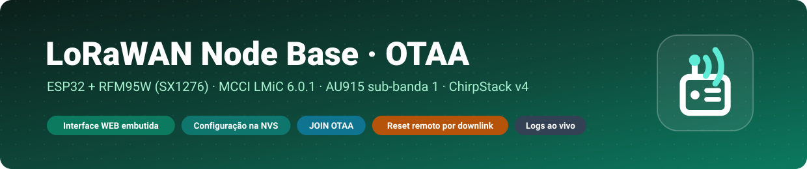
</p>

<p align="center">
  
</p>

**LoRaWAN Node Base OTAA** é o firmware base de um nó LoRaWAN com **ESP32** e rádio **RFM95W (SX1276)**, ativação **OTAA** (JOIN over-the-air), stack **MCCI LMiC 6.0.1**, plano **AU915 sub-banda 1** e servidor **ChirpStack v4**.

Ele é a camada de firmware de um projeto maior de medição de energia elétrica em tempo real, ponta a ponta, com backend em **Java/Spring**, frontend em **TypeScript/Angular** e app em **Dart/Flutter**, e serve de ponto de partida para qualquer sensor que precise enviar dados por LoRaWAN.

Tudo o que normalmente ficaria fixo no código-fonte (DevEUI, JoinEUI, AppKey, canais, data rate, potência, intervalo, payload, comando de reset remoto, pinos, Wi-Fi…) é configurado por uma **página WEB servida pelo próprio ESP32** e fica gravado na **NVS**. Não é preciso recompilar para trocar de rede, de chave ou de pino.

<p align="center">
  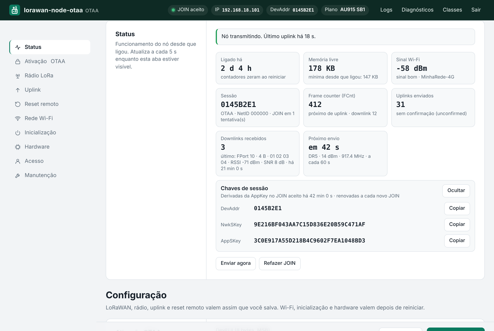
</p>

> **Biblioteca para ABP:** este nó usa a **MCCI LMiC 6.0.1** (JOIN e Classe C). Para ativação **ABP** LoRaWAN 1.0.x é preciso a **LMiC 3.3.0** (a 6.x quebra o MIC do ABP), que está, com a mesma HAL (`components/lmic/hal_esp32.c`), em **[Node_ESP32_SX1276_RFM95W_HOPERF_ABP](https://github.com/AdailSilva/Node_ESP32_SX1276_RFM95W_HOPERF_ABP)**.

---

## Sumário

- [Destaques da v0.0.1](#-destaques-da-v001)
- [Funcionalidades](#-funcionalidades)
- [Classes LoRaWAN (A, B e C)](#-classes-lorawan-a-b-e-c)
- [Onde o nó entra na rede](#-onde-o-nó-entra-na-rede)
- [Arquitetura do firmware](#-arquitetura-do-firmware)
- [Hardware](#-hardware)
- [Placas suportadas](#-placas-suportadas)
- [Ligação ESP32 ↔ RFM95W](#-ligação-esp32--rfm95w)
- [Preparar o ambiente ESP-IDF](#-preparar-o-ambiente-esp-idf)
- [Compilar e gravar](#-compilar-e-gravar)
- [Primeiro uso](#-primeiro-uso)
- [Interface WEB](#-interface-web)
- [App Android](#-app-android)
- [Parâmetros e valores de fábrica](#-parâmetros-e-valores-de-fábrica)
- [Console serial](#-console-serial)
- [Plano de canais AU915](#-plano-de-canais-au915)
- [JOIN OTAA](#-join-otaa)
- [Ordem dos bytes do DevEUI/JoinEUI](#-ordem-dos-bytes-do-deveuijoineui)
- [Reset remoto por downlink](#-reset-remoto-por-downlink)
- [Diagnóstico de sessão e MIC](#-diagnóstico-de-sessão-e-mic)
- [Saída no monitor serial](#-saída-no-monitor-serial)
- [Cadastro no ChirpStack](#-cadastro-no-chirpstack)
- [Diferenças em relação ao ABP](#-diferenças-em-relação-ao-abp)
- [Solução de problemas](#-solução-de-problemas)
- [Estrutura do repositório](#-estrutura-do-repositório)
- [Licença e autor](#-licença-e-autor)

---

## 🆕 Destaques da v0.0.1

A **v0.0.1** é a primeira versão deste repositório. O firmware é um projeto **ESP-IDF** puro (C/C++), com a MCCI LMiC 6.0.1 dentro do próprio projeto.

| Recurso | Detalhe |
|---|---|
| 🧰 **Projeto ESP-IDF** | Compila e grava com `scripts/build.sh <BOARD> flash /dev/ttyUSB0` para **ESP32-WROOM-32U**, **ESP32-S3-WROOM-1U-N16R8** ou **ESP32-S3-WROOM-2-N32R16V**; os logs vão para `logs/`. Instalação do ESP-IDF em [Preparar o ambiente ESP-IDF](#-preparar-o-ambiente-esp-idf) |
| 📡 **LMiC 6.0.1 no projeto** | [`components/lmic`](components/lmic): núcleo da MCCI sem mudanças, com uma HAL própria para ESP-IDF (SPI master, interrupção nos DIO, `esp_timer`) |
| 🖥️ **Interface WEB** | Página em português: status ao vivo, configuração completa, logs, diagnósticos de rede (ping, traceroute, nslookup), tema claro/escuro e layout para celular |
| 🌐 **Página e app com a mesma API** | `esp_http_server` + `esp_wifi` + `mdns`: a página WEB e o app Android usam os mesmos endereços HTTP, sem nuvem |
| 💾 **Configuração na NVS** | Tudo o que seria `#define` vem da NVS. O `node_build.h` guarda só os valores de fábrica, e regravar o firmware não apaga a configuração |
| ⚡ **Aplica sem reiniciar** | Chaves, rádio, uplink e reset remoto valem assim que você salva (mudança de chaves ou canais refaz o JOIN) |
| 📶 **Wi-Fi resiliente** | Station com **Soft AP de emergência** e portal cativo, IP fixo ou DHCP, `http://<nome>.local`, ou Wi-Fi desligado |
| 🔘 **Botão BOOT** | Segurar **3 s** abre o Soft AP a qualquer momento |
| 🧵 **Sem atrapalhar o LoRa** | O servidor WEB roda numa task no **core 0**; o LMiC continua sozinho no core 1, sem atrasar as janelas RX1/RX2 |
| ⏱️ **Janelas RX** | DIO0/DIO1 por interrupção de GPIO: o instante do fim do TX é registrado no próprio ISR |
| 🛡️ **Watchdog do rádio** | O RFM95W volta a funcionar sozinho, com a mesma sessão (DevAddr, chaves, FCnt, canais, ADR): interrupção DIO perdida é entregue pelo nível do pino; com o rádio parado, uma verificação por segundo (versão e modo SLEEP) e reset do rádio se ele foi resetado ou não responde, antes do próximo uplink; TX/RX que não termina em 60 s ou falha interna do LMiC: reset do rádio e o próximo uplink sai no horário. Rádio que não responde é tentado de novo (1 s … 60 s) sem travar a página |
| 🔄 **Reset remoto configurável** | FPort, bytes do comando (1–16), espera e liga/desliga pela página |
| 🔁 **Ordem dos bytes do EUI** | A página mostra qual DevEUI/JoinEUI o ChirpStack vai receber e permite escolher entre os bytes na ordem digitada (padrão) e o padrão LSB do MCCI ([detalhes](#-ordem-dos-bytes-do-deveuijoineui)) |
| 📝 **Logs completos** | `printf` e `ESP_LOGx` (Wi-Fi, servidor web) aparecem no console e na página Logs |
| 📟 **Console serial** | `help`, `status`, `keys`, `wifi_ap`, `web_auth --reset`, `send`, `rejoin`, `cfg_reset`, `reboot` |

---

## ✨ Funcionalidades

### LoRaWAN e rádio

| Função | Detalhe |
|---|---|
| Ativação **OTAA** | DevEUI + JoinEUI + AppKey; JOIN automático com novas tentativas; botão “Do MAC” gera um DevEUI único |
| Canais AU915 | Sub-banda 0–7, canal de 500 kHz opcional, ou lista própria (`8-15,65`) |
| Data rate e potência | DR0–DR6, 2–20 dBm, **ADR** liga/desliga, **link check** liga/desliga |
| Janela RX2 | Data rate (DR8–DR13) e frequência |
| Erro de relógio | 0–10 % de `MAX_CLOCK_ERROR` para alargar a janela de recepção |
| Uplink | Intervalo, FPort, confirmado ou não, payload em **texto ou hexadecimal** (até 222 bytes), com cálculo do **tempo no ar** e da ocupação do canal |
| Downlink | **Classe A** (RX1/RX2, ver [Classes LoRaWAN](#-classes-lorawan-a-b-e-c)); FPort, bytes, RSSI e SNR do último downlink no painel |
| Reset remoto | Comando validado byte a byte numa FPort dedicada |


### Interface WEB e operação

| Função | Detalhe |
|---|---|
| Status ao vivo (5 s) | Uptime, memória, RSSI do Wi-Fi, sessão, FCnt, uplinks/ACKs, último downlink, próximo envio |
| Ações | **Enviar agora**, **Refazer JOIN** |
| Login | HTTP Basic (padrão `admin` / `lorawan101`), botão **Sair** |
| Logs | Tudo o que sai no monitor serial, ao vivo, com filtro, pausa e download (buffer de 16 KB em RAM), exceto segredos: senha do Soft AP, NwkSKey e AppSKey aparecem mascaradas |
| Diagnósticos | **Ping**, **Traceroute** e **Nslookup** feitos pelo nó, iguais aos do gateway, com destino padrão `chirpstack-v4.adailsilva.com.br` |
| Manutenção | Exportar/importar a configuração em JSON (sem senhas) e restaurar padrão de fábrica |
| Validação | No navegador e de novo no ESP32: chaves com tamanho exato, IPs, pinos repetidos ou só-entrada, canais, faixas numéricas |

---

## 📶 Classes LoRaWAN (A, B e C)

A **classe** define quando o nó escuta downlinks (servidor → nó). O uplink é igual nas três; todo nó suporta a **Classe A**, e B e C são modos adicionais.

| Classe | Quando o nó escuta | Atraso do downlink | Consumo | Uso típico |
|:---:|---|---|---|---|
| **A** | Só em 2 janelas curtas (RX1/RX2) depois de cada uplink | Até o **próximo uplink** | 🔋 Mínimo | Sensores a bateria: medidores, temperatura, nível, rastreadores |
| **B** | Janelas A + **ping slots** sincronizados por *beacon* (GPS) | Até o próximo ping slot (**1–128 s**) | 🔋🔋 Baixo/médio | Atuadores a bateria com atraso previsível: fechaduras, válvulas |
| **C** | **O tempo todo**, exceto enquanto transmite | **Quase imediato** | 🔌 Alto | Equipamentos na rede elétrica: relés, iluminação pública, alarmes |

**Neste nó:** o firmware funciona em **Classe A**. A **MCCI LMiC 6.0.1** tem:

| Classe | MCCI LMiC 6.0.1 | Este firmware |
|:---:|:---:|---|
| **A** | ✅ | ✅ **Em uso** (RX1/RX2 depois de cada uplink) |
| **B** | 🧪 no código, não testada pela MCCI | ➖ Não ativada (exige gateway com GPS + PPS) |
| **C** | ✅ (desligada na compilação) | ➖ Não ativada (`LMIC_ENABLE_class_c` = 0); passos para ligar no doc |

- Todo downlink (**reset remoto**, ADR, dados da fila do ChirpStack) chega **só depois de um uplink**: o atraso máximo é o intervalo de uplink. Para receber logo, use **Enviar agora**.
- No ChirpStack, deixe **Class-B** e **Class-C desmarcadas** no perfil do dispositivo. Com Class-C marcada, os downlinks saem "imediatamente" e se perdem. Depois de mudar o perfil, refaça o JOIN ([por quê](#a-classe-no-chirpstack-só-muda-no-join)).

### A classe no ChirpStack só muda no JOIN

O ChirpStack v4 não consulta o perfil a cada downlink: ele guarda a classe ativa no próprio dispositivo (coluna `enabled_class`) e só a recalcula no **JOIN** (perfil LoRaWAN 1.0.x com Class-C marcada → `C`; senão → `A`). Marcar ou desmarcar Class-C no perfil, ou mudar o dispositivo de perfil, **não altera** a sessão que já existe:

- **Class-C desmarcada depois do JOIN:** o ChirpStack continua tratando o nó como C e manda os downlinks na hora, e eles se perdem (este nó está em Classe A).
- **Class-C marcada depois do JOIN** (se um dia ligar a Classe C no firmware): o downlink continua esperando o próximo uplink, como na Classe A.

Sempre que mudar a classe no perfil ou trocar o perfil do dispositivo, refaça o JOIN (**Refazer JOIN** na página ou reinicie o nó).

#### Conferir a classe que o ChirpStack gravou

**Pela interface:** *Devices* → dispositivo → **Events** → clique em um evento `up` → campo `deviceInfo.deviceClassEnabled` (`CLASS_A`, `CLASS_B` ou `CLASS_C`). Mostra a classe que valia no momento daquele uplink.

**Pelo banco (PostgreSQL do ChirpStack no Kubernetes), da máquina local com o `kubectl`:**

```bash
# Pod e namespace do PostgreSQL do ChirpStack (o sufixo do pod muda a cada reinício,
# por isso ele é procurado pelo nome do deployment)
POD=$(kubectl get pods -A --no-headers | awk '/chirpstack-v4-ns-as-postgresql/ {print $2; exit}')
NS=$(kubectl get pods -A --no-headers | awk '/chirpstack-v4-ns-as-postgresql/ {print $1; exit}')

# DevEUI do nó, igual ao cadastro no ChirpStack (16 dígitos hex)
DEV_EUI=f38df5e5a31e63de

# Classe ativa do dispositivo
kubectl exec -n "$NS" "$POD" -- sh -c "psql -U \"\${POSTGRES_USER:-chirpstack}\" -d chirpstack -c \"
SELECT encode(dev_eui, 'hex') AS dev_eui, enabled_class, scheduler_run_after
FROM device
WHERE dev_eui = decode('$DEV_EUI', 'hex');\""
```

Exemplo de saída:

```
Defaulted container "chirpstack-v4-ns-as-postgresql" out of: chirpstack-v4-ns-as-postgresql, ...
     dev_eui      | enabled_class |      scheduler_run_after
------------------+---------------+-------------------------------
 f38df5e5a31e63de | A             | 2026-11-09 16:33:41.017283+00
(1 row)
```

A linha `Defaulted container ...` é normal: o pod tem containers de inicialização e o `kubectl` escolhe o do PostgreSQL. Se o banco tiver outro nome, liste com `psql -U ... -l` e troque o `-d chirpstack`.

Para ver a classe junto com o perfil que o dispositivo usa:

```bash
kubectl exec -n "$NS" "$POD" -- sh -c "psql -U \"\${POSTGRES_USER:-chirpstack}\" -d chirpstack -c \"
SELECT d.name, d.enabled_class, dp.name AS profile, dp.mac_version,
       dp.supports_class_b, dp.supports_class_c
FROM device d JOIN device_profile dp ON dp.id = d.device_profile_id
WHERE d.dev_eui = decode('$DEV_EUI', 'hex');\""
```

**Pela REST API** (precisa de uma *API key* do ChirpStack):

```bash
curl -s -H "Grpc-Metadata-Authorization: Bearer $API_KEY" \
  https://chirpstack-v4-rest-api.adailsilva.com.br/api/devices/$DEV_EUI | jq .classEnabled
```

| `enabled_class` | Significado | O que fazer |
|:---:|---|---|
| `A` | Correto para este nó (Classe A) | Nada |
| `C` | A sessão foi criada com o perfil com Class-C: os downlinks saem na hora e se perdem | Desmarcar Class-C no perfil e refazer o JOIN |
| `B` | Os uplinks chegam com o bit *Class B* e o perfil tem Class-B marcada | Desmarcar Class-B no perfil |

Explicação completa (diagramas de tempo, quando usar cada classe, ChirpStack e como ligar a Classe C): **[`doc/CLASSES_LORAWAN.md`](doc/CLASSES_LORAWAN.md)**. O mesmo resumo está na página WEB **Classes** (`/classes`) e no app Android (ícone 🎓 **Classes LoRaWAN**).

---

## 🌐 Onde o nó entra na rede

<p align="center">
  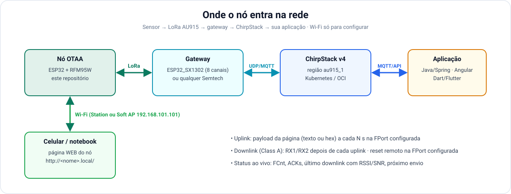
</p>

O Wi-Fi do nó serve **só para configurar e acompanhar**. Os dados vão sempre por LoRa até o gateway. Se o nó fica longe de qualquer Wi-Fi, use o modo **Soft AP** ou deixe o Wi-Fi **desligado** e abra o Soft AP pelo botão BOOT quando precisar.

---

## 🧱 Arquitetura do firmware

<p align="center">
  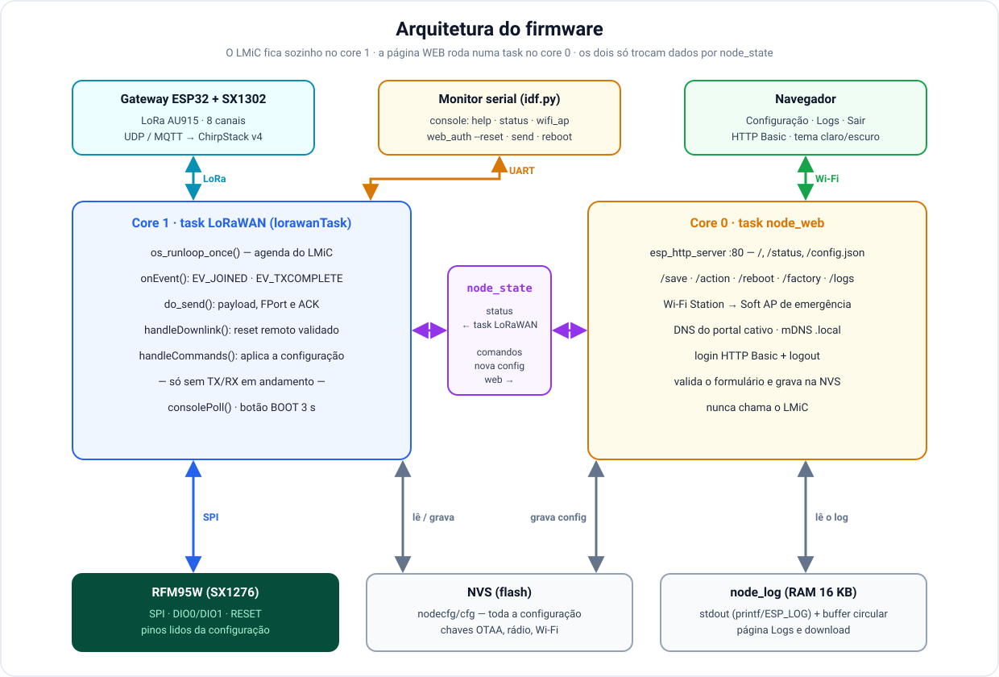
</p>

O LMiC **não é thread-safe** e as janelas RX1/RX2 são sensíveis a atraso. Por isso o servidor WEB roda numa **task própria no core 0**, e a task LoRaWAN (LMiC) continua sozinha no core 1. A página nunca chama o LMiC: ela publica **comandos** e a **nova configuração** em `node_state`, e a task LoRaWAN aplica quando não há TX/RX em andamento.

| Arquivo | Conteúdo |
|---|---|
| [`main/node_main.cpp`](main/node_main.cpp) | `app_main` e task LoRaWAN: eventos do LMiC, uplink, reset remoto, aplicação da configuração, console, botão BOOT |
| [`components/lmic`](components/lmic) | MCCI LMiC 6.0.1 + HAL para ESP-IDF ([`hal_esp32.c`](components/lmic/hal_esp32.c)) e região em `project_config/` |
| [`main/node_build.h`](main/node_build.h) | **Único arquivo diferente entre ABP e OTAA**: modo de ativação e valores de fábrica |
| [`node_config.h`](main/node_config.h) / [`.cpp`](main/node_config.cpp) | Estrutura da configuração, NVS (namespace `nodecfg`), validação e utilitários (hex, lista de canais) |
| [`node_state.h`](main/node_state.h) / [`.cpp`](main/node_state.cpp) | Status (loop → web) e comandos/configuração (web → loop) com spinlock/mutex |
| [`node_web.h`](main/node_web.h) / [`.cpp`](main/node_web.cpp) | Wi-Fi (Station, Soft AP, mDNS) e servidor WEB com login (`esp_http_server`); DNS do portal cativo em [`node_dns.c`](main/node_dns.c) |
| [`node_page.h`](main/node_page.h) | Páginas HTML/CSS/JS (na flash, sem internet nem CDN) |
| [`node_log.h`](main/node_log.h) / [`.cpp`](main/node_log.c) | `stdout` (printf e ESP_LOGx) = console + buffer circular de 16 KB para a página Logs |
| [`node_diag.h`](main/node_diag.h) / [`.c`](main/node_diag.c) | Ping, traceroute e nslookup da página Diagnósticos (mesmo código do `diag.c` do gateway; destino padrão `chirpstack-v4.adailsilva.com.br`) |

---

## 🔧 Hardware

| Componente | Especificação | Observação |
|---|---|---|
| Microcontrolador | **ESP32-WROOM-32U**, **ESP32-S3-WROOM-1U-N16R8** ou **ESP32-S3-WROOM-2-N32R16V** (DevKit) | Um firmware por módulo, ver [Placas suportadas](#-placas-suportadas). Precisa de Wi-Fi para a página; usa os dois núcleos |
| Rádio | RFM95W (HopeRF) — SX1276, 915 MHz | Alimentação e lógica de **3,3 V** |
| Antena | ¼ de onda para 915 MHz (≈ 8,2 cm) ou antena SMA/u.FL | **Nunca** transmita sem antena |
| Antena Wi-Fi | u.FL no WROOM-32U e no WROOM-1U; de PCB no WROOM-2 | Sem antena no u.FL o Wi-Fi quase não alcança |
| Botão | BOOT da DevKit (GPIO 0) | Segurar 3 s abre o Soft AP (configurável) |

---

## 🧩 Placas suportadas

O mesmo código-fonte gera **um firmware para cada módulo ESP32**. A placa é escolhida no build: `sh scripts/build.sh <BOARD>`.

| | ESP32-WROOM-32U DevKit | ESP32-S3-WROOM-1U-N16R8 DevKit | ESP32-S3-WROOM-2-N32R16V DevKit |
|---|---|---|---|
| `BOARD` | `esp32` | `esp32s3_n16r8` | `esp32s3_n32r16v` |
| `IDF_TARGET` | `esp32` | `esp32s3` | `esp32s3` |
| CPU / RAM | LX6 240 MHz, 520 KB SRAM | LX7 240 MHz, 512 KB SRAM + **8 MB PSRAM octal** | LX7 240 MHz, 512 KB SRAM + **16 MB PSRAM octal** |
| Flash | 4 MB quad (DIO) | **16 MB quad (QIO), 3,3 V** | **32 MB octal (OPI), 1,8 V** |
| Console | UART0, GPIO1/3 → `/dev/ttyUSB0` | UART0, GPIO43/44 (conector "UART") | UART0, GPIO43/44 (conector "UART") |
| SPI do RFM95W (fábrica) | 18 / 19 / 23 / 5 | 12 / 13 / 11 / 10 (IOMUX) | 12 / 13 / 11 / 10 (IOMUX) |
| RESET / DIO0 / DIO1 (fábrica) | 14 / 34 / 35 | 9 / 4 / 5 | 9 / 4 / 5 |
| Arquivo da placa | [`boards/esp32.defaults`](boards/esp32.defaults) | [`boards/esp32s3_n16r8.defaults`](boards/esp32s3_n16r8.defaults) | [`boards/esp32s3_n32r16v.defaults`](boards/esp32s3_n32r16v.defaults) |
| Guia | [ESP32-WROOM-32U](doc/hardware/ESP32-WROOM-32U_DevKit.md) | [ESP32-S3-WROOM-1U-N16R8](doc/hardware/ESP32-S3-WROOM-1U_N16R8_DevKit.md) | [ESP32-S3-WROOM-2-N32R16V](doc/hardware/ESP32-S3-WROOM-2_N32R16V_DevKit.md) |

- O [`CMakeLists.txt`](CMakeLists.txt) traduz `BOARD` em `IDF_TARGET` e carrega [`sdkconfig.defaults`](sdkconfig.defaults) (comum) e `boards/<BOARD>.defaults` (flash, PSRAM e `CONFIG_NODE_BOARD_*`).
- Os pinos de fábrica de cada placa ficam em [`main/node_board.h`](main/node_board.h). Depois do primeiro boot eles vivem na NVS e mudam pela página ou pelo app.
- A página e o app recusam os GPIOs proibidos **da placa gravada** (flash, PSRAM, USB, console, strapping, 1,8 V), com a regra enviada pelo firmware no `/config.json`.
- O boot, o `/info`, a página e o app mostram a placa: `Board: ESP32-S3-WROOM-1U-N16R8 (esp32s3_n16r8, esp32s3)`.

> ⚠️ **Os dois S3 não são intercambiáveis.** O firmware do N16R8 (flash quad 3,3 V) não inicia no N32R16V (flash octal 1,8 V), e vice-versa. Confira a marcação do módulo antes de gravar.

Comparação completa (GPIOs recusados, opções de cada sdkconfig, binários): [`doc/hardware/README.md`](doc/hardware/README.md).

---

## 📌 Ligação ESP32 ↔ RFM95W

### ESP32-WROOM-32U DevKit (`esp32`)

<p align="center">
  <a href="doc/images/wiring_esp32_rfm95w.png">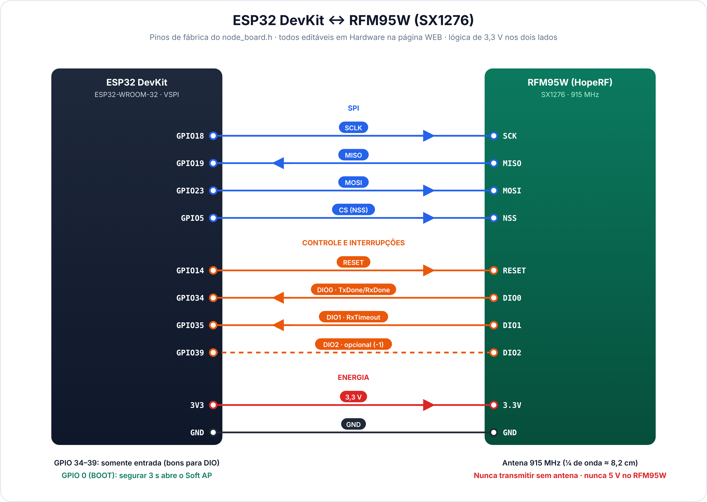</a>
</p>
<p align="center"><sub>🔍 Alta resolução (PNG, 3720 px de largura): clique na imagem para ampliar · versão vetorial: <a href="doc/images/wiring_esp32_rfm95w.svg"><code>wiring_esp32_rfm95w.svg</code></a></sub></p>

| ESP32 | RFM95W | Sinal | Campo na página |
|---|---|---|---|
| GPIO 18 | SCK | SPI clock | Hardware → SCLK |
| GPIO 19 | MISO | SPI | Hardware → MISO |
| GPIO 23 | MOSI | SPI | Hardware → MOSI |
| GPIO 5 | NSS | Chip select | Hardware → NSS / CS |
| GPIO 14 | RESET | Reset do rádio | Hardware → RESET (`-1` = não ligado) |
| GPIO 34 | DIO0 | TxDone / RxDone | Hardware → DIO0 |
| GPIO 35 | DIO1 | RxTimeout | Hardware → DIO1 |
| — | DIO2 | Não usado em LoRa | Hardware → DIO2 (`-1`) |
| 3V3 | 3.3V | Alimentação | — |
| GND | GND | Terra | — |

> ⚠️ **GPIO 34–39 do ESP32 são só entrada** e não têm pull-up interno. Servem para DIO0/DIO1 (saídas do rádio), nunca para SCLK, MOSI, NSS ou RESET. GPIO 6–11 são da memória flash. A página recusa essas combinações e pinos repetidos.

Guia completo: [`doc/hardware/ESP32-WROOM-32U_DevKit.md`](doc/hardware/ESP32-WROOM-32U_DevKit.md).

### ESP32-S3-WROOM-1U-N16R8 e ESP32-S3-WROOM-2-N32R16V DevKitC-1 (`esp32s3_n16r8`, `esp32s3_n32r16v`)

Os dois S3 usam **os mesmos fios**; só o firmware muda.

<p align="center">
  <a href="doc/images/wiring_esp32s3_wroom1u_n16r8_rfm95w.png">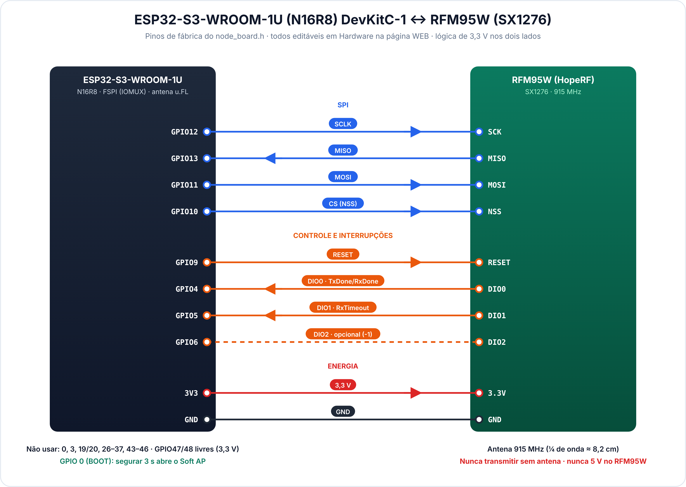</a>
</p>
<p align="center"><sub>🔍 Alta resolução (PNG, 3720 px de largura): clique na imagem para ampliar · versão vetorial: <a href="doc/images/wiring_esp32s3_wroom1u_n16r8_rfm95w.svg"><code>wiring_esp32s3_wroom1u_n16r8_rfm95w.svg</code></a></sub></p>

<p align="center">
  <a href="doc/images/wiring_esp32s3_wroom2_n32r16v_rfm95w.png">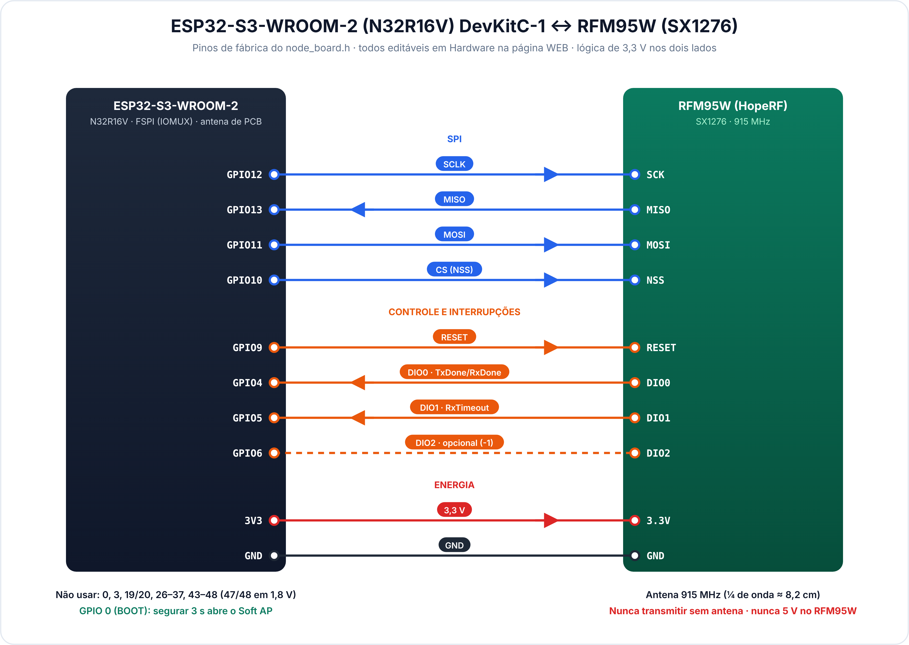</a>
</p>
<p align="center"><sub>🔍 Alta resolução (PNG, 3720 px de largura): clique na imagem para ampliar · versão vetorial: <a href="doc/images/wiring_esp32s3_wroom2_n32r16v_rfm95w.svg"><code>wiring_esp32s3_wroom2_n32r16v_rfm95w.svg</code></a></sub></p>

| ESP32-S3 | RFM95W | Sinal | Campo na página |
|---|---|---|---|
| GPIO 12 | SCK | SPI clock (FSPI, IOMUX) | Hardware → SCLK |
| GPIO 13 | MISO | SPI | Hardware → MISO |
| GPIO 11 | MOSI | SPI | Hardware → MOSI |
| GPIO 10 | NSS | Chip select | Hardware → NSS / CS |
| GPIO 9 | RESET | Reset do rádio | Hardware → RESET (`-1` = não ligado) |
| GPIO 4 | DIO0 | TxDone / RxDone | Hardware → DIO0 |
| GPIO 5 | DIO1 | RxTimeout | Hardware → DIO1 |
| — | DIO2 | Não usado em LoRa | Hardware → DIO2 (`-1`) |
| 3V3 | 3.3V | Alimentação | — |
| GND | GND | Terra | — |

> ⚠️ **Não use nos S3:** GPIO 0/3/45/46 (strapping), 19/20 (USB nativo), 26–32 (flash), 33–37 (PSRAM octal) e 43/44 (console). No **N16R8**, GPIO 47/48 são de 3,3 V e podem ser usados; no **N32R16V** ficam no domínio de **1,8 V**. Todo GPIO do S3 é entrada e saída. O console do nó fica na **UART0** (conector "UART" da DevKitC-1), não no USB nativo, porque a velocidade da serial é configurável na página.

Guias completos: [`ESP32-S3-WROOM-1U_N16R8_DevKit.md`](doc/hardware/ESP32-S3-WROOM-1U_N16R8_DevKit.md) e [`ESP32-S3-WROOM-2_N32R16V_DevKit.md`](doc/hardware/ESP32-S3-WROOM-2_N32R16V_DevKit.md).

---

## 🧰 Preparar o ambiente ESP-IDF

Este projeto usa **somente o ESP-IDF**. A versão de referência é a **v5.5.1**, a mesma da pipeline do GitHub Actions; qualquer versão a partir da 5.3 compila (também testado com a 6.x). Os comandos deste README supõem esta organização de pastas:

```
~/Apps/esp-idf/                ← ESP-IDF (git clone)
~/Apps/lorawan_workspace/      ← pasta de trabalho; este projeto é clonado dentro dela
```

> ⚠️ O ESP-IDF não aceita **espaços** no caminho dele nem no do projeto. No Windows, prefira caminhos curtos (por exemplo `C:\Apps\...`).

| Sistema | Caminho recomendado | `scripts/build.sh` e comandos com log |
|---|---|---|
| 🐧 Linux | `git clone` do ESP-IDF | funcionam como estão |
| 🍎 macOS | `git clone` do ESP-IDF | funcionam com o `sed` do GNU e um ajuste no `script` |
| 🪟 Windows | **WSL2 + Ubuntu** (recomendado) | funcionam como no Linux |
| 🪟 Windows | nativo, com o instalador da Espressif (EIM) | use o `idf.py` direto no PowerShell |

### 🐧 Linux (Ubuntu / Debian)

**1. Dependências do sistema**

```bash
sudo apt-get update
sudo apt-get install -y git wget flex bison gperf python3 python3-pip python3-venv \
  cmake ninja-build ccache libffi-dev libssl-dev dfu-util libusb-1.0-0
```

Fedora: `sudo dnf install git wget flex bison gperf python3 python3-pip cmake ninja-build ccache dfu-util libusbx`. Arch: `sudo pacman -S --needed gcc git make flex bison gperf python cmake ninja ccache dfu-util libusb python-pip`.

**2. Baixar e instalar o ESP-IDF v5.5.1** (as ferramentas vão para `~/.espressif`)

```bash
mkdir -p ~/Apps/lorawan_workspace && cd ~/Apps
git clone -b v5.5.1 --recursive https://github.com/espressif/esp-idf.git
cd esp-idf && ./install.sh esp32,esp32s3
```

`esp32,esp32s3` deixa a mesma instalação pronta para as três placas suportadas (ESP32-WROOM-32U, ESP32-S3-WROOM-1U-N16R8 e ESP32-S3-WROOM-2-N32R16V).

**3. Ativar o ambiente** em cada terminal novo, antes de compilar

```bash
. ~/Apps/esp-idf/export.sh
idf.py --version          # deve mostrar ESP-IDF v5.5.1
```

Atalho opcional: `echo "alias get_idf='. \$HOME/Apps/esp-idf/export.sh'" >> ~/.bashrc`; depois basta digitar `get_idf`.

**4. Permissão na porta serial** (uma vez só; depois saia e entre de novo na sessão)

```bash
sudo usermod -aG dialout $USER      # no Arch: uucp
ls /dev/ttyUSB* /dev/ttyACM*        # com a placa ligada no USB
```

**5. Clonar este projeto e compilar**

```bash
cd ~/Apps/lorawan_workspace
git clone https://github.com/AdailSilva/Node_ESP32_SX1276_RFM95W_HOPERF_OTAA.git
cd Node_ESP32_SX1276_RFM95W_HOPERF_OTAA && sh scripts/build.sh esp32
```

### 🍎 macOS (Intel ou Apple Silicon)

**1. Ferramentas da Apple e pacotes do [Homebrew](https://brew.sh)**

```bash
xcode-select --install
brew install cmake ninja dfu-util ccache python3 gnu-sed
```

**2. ESP-IDF:** o mesmo `git clone` e o mesmo `./install.sh esp32,esp32s3` do passo 2 do Linux. Ative com `. ~/Apps/esp-idf/export.sh` (funciona no zsh, o shell padrão do macOS) e confira com `idf.py --version`.

**3. `sed` do GNU.** O comando que limpa os logs usa `\x1B`, que o `sed` do macOS não entende. Coloque o `sed` do GNU na frente no `PATH`:

```bash
echo 'export PATH="$(brew --prefix)/opt/gnu-sed/libexec/gnubin:$PATH"' >> ~/.zshrc && source ~/.zshrc
```

**4. Porta serial.** A DevKit aparece como `/dev/cu.usbserial-*` (CP210x) ou `/dev/cu.wchusbserial*` (CH340). Liste com `ls /dev/cu.*` e use sempre o `/dev/cu.*`, não o `/dev/tty.*`. Se a placa não aparecer, instale o driver do chip USB-serial (links no passo 1 do Windows nativo).

**5. Gravar com log.** O `script` do macOS tem outra sintaxe (`script -q <arquivo> <comando>`, sem `-c` e `-f`). O comando *compilar do zero, gravar e abrir o monitor* fica assim (troque a porta):

```bash
. ~/Apps/esp-idf/export.sh && \
cd ~/Apps/lorawan_workspace/Node_ESP32_SX1276_RFM95W_HOPERF_OTAA && \
mkdir -p logs && \
LOG=logs/esp32_$(date +%Y%m%d_%H%M%S).log && \
script -q "$LOG" sh -c "rm -rf build-esp32 sdkconfig.esp32 managed_components dependencies.lock && sh scripts/build.sh esp32 flash /dev/cu.usbserial-0001" ; \
sed -r 's/\x1B\[[0-9;]*[mK]//g; s/\r//g' "$LOG" > "${LOG%.log}_limpo.log" && \
echo "Logs salvos em: $LOG e ${LOG%.log}_limpo.log"
```

Sem log, os atalhos funcionam iguais: `sh scripts/build.sh esp32 flash /dev/cu.usbserial-0001`. No S3, troque `esp32` por `esp32s3_n16r8` ou `esp32s3_n32r16v` (nas pastas também).

### 🪟 Windows

**Opção A: WSL2 + Ubuntu (recomendada).** Tudo neste README funciona igual ao Linux, inclusive o `scripts/build.sh` e os comandos com log.

1. No PowerShell **como administrador**:

   ```powershell
   wsl --install -d Ubuntu-24.04
   winget install --exact dorssel.usbipd-win
   ```

2. Reinicie o Windows, abra o **Ubuntu** e siga os passos do **Linux** acima. Deixe o ESP-IDF e os projetos dentro do Ubuntu (`~/Apps`), não em `/mnt/c`: a compilação fica muito mais rápida.

3. Passe a placa USB para o WSL (PowerShell como administrador; o `bind` é só na primeira vez):

   ```powershell
   usbipd list                                     # anote o BUSID da placa, por exemplo 2-3
   usbipd bind --busid 2-3
   usbipd attach --wsl --busid 2-3 --auto-attach
   ```

   Deixe essa janela aberta: o `--auto-attach` reconecta a placa sozinho quando ela reinicia ou é desconectada. No Ubuntu, ela aparece como `/dev/ttyUSB0`.

**Opção B: Windows nativo.**

1. **Driver da porta serial**, se o Windows não reconhecer a placa: [CP210x (Silicon Labs)](https://www.silabs.com/developers/usb-to-uart-bridge-vcp-drivers) ou [CH340 (WCH)](https://www.wch-ic.com/downloads/CH341SER_EXE.html). A placa aparece como `COMx` no Gerenciador de Dispositivos.

2. **ESP-IDF Installation Manager (EIM)**, o instalador oficial da Espressif:

   ```powershell
   winget install Espressif.EIM
   ```

   Abra o EIM e instale o **ESP-IDF v5.5.1** num caminho curto e sem espaços. Pela linha de comando: `winget install Espressif.EIM-CLI` e depois `eim install -i v5.5.1`.

3. Abra o atalho **IDF_PowerShell** que o EIM cria na área de trabalho (ele já ativa o ambiente) e confira com `idf.py --version`.

4. O `scripts/build.sh`, o `script` e o `sed` são de Linux. No PowerShell, use o `idf.py` direto, com os mesmos parâmetros que o `build.sh` usa (troque `COM5` pela porta da placa):

   ```powershell
   cd C:\Apps\lorawan_workspace
   git clone https://github.com/AdailSilva/Node_ESP32_SX1276_RFM95W_HOPERF_OTAA.git
   cd Node_ESP32_SX1276_RFM95W_HOPERF_OTAA
   # ESP32-WROOM-32U
   idf.py -B build-esp32 -D SDKCONFIG=sdkconfig.esp32 -D IDF_TARGET=esp32 -D BOARD=esp32 build
   idf.py -B build-esp32 -D SDKCONFIG=sdkconfig.esp32 -D IDF_TARGET=esp32 -D BOARD=esp32 -p COM5 flash monitor

   # ESP32-S3-WROOM-1U-N16R8 (porta COM do conector "UART")
   idf.py -B build-esp32s3_n16r8 -D SDKCONFIG=sdkconfig.esp32s3_n16r8 -D IDF_TARGET=esp32s3 -D BOARD=esp32s3_n16r8 build

   # ESP32-S3-WROOM-2-N32R16V (porta COM do conector "UART")
   idf.py -B build-esp32s3_n32r16v -D SDKCONFIG=sdkconfig.esp32s3_n32r16v -D IDF_TARGET=esp32s3 -D BOARD=esp32s3_n32r16v build
   ```

   | Para | No PowerShell |
   |---|---|
   | Compilar do zero | `Remove-Item -Recurse -Force build-esp32, sdkconfig.esp32, managed_components, dependencies.lock -ErrorAction SilentlyContinue` e depois o `build` |
   | Apagar a flash (inclusive a NVS) | `idf.py -B build-esp32 -D SDKCONFIG=sdkconfig.esp32 -D IDF_TARGET=esp32 -D BOARD=esp32 -p COM5 erase-flash` |
   | Só monitorar | `idf.py -B build-esp32 -D SDKCONFIG=sdkconfig.esp32 -D IDF_TARGET=esp32 -D BOARD=esp32 -p COM5 monitor` |
   | Monitor em outra velocidade | `$env:IDF_MONITOR_BAUD = "9600"` antes do `monitor` |
   | Salvar o log do monitor | dentro do monitor, **Ctrl+T** e depois **Ctrl+L** (liga e desliga a gravação em arquivo na pasta do projeto) |

### ✅ Conferir a instalação

Com o ambiente ativado, `idf.py --version` mostra a versão do ESP-IDF, e `sh scripts/build.sh esp32` (ou o `idf.py ... build` no Windows nativo) termina com `Project build complete`. O primeiro build também baixa o componente `espressif/mdns` pelo Component Manager, então precisa de internet.

---

## 🔨 Compilar e gravar

Só **ESP-IDF**: `scripts/build.sh <BOARD>`, pasta `build-<BOARD>/` e `sdkconfig.<BOARD>`, uma por placa:

| `BOARD` | Placa | Pasta de build + sdkconfig | Porta (UART0) |
|---|---|---|---|
| `esp32` | ESP32-WROOM-32U DevKit | `build-esp32/` + `sdkconfig.esp32` | `/dev/ttyUSB0` |
| `esp32s3_n16r8` | ESP32-S3-WROOM-1U-N16R8 DevKitC-1 | `build-esp32s3_n16r8/` + `sdkconfig.esp32s3_n16r8` | `/dev/ttyUSB0` (CP2102) ou `/dev/ttyACM0` (CH343), conector "UART" |
| `esp32s3_n32r16v` | ESP32-S3-WROOM-2-N32R16V DevKitC-1 | `build-esp32s3_n32r16v/` + `sdkconfig.esp32s3_n32r16v` | idem |

Nos comandos abaixo, troque `esp32` pelo `BOARD` da sua placa (inclusive em `build-esp32` e `sdkconfig.esp32`). Se o ESP-IDF ainda não está instalado, comece por [Preparar o ambiente ESP-IDF](#-preparar-o-ambiente-esp-idf).

### Requisitos

| Software | Versão | Observação |
|---|---|---|
| ESP-IDF | **5.3 ou mais nova** (testado com **v5.5.1** e **v6.2**/master) | `~/Apps/esp-idf` ([instalação](#-preparar-o-ambiente-esp-idf)) |
| MCCI LMiC | **6.0.1**, já dentro do projeto | [`components/lmic`](components/lmic): núcleo da MCCI sem mudanças + HAL própria para ESP-IDF ([`hal_esp32.c`](components/lmic/hal_esp32.c)) |
| `espressif/mdns` | baixado sozinho pelo Component Manager | `http://<nome>.local/` e descoberta pelo app |

A LMiC já vem dentro do projeto: não há biblioteca para instalar. A região e o rádio ficam em [`components/lmic/project_config/lmic_project_config.h`](components/lmic/project_config/lmic_project_config.h): `CFG_au915` e `CFG_sx1276_radio`.

### Gravar e acompanhar o log

Os comandos abaixo valem para Linux e WSL2 (no macOS e no Windows nativo, veja as variações em [Preparar o ambiente ESP-IDF](#-preparar-o-ambiente-esp-idf)):

- a saída da compilação, da gravação e do monitor vai para `logs/<BOARD>_<data>.log`;
- uma cópia sem códigos de cor vai para `logs/<BOARD>_<data>_limpo.log`.

A porta é a do chip USB-serial da DevKit, normalmente `/dev/ttyUSB0`. Se o gateway estiver ligado no mesmo PC, o nó pode aparecer como `/dev/ttyUSB1`. Use `ls /dev/ttyUSB*` para conferir.

Cada placa tem três comandos, prontos para copiar e colar:

| Comando | O que faz | Configuração na NVS |
|---|---|---|
| **Do zero** | libera a porta, apaga `build-<BOARD>/`, `sdkconfig.<BOARD>`, `managed_components/` e `dependencies.lock`, apaga a flash inteira (`erase`), compila, grava e abre o monitor | **apagada**: volta ao padrão de fábrica (o nó faz um JOIN novo) |
| **Atualizar** | libera a porta, apaga as mesmas pastas e arquivos de build, compila do zero, grava e abre o monitor | mantida |
| **Só monitorar** | libera a porta e abre o monitor, sem compilar nem gravar | mantida |

`sudo fuser -k <porta> 2>/dev/null ;` fecha o programa que estiver usando a porta serial (um monitor esquecido em outro terminal, por exemplo), que senão faria a gravação falhar com *port is busy*. A linha termina com `;` e não com `&&` de propósito: quando a porta já está livre, o `fuser` retorna erro e a sequência continua mesmo assim. O `sudo` pede a senha na primeira vez.

**O que o Do zero apaga.** O `erase-flash` apaga a flash inteira antes de gravar, inclusive a NVS. Use ao trocar de firmware na mesma placa, porque uma configuração antiga gravada na NVS seria carregada pelo firmware novo (por exemplo, o nome de outro nó). O nó volta aos valores do `node_build.h` e sobe em **Soft AP**, na rede **`lorawan-node-otaa`** (senha `lorawan101`), com a página em `http://192.168.101.101` e login `admin` / `lorawan101`. No OTAA, o nó faz um JOIN novo ao ligar. Exporte a configuração antes (seção **Manutenção**) se for reaproveitar. Para regravar o mesmo firmware mantendo a configuração, use o **Atualizar**.

> A DevKitC-1 do S3 com o conversor **CH343** aparece como `/dev/ttyACM0` mesmo no conector "UART": troque `/dev/ttyUSB0` por `/dev/ttyACM0` nos comandos dessa placa.

#### ESP32-WROOM-32U DevKit (`esp32`, `/dev/ttyUSB0`)

**Do zero:** apaga a flash, compila do zero, grava e abre o monitor

```bash
sudo fuser -k /dev/ttyUSB0 2>/dev/null ; \
cd ~/Apps/esp-idf/ && \
. ./export.sh && \
cd ~/Apps/lorawan_workspace/Node_ESP32_SX1276_RFM95W_HOPERF_OTAA && \
mkdir -p logs && \
LOG=logs/esp32_$(date +%Y%m%d_%H%M%S).log && \
script -f -q -c "rm -rf build build-esp32 sdkconfig.esp32 managed_components dependencies.lock && sh scripts/build.sh esp32 erase /dev/ttyUSB0 && sh scripts/build.sh esp32 flash /dev/ttyUSB0" "$LOG" ; \
sed -r 's/\x1B\[[0-9;]*[mK]//g; s/\r//g' "$LOG" > "${LOG%.log}_limpo.log" && \
echo "Logs salvos em: $LOG e ${LOG%.log}_limpo.log"
```

**Atualizar:** compila do zero, grava e abre o monitor (mantém a configuração e o FCnt)

```bash
sudo fuser -k /dev/ttyUSB0 2>/dev/null ; \
cd ~/Apps/esp-idf/ && \
. ./export.sh && \
cd ~/Apps/lorawan_workspace/Node_ESP32_SX1276_RFM95W_HOPERF_OTAA && \
mkdir -p logs && \
LOG=logs/esp32_update_$(date +%Y%m%d_%H%M%S).log && \
script -f -q -c "rm -rf build build-esp32 sdkconfig.esp32 managed_components dependencies.lock && sh scripts/build.sh esp32 flash /dev/ttyUSB0" "$LOG" ; \
sed -r 's/\x1B\[[0-9;]*[mK]//g; s/\r//g' "$LOG" > "${LOG%.log}_limpo.log" && \
echo "Logs salvos em: $LOG e ${LOG%.log}_limpo.log"
```

**Só monitorar:** sem compilar nem gravar

```bash
sudo fuser -k /dev/ttyUSB0 2>/dev/null ; \
cd ~/Apps/esp-idf/ && \
. ./export.sh && \
cd ~/Apps/lorawan_workspace/Node_ESP32_SX1276_RFM95W_HOPERF_OTAA && \
mkdir -p logs && \
LOG=logs/esp32_monitor_$(date +%Y%m%d_%H%M%S).log && \
script -f -q -c "sh scripts/build.sh esp32 monitor /dev/ttyUSB0" "$LOG" ; \
sed -r 's/\x1B\[[0-9;]*[mK]//g; s/\r//g' "$LOG" > "${LOG%.log}_limpo.log" && \
echo "Logs salvos em: $LOG e ${LOG%.log}_limpo.log"
```

#### ESP32-S3-WROOM-1U-N16R8 DevKit (`esp32s3_n16r8`, `/dev/ttyUSB0`, conector "UART")

**Do zero:** apaga a flash, compila do zero, grava e abre o monitor

```bash
sudo fuser -k /dev/ttyUSB0 2>/dev/null ; \
cd ~/Apps/esp-idf/ && \
. ./export.sh && \
cd ~/Apps/lorawan_workspace/Node_ESP32_SX1276_RFM95W_HOPERF_OTAA && \
mkdir -p logs && \
LOG=logs/esp32s3_n16r8_$(date +%Y%m%d_%H%M%S).log && \
script -f -q -c "rm -rf build build-esp32s3_n16r8 sdkconfig.esp32s3_n16r8 managed_components dependencies.lock && sh scripts/build.sh esp32s3_n16r8 erase /dev/ttyUSB0 && sh scripts/build.sh esp32s3_n16r8 flash /dev/ttyUSB0" "$LOG" ; \
sed -r 's/\x1B\[[0-9;]*[mK]//g; s/\r//g' "$LOG" > "${LOG%.log}_limpo.log" && \
echo "Logs salvos em: $LOG e ${LOG%.log}_limpo.log"
```

**Atualizar:** compila do zero, grava e abre o monitor (mantém a configuração e o FCnt)

```bash
sudo fuser -k /dev/ttyUSB0 2>/dev/null ; \
cd ~/Apps/esp-idf/ && \
. ./export.sh && \
cd ~/Apps/lorawan_workspace/Node_ESP32_SX1276_RFM95W_HOPERF_OTAA && \
mkdir -p logs && \
LOG=logs/esp32s3_n16r8_update_$(date +%Y%m%d_%H%M%S).log && \
script -f -q -c "rm -rf build build-esp32s3_n16r8 sdkconfig.esp32s3_n16r8 managed_components dependencies.lock && sh scripts/build.sh esp32s3_n16r8 flash /dev/ttyUSB0" "$LOG" ; \
sed -r 's/\x1B\[[0-9;]*[mK]//g; s/\r//g' "$LOG" > "${LOG%.log}_limpo.log" && \
echo "Logs salvos em: $LOG e ${LOG%.log}_limpo.log"
```

**Só monitorar:** sem compilar nem gravar

```bash
sudo fuser -k /dev/ttyUSB0 2>/dev/null ; \
cd ~/Apps/esp-idf/ && \
. ./export.sh && \
cd ~/Apps/lorawan_workspace/Node_ESP32_SX1276_RFM95W_HOPERF_OTAA && \
mkdir -p logs && \
LOG=logs/esp32s3_n16r8_monitor_$(date +%Y%m%d_%H%M%S).log && \
script -f -q -c "sh scripts/build.sh esp32s3_n16r8 monitor /dev/ttyUSB0" "$LOG" ; \
sed -r 's/\x1B\[[0-9;]*[mK]//g; s/\r//g' "$LOG" > "${LOG%.log}_limpo.log" && \
echo "Logs salvos em: $LOG e ${LOG%.log}_limpo.log"
```

#### ESP32-S3-WROOM-2-N32R16V DevKit (`esp32s3_n32r16v`, `/dev/ttyUSB0`, conector "UART")

**Do zero:** apaga a flash, compila do zero, grava e abre o monitor

```bash
sudo fuser -k /dev/ttyUSB0 2>/dev/null ; \
cd ~/Apps/esp-idf/ && \
. ./export.sh && \
cd ~/Apps/lorawan_workspace/Node_ESP32_SX1276_RFM95W_HOPERF_OTAA && \
mkdir -p logs && \
LOG=logs/esp32s3_n32r16v_$(date +%Y%m%d_%H%M%S).log && \
script -f -q -c "rm -rf build build-esp32s3_n32r16v sdkconfig.esp32s3_n32r16v managed_components dependencies.lock && sh scripts/build.sh esp32s3_n32r16v erase /dev/ttyUSB0 && sh scripts/build.sh esp32s3_n32r16v flash /dev/ttyUSB0" "$LOG" ; \
sed -r 's/\x1B\[[0-9;]*[mK]//g; s/\r//g' "$LOG" > "${LOG%.log}_limpo.log" && \
echo "Logs salvos em: $LOG e ${LOG%.log}_limpo.log"
```

**Atualizar:** compila do zero, grava e abre o monitor (mantém a configuração e o FCnt)

```bash
sudo fuser -k /dev/ttyUSB0 2>/dev/null ; \
cd ~/Apps/esp-idf/ && \
. ./export.sh && \
cd ~/Apps/lorawan_workspace/Node_ESP32_SX1276_RFM95W_HOPERF_OTAA && \
mkdir -p logs && \
LOG=logs/esp32s3_n32r16v_update_$(date +%Y%m%d_%H%M%S).log && \
script -f -q -c "rm -rf build build-esp32s3_n32r16v sdkconfig.esp32s3_n32r16v managed_components dependencies.lock && sh scripts/build.sh esp32s3_n32r16v flash /dev/ttyUSB0" "$LOG" ; \
sed -r 's/\x1B\[[0-9;]*[mK]//g; s/\r//g' "$LOG" > "${LOG%.log}_limpo.log" && \
echo "Logs salvos em: $LOG e ${LOG%.log}_limpo.log"
```

**Só monitorar:** sem compilar nem gravar

```bash
sudo fuser -k /dev/ttyUSB0 2>/dev/null ; \
cd ~/Apps/esp-idf/ && \
. ./export.sh && \
cd ~/Apps/lorawan_workspace/Node_ESP32_SX1276_RFM95W_HOPERF_OTAA && \
mkdir -p logs && \
LOG=logs/esp32s3_n32r16v_monitor_$(date +%Y%m%d_%H%M%S).log && \
script -f -q -c "sh scripts/build.sh esp32s3_n32r16v monitor /dev/ttyUSB0" "$LOG" ; \
sed -r 's/\x1B\[[0-9;]*[mK]//g; s/\r//g' "$LOG" > "${LOG%.log}_limpo.log" && \
echo "Logs salvos em: $LOG e ${LOG%.log}_limpo.log"
```

#### Compilar as três placas (sem gravar)

Útil para conferir, antes de um commit, que o projeto não quebrou em nenhuma placa. O `build.sh all` compila `esp32`, `esp32s3_n16r8` e `esp32s3_n32r16v` em sequência, cada um na sua pasta `build-<BOARD>/`.

```bash
cd ~/Apps/esp-idf/ && . ./export.sh && \
cd ~/Apps/lorawan_workspace/Node_ESP32_SX1276_RFM95W_HOPERF_OTAA && sh scripts/build.sh all
```

> **Lembretes**
> - Com duas placas no USB ao mesmo tempo, a segunda aparece como `/dev/ttyUSB1` ou `/dev/ttyACM1`. Confira com `ls /dev/ttyUSB* /dev/ttyACM*` e troque a porta nos comandos.
> - Para sair do monitor, use **Ctrl+]**.

**Atalhos:**

| Comando | Faz |
|---|---|
| `sh scripts/build.sh esp32` | Só compila (ESP32-WROOM-32U) |
| `sh scripts/build.sh esp32s3_n16r8` | Só compila (ESP32-S3-WROOM-1U-N16R8) |
| `sh scripts/build.sh esp32s3_n32r16v` | Só compila (ESP32-S3-WROOM-2-N32R16V) |
| `sh scripts/build.sh all` | Compila as três placas |
| `sh scripts/build.sh <BOARD> flash /dev/ttyUSB0` | Compila, grava e abre o monitor |
| `sh scripts/build.sh <BOARD> monitor /dev/ttyUSB0` | Só abre o monitor |
| `sh scripts/build.sh <BOARD> erase /dev/ttyUSB0` | Apaga a flash inteira (fábrica, FCnt 0) |

No Windows nativo (PowerShell), use o `idf.py` com os mesmos parâmetros que o script mostra, por exemplo `idf.py -B build-esp32s3_n16r8 -D SDKCONFIG=sdkconfig.esp32s3_n16r8 -D IDF_TARGET=esp32s3 -D BOARD=esp32s3_n16r8 -p COM5 flash monitor`.

Os comandos do console (`help`, `status`...) são digitados direto no monitor, terminando com Enter.

> **Velocidade do console:** o padrão é **115200 bps**, o mesmo do `idf.py monitor`. Se você mudou *Hardware → Velocidade da serial* na página, use o mesmo valor no monitor, por exemplo `BAUD=9600 sh scripts/build.sh esp32 monitor /dev/ttyUSB0`.

### Binários prontos (GitHub Actions)

O workflow [`.github/workflows/build.yml`](.github/workflows/build.yml) compila as **três placas** com **ESP-IDF v5.5.1** (container `espressif/idf`) a cada push e pull request e guarda os `.bin` como *artifacts*. Ao criar uma tag `v*` (por exemplo `v0.0.1`), ele também cria uma **Release** com:

| Arquivo | Uso |
|---|---|
| `Node_ESP32_SX1276_RFM95W_HOPERF_OTAA-<versão>-<BOARD>-full.bin` | imagem única, gravar em `0x0` |
| `Node_ESP32_SX1276_RFM95W_HOPERF_OTAA-<versão>-<BOARD>-app.bin` | só a aplicação, gravar em `0x10000` |
| `Node_ESP32_SX1276_RFM95W_HOPERF_OTAA-<versão>-<BOARD>-parts.zip` | bootloader, tabela de partições, otadata e aplicação, com o `flash_args` |

`<BOARD>` = `esp32` (ESP32-WROOM-32U), `esp32s3_n16r8` (ESP32-S3-WROOM-1U-N16R8) ou `esp32s3_n32r16v` (ESP32-S3-WROOM-2-N32R16V). No S3, grave com `esptool.py --chip esp32s3`.
| `SHA256SUMS.txt` | somas de verificação |

A versão vem da **tag**: o [`CMakeLists.txt`](CMakeLists.txt) usa o `FW_VERSION` da pipeline ou, no seu PC, o `git describe` (`0.0.1`, `0.0.1-3-gabc1234`, `0.0.1-dirty`; sem tag, `0.0.0-dev`) e passa para o `NODE_FW_VERSION` (boot, página, `/info`). Não há número para editar à mão. Tags com sufixo (`v0.1.0-rc1`) viram *pre-release*.

```bash
git tag -a v0.0.2 -m "v0.0.2" && git push origin v0.0.2
```

> A imagem única (`-full.bin`) preenche a área da NVS com `0xFF`: o nó volta aos valores de fábrica e o FCnt volta a zero. Para atualizar mantendo a configuração e o FCnt, grave só a aplicação: `esptool.py --chip esp32 -p /dev/ttyUSB0 write_flash 0x10000 Node_ESP32_SX1276_RFM95W_HOPERF_OTAA-<versão>-esp32-app.bin`.

### Criar o repositório no GitHub

O [`scripts/create_github_repo.sh`](scripts/create_github_repo.sh) cria o repositório **`Node_ESP32_SX1276_RFM95W_HOPERF_OTAA`** com o GitHub CLI (`gh auth login` antes), envia o código e cria a tag `v0.0.1`, que dispara a primeira Release. Se a pasta já tem histórico git, ele é mantido e só o `origin` passa a apontar para o repositório novo. A pasta `configurations_backup/` nunca vai para o GitHub. Se o seu GitHub ainda tiver o repositório com o nome antigo (**`LoRaWAN_Node_ESP32_SX1276_RFM95W_HOPERF_OTAA`**, de antes de o projeto perder o prefixo `LoRaWAN_`), o script o **renomeia** (`gh repo rename`: histórico, Releases e estrelas continuam, e o GitHub redireciona o endereço antigo), aponta o `origin` para o novo nome e segue como no `--sync`.

```bash
cd ~/Apps/lorawan_workspace/Node_ESP32_SX1276_RFM95W_HOPERF_OTAA
sh scripts/create_github_repo.sh             # público
sh scripts/create_github_repo.sh --private   # privado
sh scripts/create_github_repo.sh --sync      # repositório já existe: só descrição, tópicos e tags
```

O script aplica a descrição e os **tópicos** do repositório e cria a tag **`v0.0.1`**. Se o GitHub ainda não responder logo após a criação, ele tenta de novo e, no final, mostra os tópicos e as tags que ficaram no GitHub. Se faltar algo, rode com `--sync`.

Se o repositório foi apagado no GitHub, basta rodar de novo: as tags que já existem no histórico local também sobem, e o GitHub Actions refaz as Releases.

> **`GraphQL: You have created too many repositories, too quickly`**: é um limite temporário do GitHub para criar muitos repositórios em pouco tempo (aparece principalmente depois de apagar e recriar repositórios várias vezes). O script espera e tenta de novo sozinho (padrão: 6 tentativas, a cada 5 min; mude com `TRIES=8 WAIT=600 sh scripts/create_github_repo.sh`). Se o limite continuar, ele para com o código 75 sem perder nada: o commit local fica guardado, e basta rodar o mesmo comando mais tarde.


### Regravar mantendo a configuração

A configuração fica na NVS (namespace `nodecfg`/`cfg`), numa partição que o `idf.py flash` não apaga: regravar o firmware mantém a configuração.

Para começar do zero, apague a flash antes de gravar: `sh scripts/build.sh <BOARD> erase /dev/ttyUSB0`. O nó volta aos valores do `node_build.h` (FCnt em 0) e sobe em Soft AP na rede **`lorawan-node-otaa`** (senha `lorawan101`), página em `http://192.168.101.101`.

### Uso de memória

Medido com ESP-IDF v6.2 (master) e LMiC 6.0.1:

- **Flash:** firmware ≈ 1,0 MB, numa partição de app de 1,25 MB (cerca de 20 % livre).
- **RAM estática** (`idf.py size`): DRAM ≈ 60 KB de 177 KB (34 %). O heap livre aparece ao vivo no Status da página.

### Valores de fábrica (opcional)

Antes de gravar vários nós, ajuste o [`main/node_build.h`](main/node_build.h) (nome, Wi-Fi, credenciais, canais e login) e, para os pinos de cada placa, o [`main/node_board.h`](main/node_board.h). Esses valores só valem no **primeiro boot** ou depois de *Restaurar padrão de fábrica*. Depois disso, valem os valores salvos na NVS.

---

## 🚀 Primeiro uso

1. **Grave o firmware** e acompanhe o monitor serial (115200 bps). O nó já começa a transmitir com os valores de fábrica (faz o JOIN primeiro).
2. **Conecte no Wi-Fi do nó:** rede **`lorawan-node-otaa`**, senha **`lorawan101`**. Em celulares a página abre sozinha (portal cativo); senão, acesse **http://192.168.101.101/**.
3. **Entre** com **`admin` / `lorawan101`**.
4. Em **Rede Wi-Fi**, informe sua rede; em **Ativação OTAA**, DevEUI, JoinEUI e AppKey do ChirpStack; ajuste rádio e uplink se precisar. **Salvar**.
5. **Reinicie** pela barra inferior (o Wi-Fi novo vale depois do reinício). A página passa a responder em **http://lorawan-node-otaa.local/** ou no IP que o monitor serial mostrar.
6. Troque a senha da página em **Acesso**.

| Situação | Como chegar na página |
|---|---|
| Wi-Fi configurado e conectado | `http://<nome>.local/` ou o IP do roteador |
| Wi-Fi não conecta em 30 s | Abre o **Soft AP de emergência** (mesmo nome/senha). O nó tenta a rede de novo a cada 60 s; quando conecta e ninguém está no AP, o AP desliga |
| Wi-Fi configurado como *Desligado* | Segure o **BOOT 3 s** com o nó ligado, ou digite `wifi_ap` no monitor serial |

> ⚠️ Não segure o BOOT **enquanto liga** o ESP32: isso entra no modo de gravação. Ligue primeiro, depois segure 3 s.

---

## 📱 Interface WEB

Servidor HTTP na porta **80**, páginas na flash do firmware (sem internet nem CDN), tema claro/escuro conforme o sistema, layout para celular.

> As capturas foram geradas com o HTML/JS real do firmware, servido com **dados de exemplo**. Os números não são de um nó em campo.

### 🔐 Login

| Item | Detalhe |
|---|---|
| Login padrão | `admin` / `lorawan101` |
| Senha do Wi-Fi do Soft AP | `lorawan101` (a mesma do login da página; o WPA2 exige no mínimo 8 caracteres) |
| Nó já configurado | Mantém o login gravado na NVS; `web_auth --reset` (console) ou **Restaurar padrão de fábrica** (seção Manutenção) aplicam `admin` / `lorawan101` |
| Trocar | Seção **Acesso**. Vale na hora; o navegador pede o novo login |
| Esqueceu | No monitor serial: `web_auth --reset` |
| Regras | Usuário de 1 a 31 caracteres; senha de 6 a 31; sem `:` |
| Sair | Link **Sair** no topo: troca o login guardado pelo navegador por um falso (`_logout_`) e abre a tela **Você saiu** |
| Senhas | Wi-Fi, Soft AP e página **nunca** voltam para o navegador: o campo aparece vazio com *“Salva (vazio mantém)”* |

### 1. Status

A **barra superior** mostra o nome do nó, o modo (OTAA), o estado da sessão (“JOIN aceito” ou “Aguardando JOIN”), o IP, o DevEUI/DevAddr e o plano. O painel de **Status** atualiza a cada 5 s enquanto a aba estiver visível.

| Cartão | Mostra |
|---|---|
| Ligado há | Uptime (os contadores zeram ao reiniciar) |
| Memória livre | Heap livre e mínimo desde o boot |
| Sinal Wi-Fi | RSSI e rede, ou Soft AP e clientes |
| Sessão | DevAddr, NetID e tentativas de JOIN |
| Frame counter | Próximo FCnt de uplink e FCnt de downlink |
| Uplinks enviados | Total e quantos tiveram ACK (se confirmado) |
| Downlinks recebidos | Total e o último: FPort, bytes, RSSI, SNR, idade |
| Próximo envio | Contagem, DR, potência, frequência do último TX, intervalo |

Abaixo dos cartões, o bloco **Chaves de sessão** mostra, nesta ordem, o **DevAddr**, a **NwkSKey** e a **AppSKey** em uso (hexadecimal, MSB, exatamente como o ChirpStack mostra em *Devices → device → Activation*). No OTAA elas são **derivadas da AppKey a cada JOIN aceito**: cada novo JOIN (botão *Refazer JOIN*, mudança de chaves/canais, reinício) gera um par novo e o anterior deixa de valer. Antes do JOIN o bloco mostra “sem sessão”. As chaves aparecem ocultas — **Mostrar** revela, **Copiar** copia mesmo ocultas (o DevAddr não é segredo e fica sempre visível). O app Android mostra o mesmo bloco na aba Status. Em todas as interfaces — monitor serial, página **Logs**, página WEB e app — a ordem de apresentação é sempre **DevAddr** (no topo), **NwkSKey** e **AppSKey**.

<p align="center">
  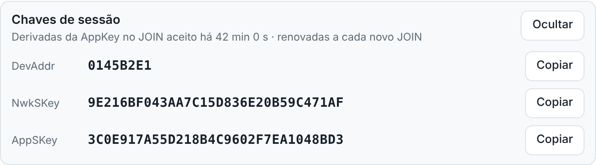
</p>

Enquanto o JOIN não é aceito, o painel avisa e mostra as tentativas:

<p align="center">
  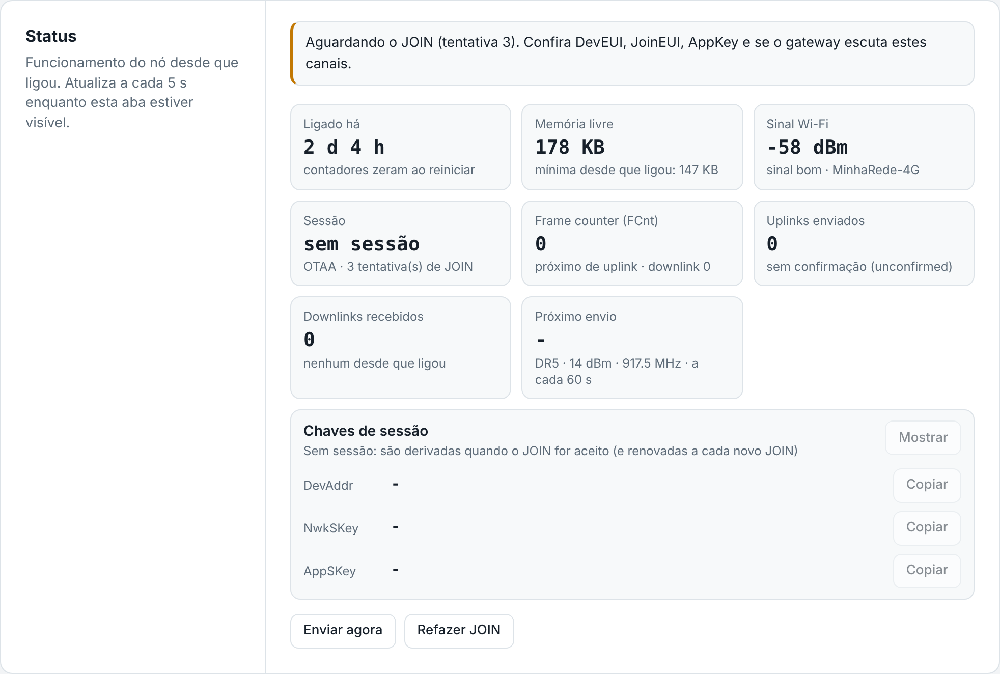
</p>

**Ações:** **Enviar agora** agenda um uplink imediato (respeitando o duty cycle do LMiC) e **Refazer JOIN** descarta a sessão e faz um JOIN novo.

### 2. Ativação OTAA

<p align="center">
  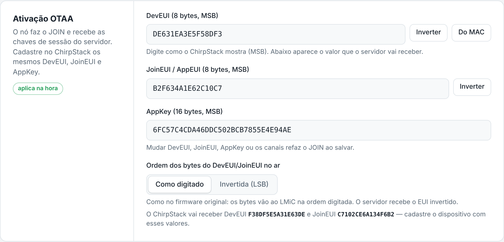
</p>

- **DevEUI:** botões **Inverter** (troca a ordem dos bytes, útil para valores copiados em LSB) e **Do MAC** (gera um EUI-64 único a partir do MAC do ESP32: 3 primeiros bytes + `FFFE` + 3 últimos).
- **JoinEUI/AppEUI** e **AppKey** em MSB, como o ChirpStack mostra.
- **Ordem dos bytes no ar:** veja [Ordem dos bytes do DevEUI/JoinEUI](#-ordem-dos-bytes-do-deveuijoineui). A linha de baixo mostra exatamente o DevEUI e o JoinEUI que o ChirpStack vai receber.
- Mudar DevEUI, JoinEUI, AppKey, ordem dos bytes ou canais **refaz o JOIN** ao salvar.

### 3. Rádio LoRa

<p align="center">
  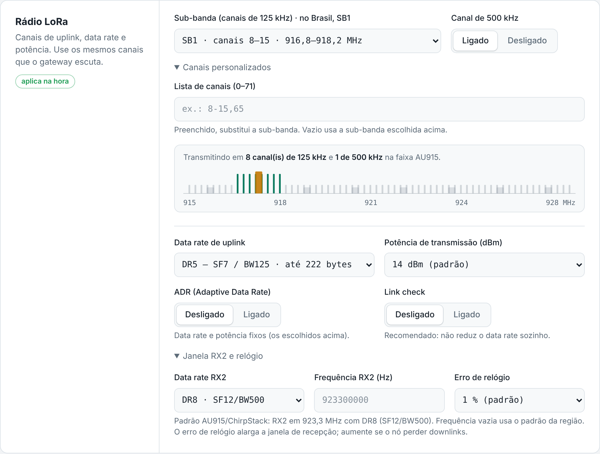
</p>

- **Sub-banda** 0–7 (no Brasil, SB1 = canais 8–15) e **canal de 500 kHz** (64 + sub-banda). O desenho mostra os canais em uso.
- **Canais personalizados:** lista como `8-15,65`; quando preenchida, substitui a sub-banda.
- **Data rate** DR0–DR6 com o payload máximo de cada um, **potência** 2–20 dBm, **ADR** e **link check**.
- **Janela RX2 e relógio:** DR8–DR13, frequência (vazia = 923,3 MHz) e erro de relógio. Aumente o erro de relógio se o nó perder downlinks.

### 4. Uplink e 5. Reset remoto

<p align="center">
  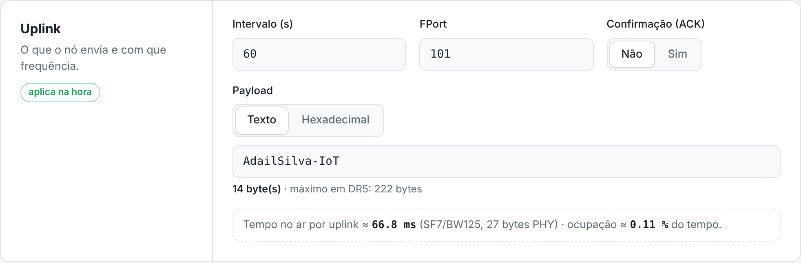
</p>

O payload pode ser **texto** ou **hexadecimal**. A página conta os bytes, avisa se passou do máximo do data rate e calcula o **tempo no ar** (cabeçalho LoRaWAN de 13 bytes incluído) e a **ocupação** do canal para o intervalo escolhido.

<p align="center">
  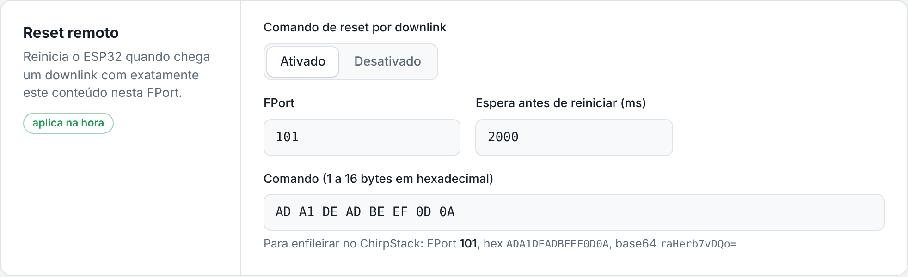
</p>

A dica abaixo do comando já mostra o **hex** e o **base64** prontos para enfileirar no ChirpStack. Detalhes em [Reset remoto por downlink](#-reset-remoto-por-downlink).

### 6. Rede Wi-Fi e 7. Inicialização

<p align="center">
  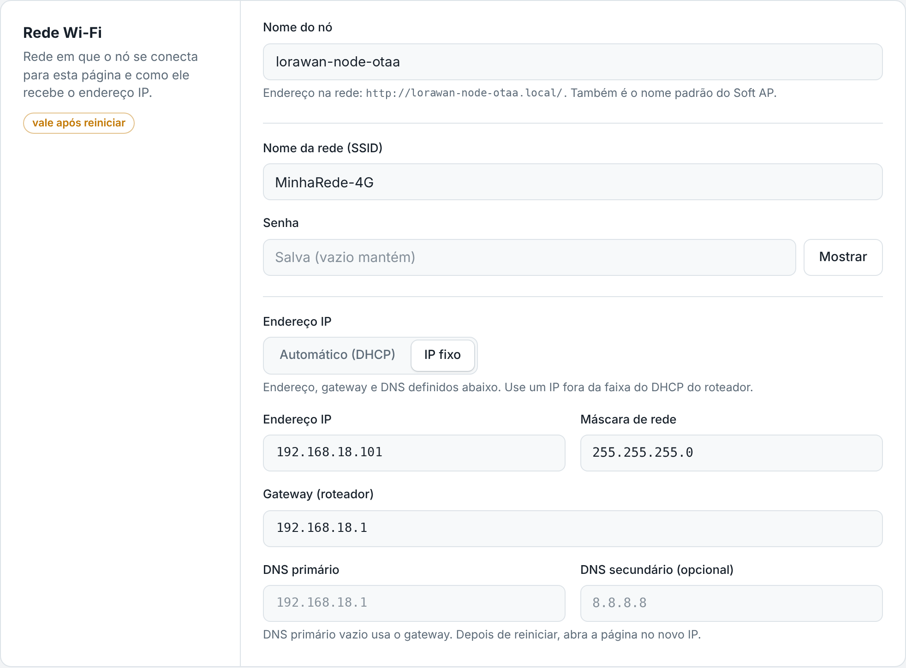
</p>

O **nome do nó** vira o hostname (`http://<nome>.local/`) e o nome padrão do Soft AP. **IP fixo** valida endereço, máscara, gateway e DNS no navegador antes de enviar.

<p align="center">
  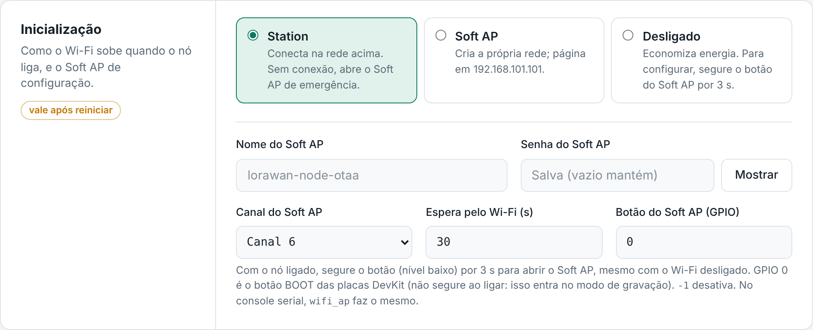
</p>

| Modo | Comportamento |
|---|---|
| **Station** | Conecta na rede; sem conexão em *Espera pelo Wi-Fi* segundos, abre o Soft AP de emergência |
| **Soft AP** | Cria a própria rede; página em `192.168.101.101` |
| **Desligado** | Sem Wi-Fi (menos consumo). O botão BOOT (3 s) ou `wifi_ap` abrem o Soft AP quando precisar |

### 8. Hardware

<p align="center">
  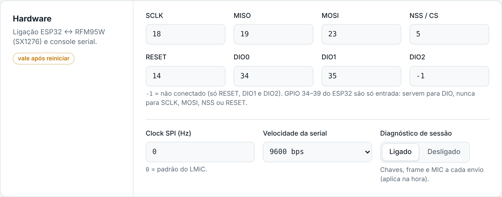
</p>

Pinos do RFM95W, clock SPI (`0` = padrão do LMiC), velocidade da serial e **diagnóstico de sessão** (chaves, frame e MIC a cada envio; vale na hora). Pinos e serial valem depois de reiniciar. Se os pinos estiverem errados, o LMiC não inicia, mas **a página continua funcionando** para você corrigir.

### 9. Acesso e 10. Manutenção

<p align="center">
  
</p>

<p align="center">
  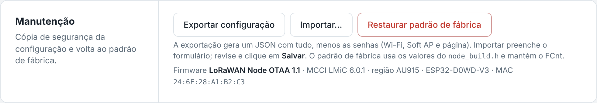
</p>

- **Exportar** baixa um JSON com toda a configuração, **menos as senhas**.
- **Importar** preenche o formulário a partir do JSON (avisa se o arquivo é de um nó ABP); revise e clique em **Salvar**.
- **Restaurar padrão de fábrica** apaga a configuração e reinicia com o `node_build.h`.

### Validação, salvar e sair

Os erros aparecem no topo do formulário e os campos com problema ficam em vermelho. O ESP32 valida tudo de novo antes de gravar.

<p align="center">
  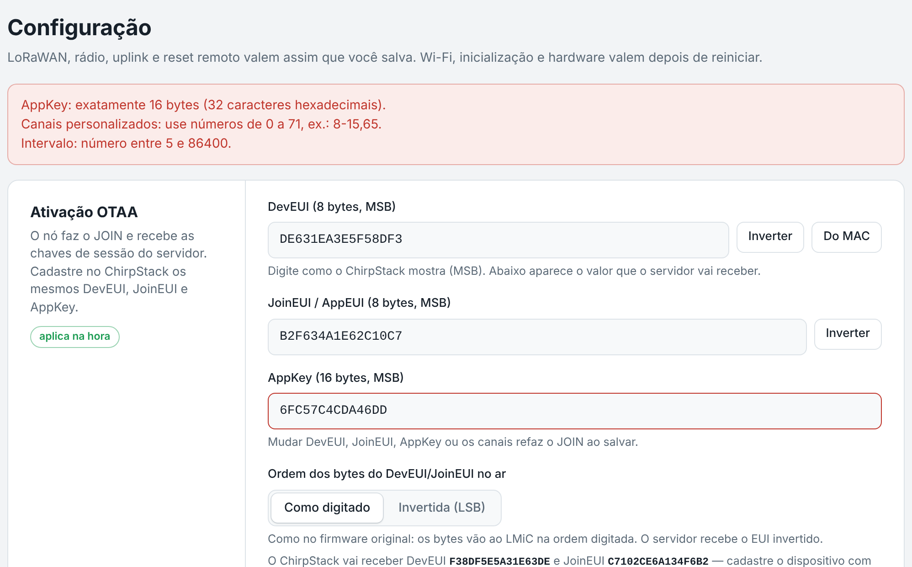
</p>

<p align="center">
  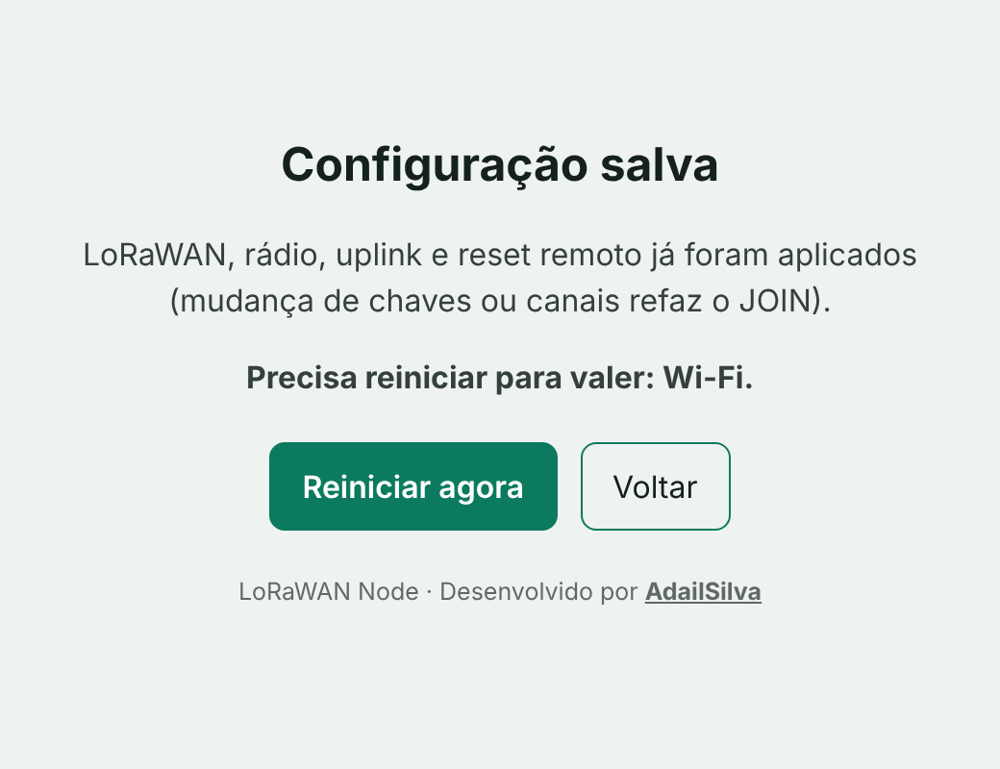
  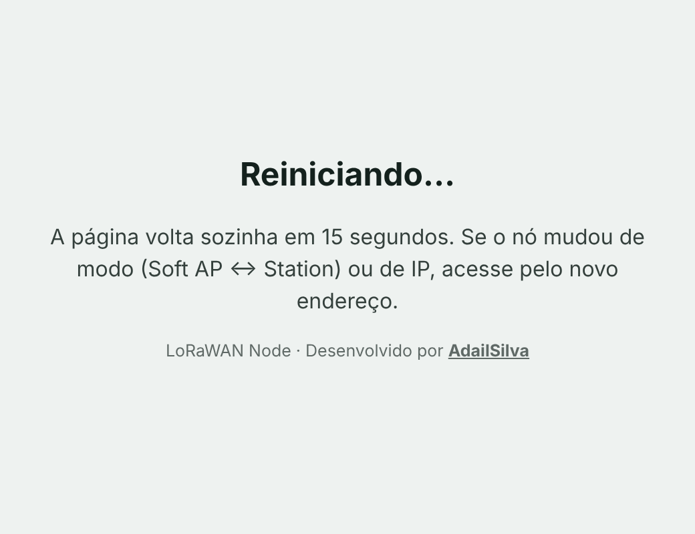
  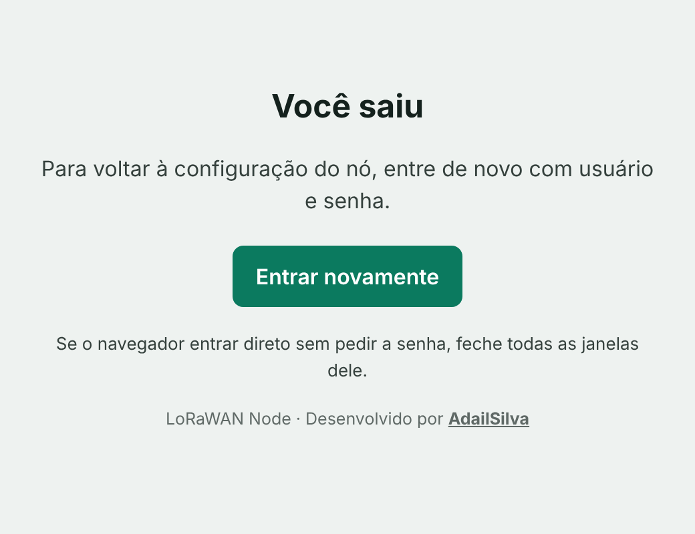
</p>

A barra inferior fica fixa e indica **alterações não salvas**; o navegador avisa se você tentar sair da página com alterações pendentes. Depois de salvar, a página diz o que já foi aplicado e o que **precisa de reinício**, e o painel de Status mantém esse aviso até reiniciar.

### Logs (`/logs`)

<p align="center">
  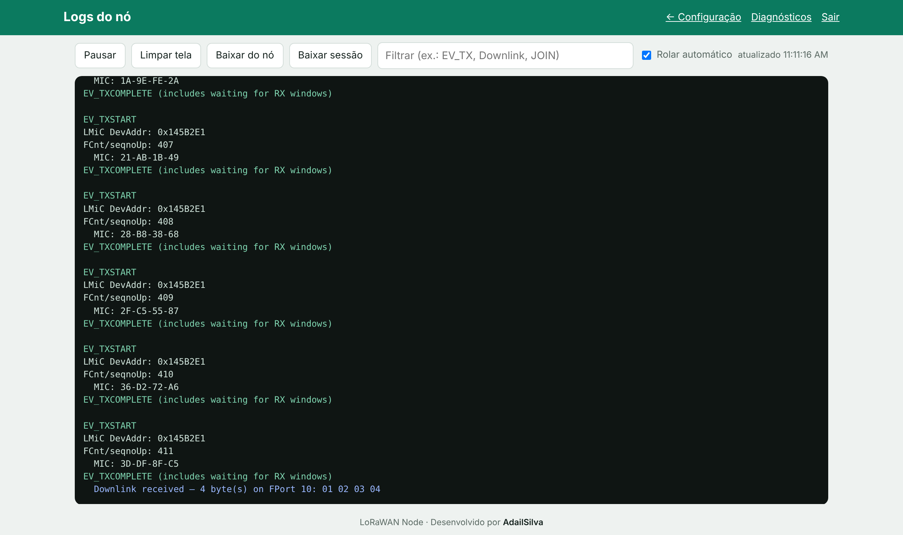
</p>

Tudo o que o firmware imprime no monitor serial, atualizado a cada 1,5 s, com cores por tipo (eventos, downlinks, avisos, erros), **filtro**, **pausa**, **rolar automático**, **Baixar do nó** (o buffer de 16 KB do ESP32) e **Baixar sessão** (o que a aba recebeu desde que abriu).

<p align="center">
  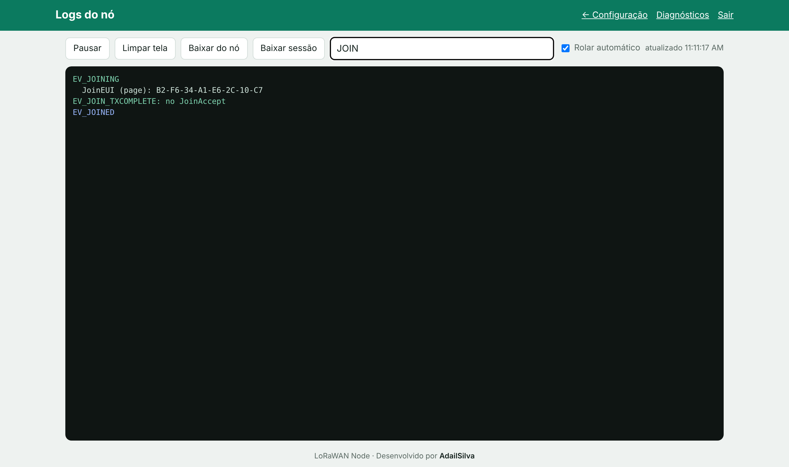
</p>

### Diagnósticos (`/diag`)

Testes de rede feitos **a partir do nó** (estilo *Network → Diagnostics* do OpenWrt). Ajudam a separar problema de Wi-Fi, de DNS e de servidor. O link **Diagnósticos** fica no topo da página principal, da página Logs e da página Classes.

<p align="center">
  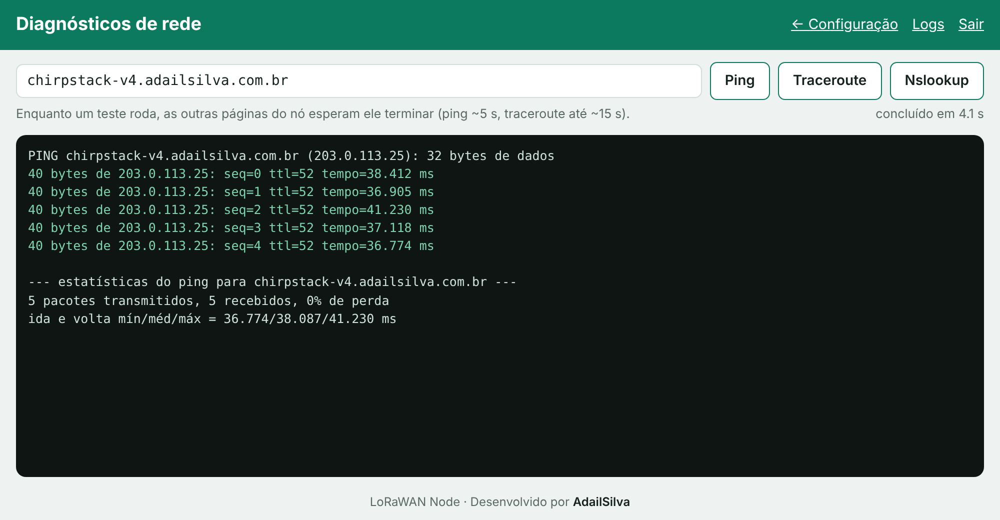
</p>

- **Destino:** já vem com **`chirpstack-v4.adailsilva.com.br`**, o destino padrão dos três testes (constante `DIAG_DEFAULT_HOST` em [`node_diag.h`](main/node_diag.h), a mesma dos gateways). A lista de sugestões traz esse domínio, o roteador Wi-Fi (quando o nó está em Station), `8.8.8.8` e `openwrt.org`. Aceita IP ou nome de até 63 caracteres.
- **Ping:** 5 pacotes ICMP, 1 por segundo, com resumo de perda e mín/méd/máx. **Enter** no campo também roda o ping.
- **Traceroute:** até 15 saltos, 1 tentativa de 1 s por salto (`*` = sem resposta).
- **Nslookup:** resolve o nome pelo DNS que o nó usa e mostra o servidor DNS e os endereços (IPv4 e IPv6).
- O resultado chega linha a linha (`GET /diag_run?t=ping|trace|dns&h=<destino>`). **Parar** interrompe; o rodapé mostra o tempo gasto. Cada teste também aparece na página **Logs** (`[WEB] Diagnóstico: ping …`).
- Enquanto um teste roda, as outras páginas do nó esperam ele terminar (ping ~5 s, traceroute até ~15 s), porque o servidor HTTP atende um pedido por vez. O servidor roda no core 0: **a task LoRaWAN (core 1) não é afetada**.
- Sem RAM extra parada: o socket ICMP só existe durante o teste e os buffers (~400 bytes) ficam na pilha do servidor HTTP.
- Em **Soft AP sem Station**, o nó não tem rota para a internet: o ping e o traceroute mostram "não foi possível resolver" — conecte o nó a um Wi-Fi com internet para testar o caminho até o ChirpStack.

<p align="center">
  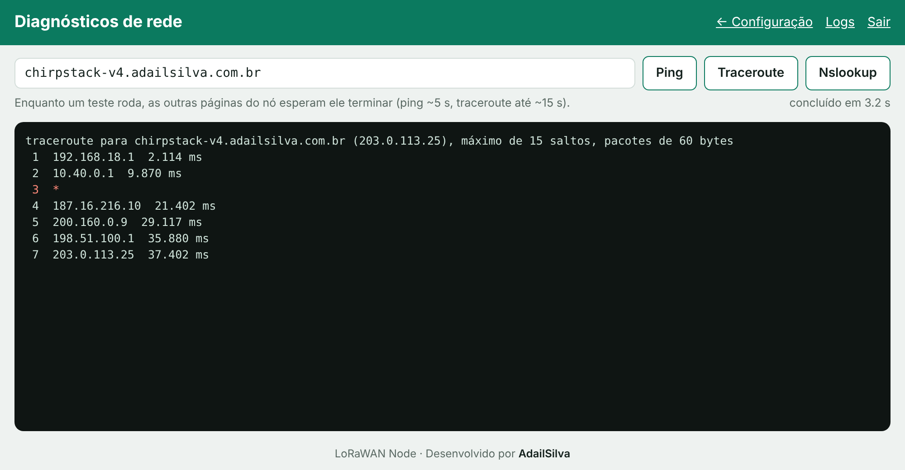
</p>

<p align="center">
  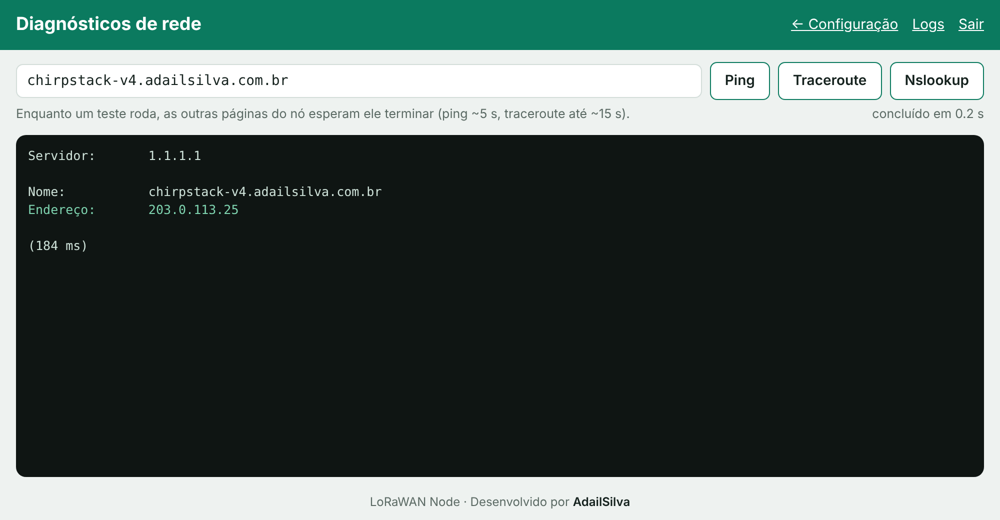
</p>

### Classes LoRaWAN (`/classes`)

Página só de leitura com a explicação das **Classes A, B e C**: quando o nó escuta, atraso do downlink, consumo, exemplos de uso, um comparativo e **o que este nó suporta hoje**. O link **Classes** fica no topo da página do nó, de Logs e de Diagnósticos. Explicação completa em [`doc/CLASSES_LORAWAN.md`](doc/CLASSES_LORAWAN.md).

<p align="center">
  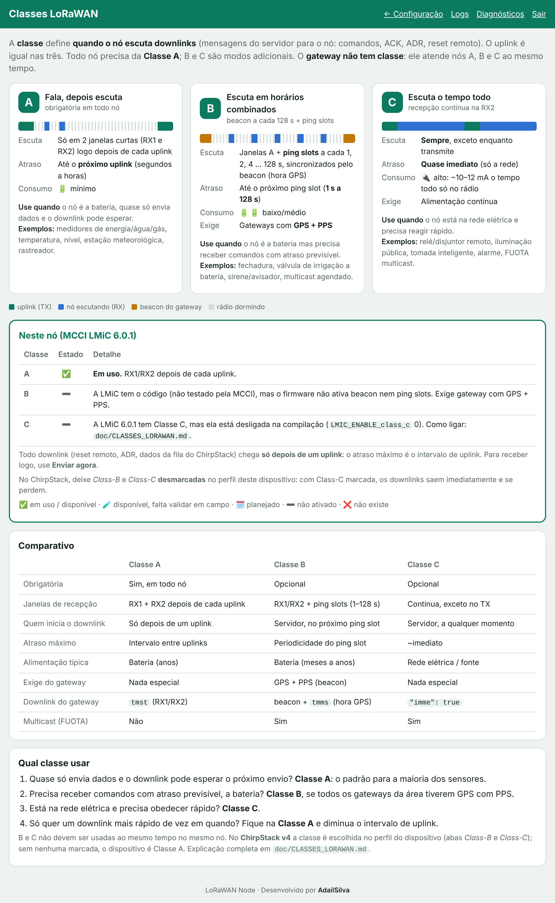
</p>

### Tema escuro e celular

<p align="center">
  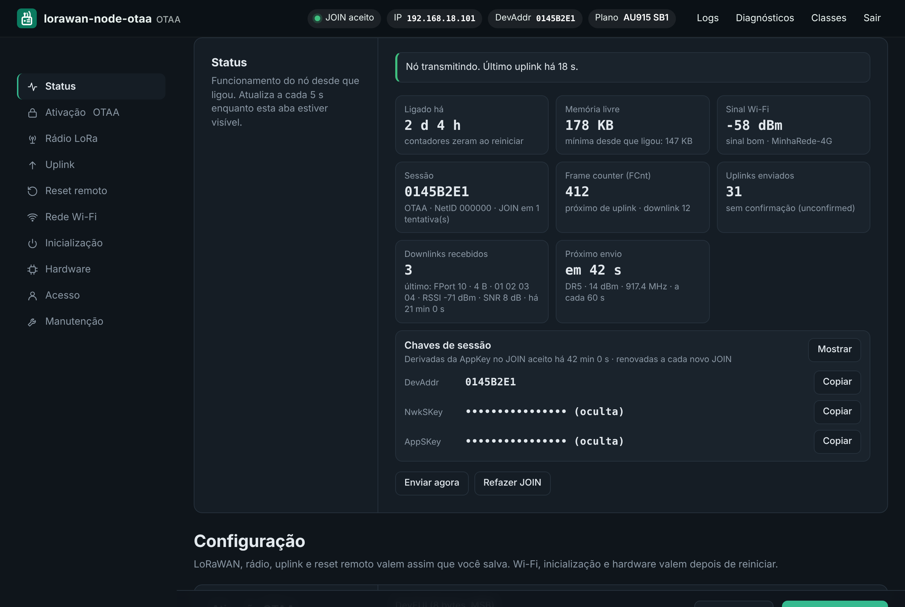
</p>

<p align="center">
  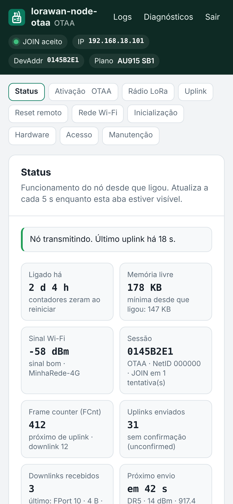
  &nbsp;&nbsp;
  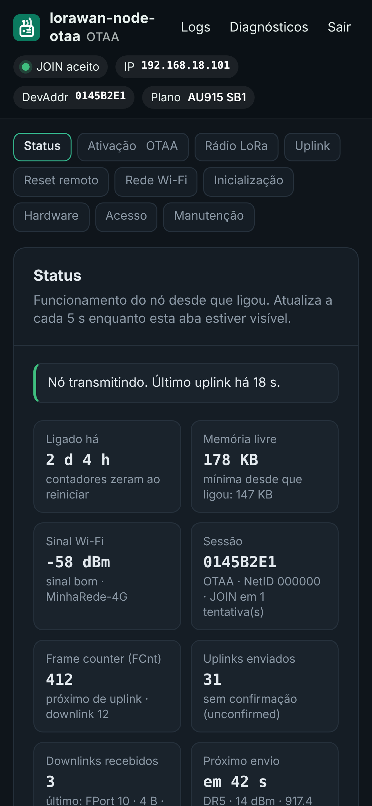
</p>

No celular, o bloco **Chaves de sessão** fica no fim do Status, com cada chave em uma linha inteira:

<p align="center">
  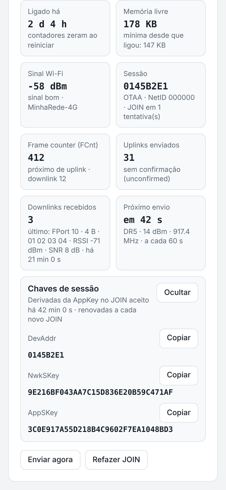
  &nbsp;&nbsp;
  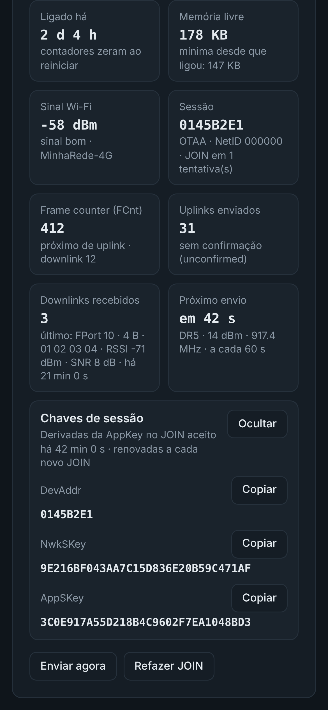
</p>

### Endereços HTTP

| Método | Caminho | Função |
|---|---|---|
| GET | `/` | Página principal (preenchida por JavaScript) |
| GET | `/config.json` | Configuração salva (sem senhas) |
| GET | `/status` | Status do nó e da sessão LoRaWAN (JSON) |
| POST | `/save` | Salva o formulário (`application/x-www-form-urlencoded`) |
| POST | `/action` | `a=send` · `a=restart` → JSON |
| POST | `/reboot` · `/factory` | Reinicia · restaura padrão de fábrica |
| GET | `/logs` · `/logs_data?from=<n>` · `/logs_download` | Página de logs · trecho novo · arquivo `.log` |
| GET | `/diag` · `/diag_run?t=ping\|trace\|dns&h=<host>` | Página de diagnósticos · resultado em texto, linha a linha (`400` se o teste ou o destino for inválido) |
| GET | `/classes` | Página *Classes LoRaWAN* (explicação das Classes A, B e C e o suporte neste nó) |
| GET | `/logout` · `/saiu` | Logout · tela “Você saiu” (sem login) |
| GET | `/favicon.svg` | Ícone (sem login) |
| GET | `/info` | Identificação para o app Android (sem login): tipo, modo, firmware, nome, host, MAC. Nada secreto |

Todos pedem **HTTP Basic**, exceto os marcados “sem login”. Exemplo de leitura do status pela linha de comando:

```bash
curl -s -u admin:SUA_SENHA http://lorawan-node-otaa.local/status | jq .lw
```

O objeto `lw.skeys` traz as chaves de sessão em uso: `{"src":"join","valid":true,"nwk":"…32 hex…","app":"…32 hex…","age":842}` — `age` em segundos desde o JOIN; `valid:false` e chaves vazias enquanto não houver sessão.

---

## 📱 App Android

A pasta [`app_flutter/`](app_flutter/) tem o app **LoRaWAN Node OTAA** (Flutter), com as mesmas funções desta página: login, Status e ações, Configuração, Logs e Manutenção. Ele usa os **mesmos endereços HTTP** e o mesmo login (HTTP Basic), sem nuvem. Por isso não aumenta o uso de RAM do nó.

- **Busca:** mDNS `_http._tcp`, que o nó já anunciava, agora com TXT `type=node`, `mode=otaa` e `info=/info`. Também varre a sub-rede com `GET /info`.
- **Soft AP:** o app conecta na rede do nó (padrão `lorawan-node-otaa`, senha `lorawan101`) e fala com `192.168.101.101`, prendendo o tráfego no Wi-Fi mesmo sem internet.
- **Compilar:** veja [`app_flutter/README.md`](app_flutter/README.md) (`./setup.sh` e depois `flutter build apk`).

### 📲 Telas e uso do app

> As telas abaixo foram reproduzidas a partir do código do app (`app_flutter/lib/`: mesmos textos, cores do tema, componentes e ordem das seções), com **dados de exemplo**, em um celular de 412 × 892 dp. Os números não são de um equipamento em campo.

**Passo a passo rápido**

1. Instale o APK no celular (como gerar o `app-release.apk`: [`app_flutter/README.md`](app_flutter/README.md)).
2. Ligue o celular na **mesma rede Wi-Fi** do nó. Se o nó estiver em **Soft AP** (primeiro uso, Wi-Fi sem conexão ou BOOT segurado 3 s), use o botão **Soft AP**.
3. Toque em **Procurar**, escolha o nó e entre com **`admin` / `lorawan101`** (ou o login que você definiu).
4. Em **Configuração**, preencha a **Ativação OTAA** com os valores do ChirpStack e toque em **Salvar**: LoRaWAN, rádio, uplink e reset remoto valem na hora.

#### 1. Lista de nós, busca e Soft AP

<p align="center">
  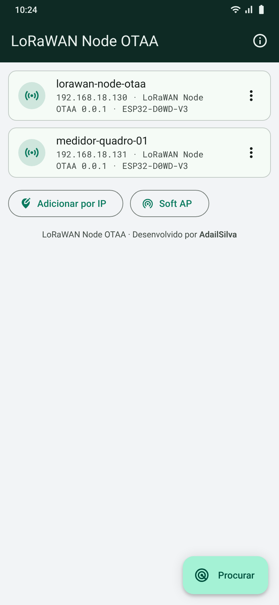
  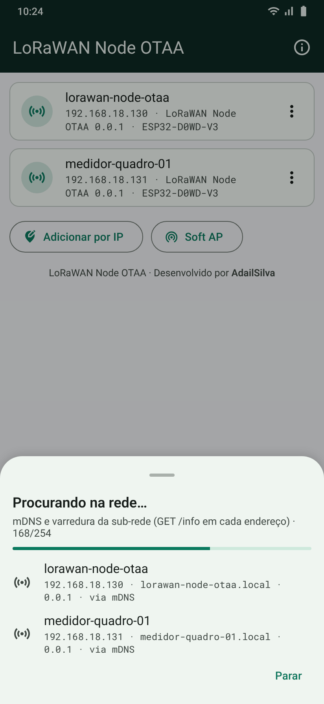
  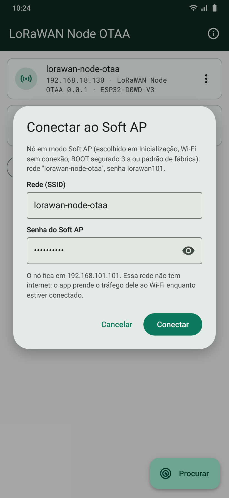
</p>

- A tela inicial mostra os nós salvos, com **IP · firmware · chip**. Toque em um para entrar. O menu **⋮** tem **Renomear**, **Esquecer senha** e **Remover da lista**.
- **Procurar** acha os nós pelo **mDNS** (`<nome>.local`, TXT `type=node`, `mode=otaa`) e pela varredura da sub-rede (`GET /info`). Só aparecem nós OTAA.
- **Adicionar por IP** aceita IP ou `nome.local` (o IP aparece no monitor serial). Se o endereço for de outro tipo de equipamento, o app avisa e pergunta antes de adicionar.
- **Soft AP:** o app conecta na rede **`lorawan-node-otaa`** (senha **`lorawan101`**) e fala com **`192.168.101.101`**, prendendo o tráfego ao Wi-Fi mesmo sem internet. Com o Wi-Fi do nó desligado, segure o botão BOOT por 3 s para abrir o Soft AP.

#### 2. Login e Status

<p align="center">
  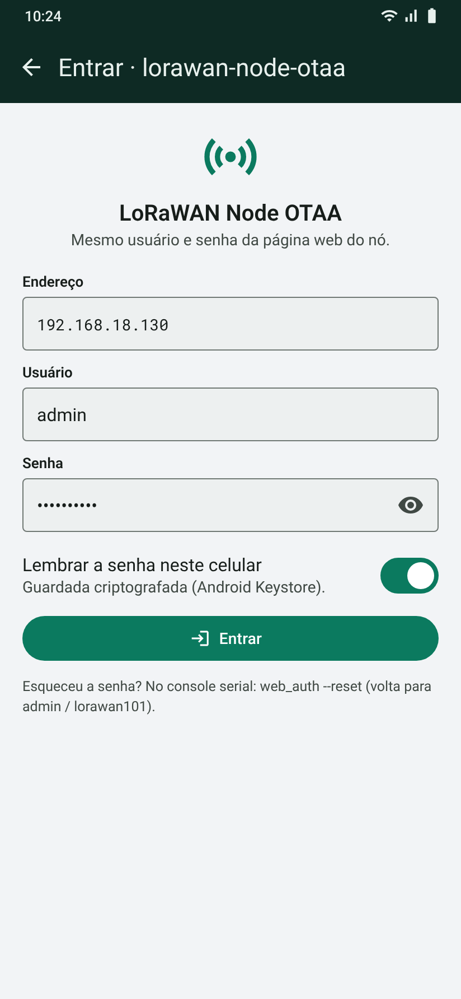
  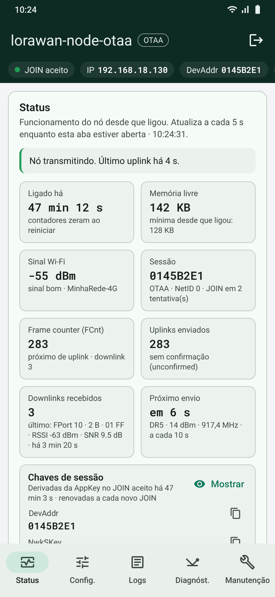
  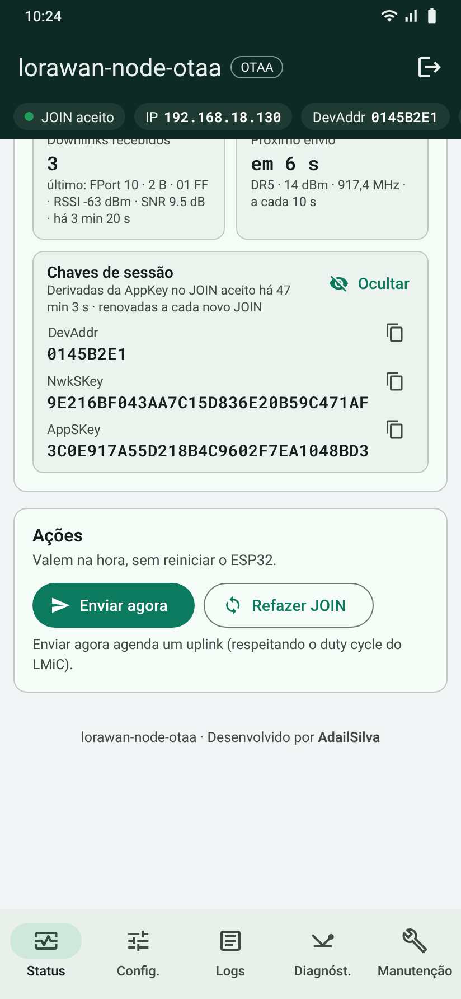
</p>

- **Login:** mesmo usuário e senha da página web. **Lembrar a senha** guarda a senha criptografada no Android Keystore. Esqueceu? No monitor serial, `web_auth --reset`.
- A barra do topo mostra o modo **OTAA**, o estado da sessão (**JOIN aceito** / **Aguardando JOIN**), o **IP**, o **DevAddr** e o **plano** (ex.: AU915 SB1).
- **Status** atualiza a cada 5 s: tempo ligado, memória, Wi-Fi, sessão, **frame counter**, uplinks, último downlink (FPort, bytes, RSSI e SNR) e o próximo envio.
- **Chaves de sessão:** DevAddr, NwkSKey e AppSKey em uso, nesta ordem (o DevAddr vem no JoinAccept; as chaves são derivadas da AppKey a cada JOIN aceito). As chaves ficam ocultas (o DevAddr sempre visível); **Mostrar** revela e o ícone de cópia copia mesmo ocultas.
- **Ações** (valem na hora): **Enviar agora** agenda um uplink; **Refazer JOIN** descarta a sessão e faz um JOIN novo.

#### 3. Configuração

<p align="center">
  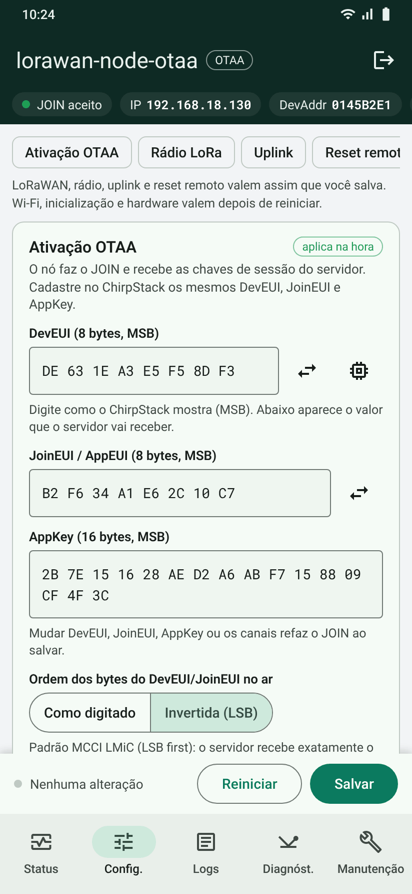
  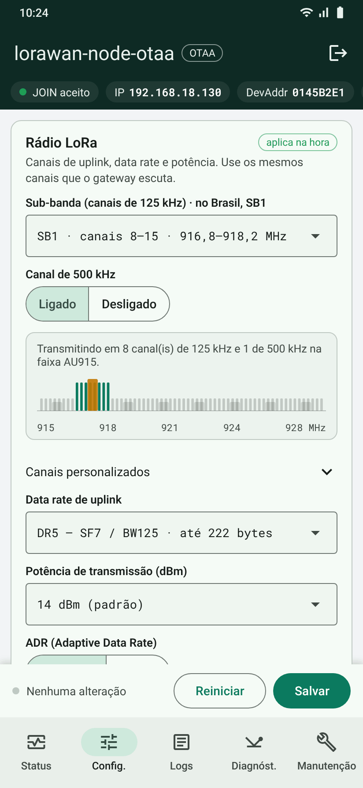
  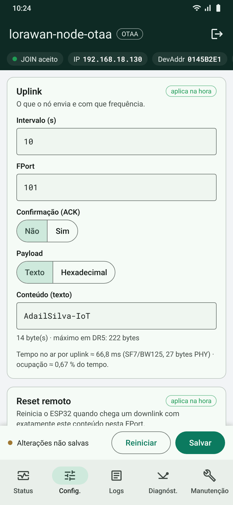
</p>

- Os botões do topo levam direto às seções: **Ativação OTAA**, **Rádio LoRa**, **Uplink**, **Reset remoto**, **Rede Wi-Fi**, **Inicialização**, **Hardware** e **Acesso**. A etiqueta de cada seção diz se ela **aplica na hora** ou **vale após reiniciar**.
- **Ativação OTAA:** DevEUI, JoinEUI e AppKey em MSB, como o ChirpStack mostra. Ao lado do DevEUI, ⇄ inverte a ordem dos bytes e o ícone de chip gera um DevEUI a partir do MAC do ESP32. **Ordem dos bytes no ar** escolhe entre *Como digitado* e *Invertida (LSB)*; a linha de baixo mostra o DevEUI e o JoinEUI que o ChirpStack vai receber. Mudar chaves ou canais refaz o JOIN ao salvar.
- **Rádio LoRa:** sub-banda (no Brasil, **SB1**), canal de 500 kHz, lista de canais personalizada, data rate, potência, ADR, link check e janela RX2. O desenho mostra os canais em uso; use os mesmos que o gateway escuta.
- **Uplink:** intervalo, FPort, confirmação e payload em texto ou hexadecimal. O app conta os bytes, avisa se passou do máximo do data rate e calcula o **tempo no ar** e a ocupação do canal.
- **Reset remoto:** FPort, comando (1 a 16 bytes) e espera. A dica já traz o **hex** e o **base64** para enfileirar no ChirpStack.
- **Rede Wi-Fi**, **Inicialização** (Station, Soft AP ou Wi-Fi desligado), **Hardware** (pinos do RFM95W, clock SPI, serial, diagnóstico de sessão) e **Acesso** valem depois de reiniciar, exceto o login.
- A barra de baixo avisa **Alterações não salvas**. **Salvar** grava no nó; **Reiniciar** aplica Wi-Fi, inicialização e hardware.

#### 4. Logs, Diagnósticos e Manutenção

<p align="center">
  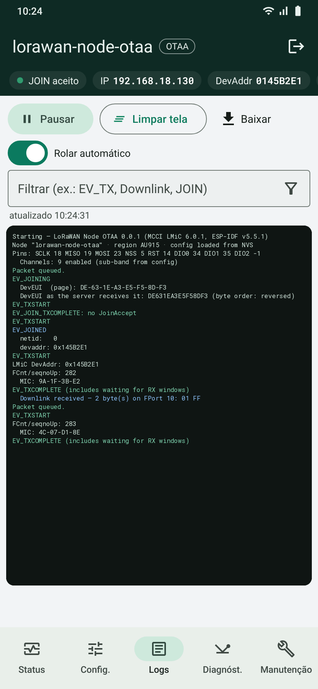
  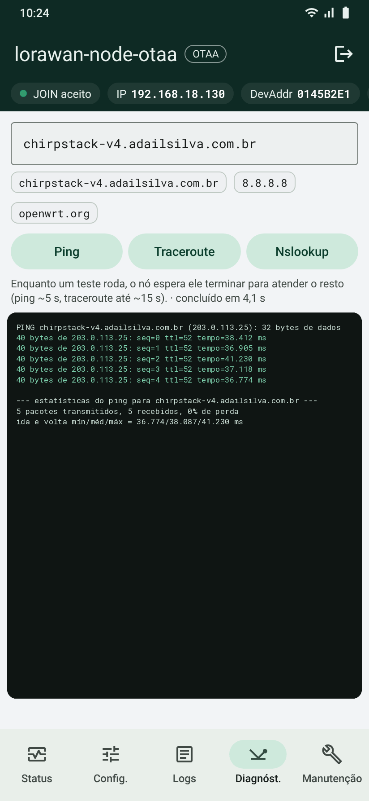
  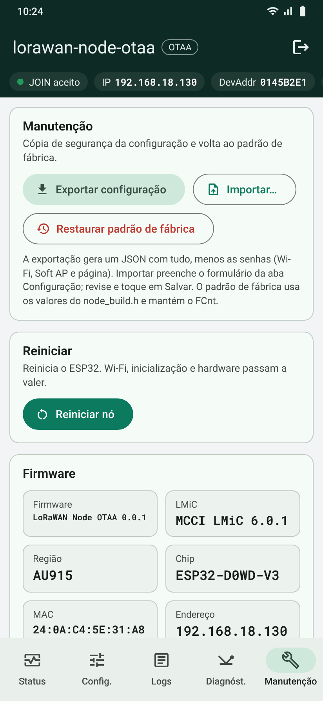
</p>

- **Logs:** tudo o que o nó imprime no monitor serial, ao vivo, com **Pausar**, **Limpar tela**, **Rolar automático**, **filtro** (ex.: `EV_TX`, `Downlink`, `JOIN`) e **Baixar** (do nó, os últimos 16 KB em RAM, ou a sessão do app). Eventos do LMiC em verde, downlinks em azul, avisos em amarelo e erros em vermelho.
- **Diagnósticos:** **Ping**, **Traceroute** e **Nslookup** feitos **pelo próprio nó** (os mesmos da página `/diag`), para testar a rede dele até o ChirpStack ou a internet. O campo já vem com **`chirpstack-v4.adailsilva.com.br`** e os atalhos abaixo dele trazem esse domínio, `8.8.8.8` e `openwrt.org`. O resultado chega linha a linha; **Parar** interrompe.
- **Manutenção:** **Exportar configuração** (JSON sem senhas), **Importar…** (preenche a aba Configuração; revise e salve. Um arquivo do gateway é recusado; um de nó ABP pede confirmação), **Restaurar padrão de fábrica** (volta aos valores do `node_build.h`), **Reiniciar nó** e o cartão **Firmware** (versão, LMiC, região, chip, MAC e endereço).
- **Classes LoRaWAN:** o ícone 🎓 na barra superior (lista de nós e tela do nó) explica as Classes A, B e C, quando usar cada uma e o que este nó suporta, igual à página `/classes`.

## 🧰 Parâmetros e valores de fábrica

Valores de fábrica do [`main/node_build.h`](main/node_build.h). **Na hora** = sem reiniciar o ESP32.

| Seção | Parâmetro | Fábrica | Vale |
|---|---|---|---|
| Ativação | DevEUI | `DE631EA3E5F58DF3` | na hora (novo JOIN) |
| Ativação | JoinEUI / AppEUI | `B2F634A1E62C10C7` | na hora (novo JOIN) |
| Ativação | AppKey | do `node_build.h` | na hora (novo JOIN) |
| Ativação | Ordem dos bytes no ar | como digitado | na hora (novo JOIN) |
| Rádio | Sub-banda / canal 500 kHz | SB1 (8–15) / ligado (65) | na hora (novo JOIN) |
| Rádio | Canais personalizados | vazio | na hora |
| Rádio | Data rate / potência | DR5 (SF7/BW125) / 14 dBm | na hora |
| Rádio | ADR / link check | desligado / desligado | na hora |
| Rádio | RX2 data rate / frequência | DR8 / 923,3 MHz | na hora |
| Rádio | Erro de relógio | 1 % | na hora |
| Uplink | Intervalo | 10 s | na hora |
| Uplink | FPort / confirmado | 101 / não | na hora |
| Uplink | Payload | `AdailSilva-IoT` (texto) | na hora |
| Reset remoto | Ativado / FPort | sim / 101 | na hora |
| Reset remoto | Comando / espera | `AD A1 DE AD BE EF 0D 0A` / 2000 ms | na hora |
| Wi-Fi | Nome do nó | `lorawan-node-otaa` | reinício |
| Wi-Fi | SSID / senha / IP | vazio / vazio / DHCP | reinício |
| Inicialização | Modo | Station (com Soft AP de emergência) | reinício |
| Inicialização | Soft AP: nome / senha / canal | nome do nó / `lorawan101` / 6 | reinício |
| Inicialização | Espera pelo Wi-Fi / botão | 30 s / GPIO 0 | reinício |
| Hardware | SCLK, MISO, MOSI, NSS | 18, 19, 23, 5 | reinício |
| Hardware | RESET, DIO0, DIO1, DIO2 | 14, 34, 35, -1 | reinício |
| Hardware | Clock SPI / serial | 0 (padrão LMiC) / 115200 | reinício |
| Hardware | Diagnóstico de sessão | ligado | na hora |
| Acesso | Usuário / senha | `admin` / `lorawan101` | na hora |

A configuração fica na NVS em `nodecfg/cfg` (um blob versionado: firmwares futuros podem acrescentar campos sem perder os antigos).

---

## 💻 Console serial

No monitor (`sh scripts/build.sh esp32 monitor /dev/ttyUSB0` ou `idf.py monitor`), digite o comando e Enter.

| Comando | Faz |
|---|---|
| `help` | Lista os comandos |
| `status` | Estado do JOIN, DevAddr, FCnt, uplinks, downlinks, heap e endereço da página |
| `keys` | Chaves de sessão do último JOIN (DevAddr, NwkSKey, AppSKey) e há quanto tempo foram derivadas |
| `wifi_ap` | Abre o Soft AP de configuração agora |
| `web_auth --reset` | Login da página volta para `admin` / `lorawan101` (vale na hora) |
| `send` | Envia um uplink agora |
| `rejoin` | Refaz o JOIN |
| `cfg_reset` | Apaga a configuração e reinicia com o padrão de fábrica |
| `reboot` | Reinicia o ESP32 |

> 🔐 As chaves de sessão (DevAddr, NwkSKey, AppSKey) aparecem **completas e sempre atualizadas em todos os logs**: console serial, página Logs e `.log` baixado (no boot, a cada JOIN/reativação, no `keys` e no *Diagnóstico de sessão*). Só a senha do Soft AP continua aparecendo completa apenas no console serial; na página Logs e no `.log` ela aparece como *“oculta no log da web”*. Cuidado ao compartilhar o `.log`: ele contém as chaves.

---

## 📡 Plano de canais AU915

<p align="center">
  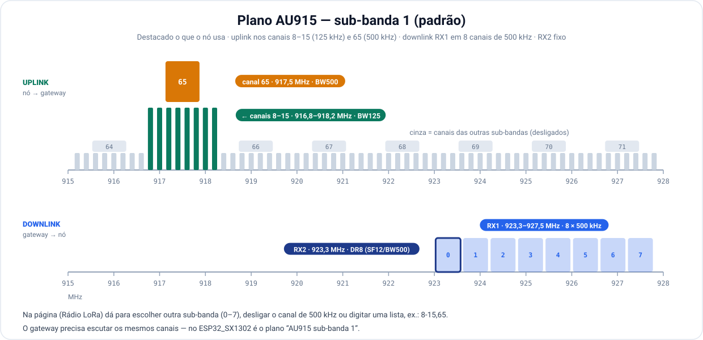
</p>

O AU915 tem 64 canais de 125 kHz (8 sub-bandas de 8) e 8 de 500 kHz. Este firmware usa por padrão a **sub-banda 1** (canais 8–15 + 65), a mesma do ChirpStack com `region_config = au915_1` e do plano “AU915 sub-banda 1” do gateway.

| Canal | Frequência (MHz) | BW (kHz) | DR | Uso |
|---|---|---|---|---|
| 8–15 | 916,8 a 918,2 (passo 0,2) | 125 | DR0–DR5 | Uplink |
| 65 | 917,5 | 500 | DR6 | Uplink / JOIN / ADR |
| RX1 0–7 | 923,3 a 927,5 (passo 0,6) | 500 | DR8–DR13 | Downlink |
| **RX2** | **923,3** | **500** | **DR8 (SF12)** | **Downlink fixo** |

> ⚠️ **Gateway e nó precisam usar a mesma sub-banda.** Se o gateway escuta a SB0 (0–7 + 64) e o nó transmite na SB1, os frames não chegam ao ChirpStack.

---

## 🤝 JOIN OTAA

<p align="center">
  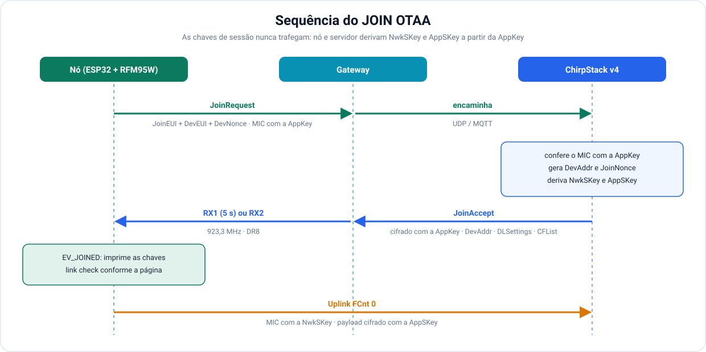
</p>

No JOIN, nó e servidor derivam as chaves de sessão (**NwkSKey** e **AppSKey**) a partir da **AppKey**; elas nunca trafegam pela rede. O servidor atribui o **DevAddr** no JoinAccept, junto com a configuração de canais e da RX2.

| Evento no Serial | Significado | Painel |
|---|---|---|
| `EV_JOINING` | Início do JOIN; imprime DevEUI/JoinEUI e o DevEUI como o servidor vai receber | “Iniciando o JOIN…” |
| `EV_JOIN_TXCOMPLETE: no JoinAccept` | JoinRequest enviado sem resposta; o LMiC tenta de novo com backoff | “Aguardando o JOIN (tentativa n)” |
| `EV_JOINED` | Sessão estabelecida; imprime NetID, DevAddr e chaves de sessão | “JOIN aceito” |
| `EV_JOIN_FAILED` | Falha definitiva | aviso |

- O JoinRequest pode sair em qualquer canal habilitado, inclusive o **65** (500 kHz). Mantenha os canais iguais aos do gateway.
- Depois do JOIN, o FCnt começa em 0 e é controlado pelo LMiC; não precisa de NVS. Cada reinício faz um JOIN novo.
- O link check é reaplicado em `EV_JOINED` (o JOIN o liga de novo automaticamente) conforme a opção da página.

---

## 🔁 Ordem dos bytes do DevEUI/JoinEUI

<p align="center">
  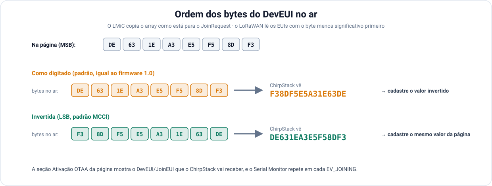
</p>

O LMiC copia os bytes de `os_getDevEui()`/`os_getArtEui()` **exatamente como estão** para o JoinRequest, e o LoRaWAN transporta EUIs com o **byte menos significativo primeiro**. Por isso a documentação da MCCI pede esses dois valores em LSB.

Na opção padrão, **“Como digitado”**, o firmware entrega os arrays em **MSB**, na ordem em que foram digitados. Resultado: o ChirpStack recebe o DevEUI **invertido** (`DE631EA3E5F58DF3` chega como `F38DF5E5A31E63DE`). Esse é o comportamento original do firmware e continua como padrão para não quebrar nós já cadastrados assim. Para o ChirpStack receber exatamente o valor da página, escolha **“Invertida (LSB)”**.

| Opção na página | Bytes entregues ao LMiC | O ChirpStack recebe | Cadastre no ChirpStack |
|---|---|---|---|
| **Como digitado** (padrão) | `DE 63 1E A3 E5 F5 8D F3` | `F38DF5E5A31E63DE` | o valor **invertido** |
| **Invertida (LSB)** | `F3 8D F5 E5 A3 1E 63 DE` | `DE631EA3E5F58DF3` | o **mesmo** valor da página |

A seção **Ativação OTAA** mostra os valores que o ChirpStack vai receber, e o monitor serial repete em cada `EV_JOINING`. A **AppKey** não é afetada: vai sempre em MSB.

---

## 🔄 Reset remoto por downlink

<p align="center">
  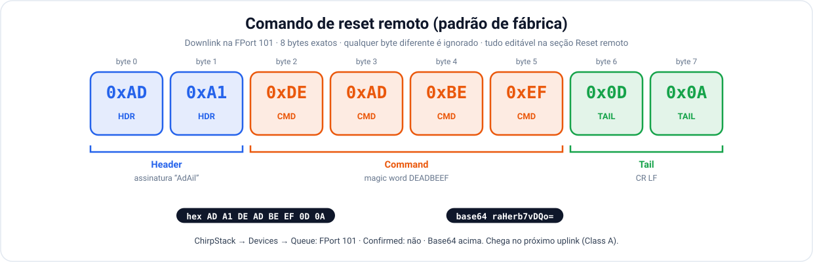
</p>

Reinicia o ESP32 em campo, sem acesso físico, com um downlink numa FPort dedicada. O comando é comparado **byte a byte** e com **tamanho exato**, para que nenhum downlink comum reinicie o nó por acidente. Tudo é configurável na seção **Reset remoto** (liga/desliga, FPort, 1–16 bytes, espera).

| Campo | Fábrica |
|---|---|
| FPort | `101` (0x65) |
| Payload | `AD A1 DE AD BE EF 0D 0A` (8 bytes) |
| Base64 | `raHerb7vDQo=` |
| Espera antes de reiniciar | 2000 ms |

| Segmento | Bytes | Valor | Significado |
|---|---|---|---|
| Header | 0–1 | `0xAD 0xA1` | Assinatura “**Ad**ail Silv**a1**” |
| Command | 2–5 | `0xDE 0xAD 0xBE 0xEF` | Palavra mágica de reset |
| Tail | 6–7 | `0x0D 0x0A` | Fim de quadro (CR LF) |

Regras: FPort diferente → o downlink é só exibido; tamanho ou qualquer byte diferente → ignorado, e o Serial mostra o esperado e o recebido; comando certo → reinicia depois da espera.

### Enviar pelo ChirpStack

**Interface web:** *Devices → seu device → Queue → Add item* · FPort `101` · Confirmed: não · Base64 `raHerb7vDQo=`. O downlink fica na fila até o próximo uplink (Class A).

**MQTT (ChirpStack v4, TLS):**

```bash
export MQTT_HOST="chirpstack.seu-dominio.com.br"
export MQTT_USER="seu-usuario"
export MQTT_PASS="sua-senha"          # nunca deixe a senha real no repositório
APP_ID="<id-da-application>"
DEV_EUI="<deveui-como-o-chirpstack-mostra>"

mosquitto_pub -h "$MQTT_HOST" -p 8883 --cafile ca.crt \
  -u "$MQTT_USER" -P "$MQTT_PASS" \
  -t "application/$APP_ID/device/$DEV_EUI/command/down" \
  -m '{"devEui":"'"$DEV_EUI"'","confirmed":false,"fPort":101,"data":"raHerb7vDQo="}'
```

Para gerar o base64 de outro comando: `printf '\xAD\xA1\xDE\xAD\xBE\xEF\x0D\x0A' | base64` (ou copie da dica na própria página).

### No monitor serial

```
EV_TXCOMPLETE (includes waiting for RX windows)
  Downlink received — 8 byte(s) on FPort 101: AD A1 DE AD BE EF 0D 0A
  [RESET PORT] Command received on FPort 101 — validating...
  [RESET] Valid reset command — rebooting in 2000 ms...
```

Payload errado:

```
  Downlink received — 8 byte(s) on FPort 101: AD A1 DE AD BE EF 0D FF
  [RESET PORT] Command received on FPort 101 — validating...
  [RESET] Invalid payload — command ignored.
  Expected: AD A1 DE AD BE EF 0D 0A
  Received: AD A1 DE AD BE EF 0D FF
```

---

## 🔍 Diagnóstico de sessão e MIC

Com **Hardware → Diagnóstico de sessão** ligado (padrão), cada `EV_TXSTART` imprime as chaves que o LMiC está usando, o DevAddr, o **frame completo** em hex, os FCnt e o **MIC** (últimos 4 bytes). Compare o MIC com o campo `mic` do frame no ChirpStack/gateway (no JSON ele vem em decimal):

```bash
printf '%02X-%02X-%02X-%02X\n' 20 46 220 190     # → 14-2E-DC-BE
```

MIC igual nos dois lados = chaves certas. MIC diferente = chave divergente.

<details>
<summary><b>Calcular o MIC à mão (Python e Java)</b></summary>

```
MIC = AES-128-CMAC(NwkSKey, B0 | msg)[0:4]
B0  = 0x49 | 0x00×4 | Dir=0 | DevAddr(LE,4) | FCnt(LE,4) | 0x00 | len(msg)
msg = MHDR | DevAddr(LE,4) | FCtrl | FCnt(LE,2) | FPort | FRMPayload
```

**Python** (`pip install pycryptodome`):

```python
from Crypto.Hash import CMAC
from Crypto.Cipher import AES
import struct

def calcular_mic(nwkskey_hex, devaddr_hex, fcnt, frame_sem_mic_hex):
    nwkskey    = bytes.fromhex(nwkskey_hex)
    devaddr_le = bytes.fromhex(devaddr_hex)[::-1]   # big-endian → little-endian
    msg        = bytes.fromhex(frame_sem_mic_hex)
    b0 = (bytes([0x49, 0, 0, 0, 0, 0]) + devaddr_le +
          struct.pack('<I', fcnt) + bytes([0x00, len(msg)]))
    c = CMAC.new(nwkskey, ciphermod=AES)
    c.update(b0 + msg)
    return c.digest()[:4].hex()

print(calcular_mic("151f7779d7aaee422a74568380db7045", "00aa88ca", 0,
                   "40CA88AA0000000001F56CB7FFFA9C7C0D6C6C72368ECD"))   # → 142edcbe
```

**Java 17+** (só `javax.crypto`):

```java
import javax.crypto.Cipher;
import javax.crypto.spec.IvParameterSpec;
import javax.crypto.spec.SecretKeySpec;
import java.nio.ByteBuffer;
import java.nio.ByteOrder;
import java.util.HexFormat;

public class LoRaWANMic {
    public static String calcularMic(String nwksKeyHex, String devAddrHex, int fcnt, String frameHex) throws Exception {
        HexFormat hex = HexFormat.of();
        byte[] key = hex.parseHex(nwksKeyHex), da = hex.parseHex(devAddrHex), msg = hex.parseHex(frameHex);
        byte[] fc = ByteBuffer.allocate(4).order(ByteOrder.LITTLE_ENDIAN).putInt(fcnt).array();
        byte[] b0 = {0x49, 0, 0, 0, 0, 0, da[3], da[2], da[1], da[0], fc[0], fc[1], fc[2], fc[3], 0, (byte) msg.length};
        byte[] data = new byte[16 + msg.length];
        System.arraycopy(b0, 0, data, 0, 16);
        System.arraycopy(msg, 0, data, 16, msg.length);
        return hex.formatHex(aesCmac(key, data), 0, 4);
    }

    static byte[] aesCmac(byte[] key, byte[] data) throws Exception {      // RFC 4493
        byte[] k1 = sub(aes(key, new byte[16])), k2 = sub(k1);
        int n = Math.max(1, (data.length + 15) / 16);
        boolean full = data.length > 0 && data.length % 16 == 0;
        byte[] last = new byte[16];
        int off = (n - 1) * 16, sz = data.length - off;
        System.arraycopy(data, off, last, 0, sz);
        if (full) xor(last, k1); else { last[sz] = (byte) 0x80; xor(last, k2); }
        byte[] x = new byte[16];
        for (int i = 0; i < n - 1; i++) {
            byte[] b = new byte[16];
            System.arraycopy(data, i * 16, b, 0, 16);
            xor(b, x);
            x = aes(key, b);
        }
        xor(last, x);
        return aes(key, last);
    }

    static byte[] aes(byte[] key, byte[] block) throws Exception {
        Cipher c = Cipher.getInstance("AES/CBC/NoPadding");
        c.init(Cipher.ENCRYPT_MODE, new SecretKeySpec(key, "AES"), new IvParameterSpec(new byte[16]));
        return c.doFinal(block);
    }

    static byte[] sub(byte[] in) {
        byte[] o = new byte[16];
        for (int i = 0; i < 15; i++) o[i] = (byte) ((in[i] << 1) | ((in[i + 1] & 0xFF) >> 7));
        o[15] = (byte) (in[15] << 1);
        if ((in[0] & 0x80) != 0) o[15] ^= (byte) 0x87;
        return o;
    }

    static void xor(byte[] a, byte[] b) { for (int i = 0; i < 16; i++) a[i] ^= b[i]; }

    public static void main(String[] args) throws Exception {
        System.out.println(calcularMic("151f7779d7aaee422a74568380db7045", "00aa88ca", 0,
                "40CA88AA0000000001F56CB7FFFA9C7C0D6C6C72368ECD"));   // → 142edcbe
    }
}
```

</details>

---

## 🧾 Saída no monitor serial

115200 bps (padrão, `idf.py monitor`). Exemplo de boot e uplink:

```
Starting — LoRaWAN Node OTAA 0.0.1 (MCCI LMiC 6.0.1, ESP-IDF v5.5.1)
Node "lorawan-node-otaa" · region AU915 · config loaded from NVS
[WEB] Página: http://lorawan-node-otaa.local/ (ou o IP que aparecer abaixo). Sem Wi-Fi em 30 s abre o Soft AP "lorawan-node-otaa".
[WEB] Segure o GPIO 0 em nível baixo por 3 s para abrir o Soft AP a qualquer momento.
Pins: SCLK 18 MISO 19 MOSI 23 NSS 5 RST 14 DIO0 34 DIO1 35 DIO2 -1
  Channels: 9 enabled (sub-band from config)
EV_JOINING
  DevEUI  (page): DE-63-1E-A3-E5-F5-8D-F3
  JoinEUI (page): B2-F6-34-A1-E6-2C-10-C7
  DevEUI as the server receives it: F38DF5E5A31E63DE  (byte order: as typed)

EV_TXSTART (Join-request)
LMiC JoinEUI: C7102CE6A134F6B2
LMiC DevEUI : F38DF5E5A31E63DE
LMiC DevNonce: 1

Frame raw: 00 B2 F6 34 A1 E6 2C 10 C7 DE 63 ... 9C 41 07 E5
  MIC: 9C-41-07-E5
EV_JOIN_TXCOMPLETE: no JoinAccept
[TX] JoinRequest · DR2 · 917,8 MHz · 20 dBm · canal 13

EV_TXSTART (Join-request)
...
EV_JOINED
[TX] JoinRequest · DR2 · 916,8 MHz · 20 dBm · canal 8
[RX] JoinAccept · RX1 · DR10 · 923,3 MHz · RSSI -58 dBm · SNR 10 dB

Frame raw (RX, Join-accept cifrado): 20 4D 9A ... 6B
  DevAddr : 0x0145B2E1
  NwkSKey : 9E-21-6B-F0-43-AA-7C-15-D8-36-E2-0B-59-C4-71-AF
  AppSKey : 3C-0E-91-7A-55-D2-18-B4-C9-60-2F-7E-A1-04-8B-D3
  NetID   : 0

EV_TXSTART
LMiC DevAddr: 0x0145B2E1
LMiC NwkSKey: 9E216BF043AA7C15D836E20B59C471AF
LMiC AppSKey: 3C0E917A55D218B4C9602F7EA1048BD3

Frame raw: 40 E1 B2 45 01 00 00 00 65 ... 9A 1F 3B E2
FCnt/up: 0
FCnt/down: - (nenhum downlink nesta sessão)
  MIC: 9A-1F-3B-E2
Packet queued.
EV_TXCOMPLETE (includes waiting for RX windows)
[TX] FCnt 0 · não confirmado · DR5 · 917,4 MHz · 14 dBm · canal 11 · porta 101 · 14 bytes
[RX] RX2 · DR8 · 923,3 MHz · porta 0 · 0 bytes · RSSI -63 dBm · SNR 8 dB · FCntDown 0
RX::-63:8

Frame raw (RX): 60 E1 B2 45 01 83 00 00 03 51 07 01 61 ... 4C
FCnt/down (quadro): 0
  MIC: ...
```

As mesmas linhas aparecem na página **Logs**.

### Formato do log — igual nos três nós (`[TX]` / `[RX]`)

Os nós ESP32 (ABP e OTAA, LMiC) e o nó Radioenge (LoRaMac-node) imprimem **as mesmas linhas, na mesma ordem**. Só o prefixo das chaves muda (`LMiC` ou `LoRaMac`), para dizer qual pilha gerou o quadro. O bloco de diagnóstico (chaves, *Frame raw*, FCnt e MIC) sai com o **Diagnóstico de sessão** ligado (`verbose 1`); sem ele, ficam só o cabeçalho e as linhas `[TX]`/`[RX]`.

**Uplink**

```
EV_TXSTART
LMiC DevAddr: 0x00B4EE08                  ┐
LMiC NwkSKey: 1CBA2DF8550A20705E019FE28759C753
LMiC AppSKey: 91BC8CAEB18DE97BAABD485787FAC3B4
                                          │ diagnóstico de sessão
Frame raw: 40 08 EE B4 00 00 CA 00 65 BF 7D … 08 7E A3 A7
FCnt/up: 202                              │ FCnt deste quadro
FCnt/down: 2                              │ último downlink recebido
  MIC: 08-7E-A3-A7                        ┘
Packet queued.
EV_TXCOMPLETE (includes waiting for RX windows)
[TX] FCnt 202 · não confirmado · DR5 · 917,0 MHz · 14 dBm · canal 9 · porta 101 · 14 bytes
```

**Downlink** (logo depois do `[TX]` do uplink que abriu a janela; na Classe C do Radioenge, a qualquer momento)

```
[RX] RX1 · DR13 · 924,5 MHz · porta 1 · 1 bytes FF · RSSI -34 dBm · SNR 6 dB · FCntDown 3
RX:ff:-34:6

Frame raw (RX): 60 08 EE B4 00 80 03 00 01 B0 2D A7 C1 6C      ┐ diagnóstico
FCnt/down (quadro): 3                                          │ de sessão
  MIC: 2D-A7-C1-6C                                             ┘
```

- **`[TX]`**: FCnt do quadro, confirmado ou não, DR, **frequência do uplink**, potência aplicada no rádio, canal, porta e tamanho. Pode terminar com `sem payload (só comandos MAC)` ou `retransmissão N`. Nos confirmados, termina com `ACK` ou `sem ACK`.
- **`[RX]`**: janela (**RX1**, **RX2**; no Radioenge também `Classe C (RXC)` e as de Classe B), o **DR** e a **frequência em que o downlink chegou** (lidos do rádio no instante da recepção), porta, bytes (já decifrados), RSSI, SNR e FCntDown. `RX:<hex>:<RSSI>:<SNR>` é a linha do formato do firmware AT original.
- **`Frame raw (RX)`**: o quadro como veio do ar (cifrado, com MHDR e MIC).
- **JOIN (OTAA)**: `EV_TXSTART (Join-request)` com JoinEUI, DevEUI, DevNonce, *Frame raw* e MIC; depois `[TX] JoinRequest · DR2 · 916,8 MHz · 20 dBm · canal 8` e, se for aceito, `[RX] JoinAccept · RX1 · DR10 · 923,3 MHz · RSSI … · SNR …` e `Frame raw (RX, Join-accept cifrado): …`. Em seguida vem o bloco da sessão nova, igual nos três nós: `  DevAddr : 0x01034B99`, `  NwkSKey : 40-D8-48-…`, `  AppSKey : 5F-9D-E0-…` e `  NetID   : 0`. No Radioenge, depois desse bloco, ainda vem a linha `[JOIN] Conectado! …`. Ela é usada para colorir o log na página e no app. Uma tentativa sem resposta mostra `EV_JOIN_TXCOMPLETE: no JoinAccept` e o `[TX] JoinRequest`.

No AU915, o RX1 usa 923,3 + 0,6 × (canal do uplink mod 8) MHz, com DR = DR do uplink + 8. O RX2 fica em 923,3 MHz, DR8. Nos ESP32, a frequência, o DR, o RSSI/SNR e o quadro cifrado de cada downlink vêm de um gancho no driver de rádio da LMiC (`lmic_node_rx_hook`, chamado a cada RxDone). A LMiC não entrega o `EV_RXSTART` ao `onEvent` e decifra o payload no próprio buffer. No Radioenge, o gancho é o `HookRadioRxDone` em `board/RadioengeL071/sx1272-board.c`.

Na página e no app, as linhas `[TX]` e `[RX]` têm cor própria e podem ser filtradas por `[TX]` / `[RX]`.

---

## 📝 Cadastro no ChirpStack

### Device profile

| Campo | Valor |
|---|---|
| Region | `AU915` |
| Region configuration | `au915_1` |
| MAC version | `LoRaWAN 1.0.3` |
| Regional parameters revision | `B` |
| Supports OTAA | ✅ Sim |
| Supports Class-C | ☐ Não |

### Perfis de dispositivo de exemplo (32)

**32 perfis = 2 configurações de região** (`au915_0` / `au915_1`) **× 2 revisões** (A / B) **× 2 ativações** (ABP / OTAA) **× 4 combinações de classe** (A / A+B / A+B+C / A+C). Campos de cada aba, cadastro passo a passo e equivalência no ChirpStack v3: [`doc/CHIRPSTACK_DEVICE_PROFILES.md`](doc/CHIRPSTACK_DEVICE_PROFILES.md).

Este nó é **OTAA** e trabalha em **Classe A** (a Classe C da LMiC 6.0.1 vem desligada na compilação). Use:

| Sub-banda do nó | Perfil |
|---|---|
| 1 (padrão do firmware) | **#29** `Device Profile - AU915_1 - 1.0.3 - B - OTAA - Class A` |
| 0 | **#13** `Device Profile - AU915_0 - 1.0.3 - B - OTAA - Class A` |

Se ligar a Classe C no firmware (passos em [`CLASSES_LORAWAN.md`](doc/CLASSES_LORAWAN.md)), troque para **#32** `Device Profile - AU915_1 - 1.0.3 - B - OTAA - Class A+C` e refaça o JOIN. A revisão **B** é a usada nos testes.

A coluna **Region configuration** precisa ser a mesma sub-banda do gateway e do nó: `au915_0` = sub-banda 0 (canais 0–7 + 64) e `au915_1` = sub-banda 1 (canais 8–15 + 65).

| # | Nome do perfil (*Name*) | Region configuration | Revisão | Supports OTAA | Class-B | Class-C |
|---:|---|:---:|:---:|:---:|:---:|:---:|
| 1 | `Device Profile - AU915_0 - 1.0.3 - A - ABP - Class A` | `au915_0` | A | — | — | — |
| 2 | `Device Profile - AU915_0 - 1.0.3 - A - ABP - Class A+B` | `au915_0` | A | — | ✅ | — |
| 3 | `Device Profile - AU915_0 - 1.0.3 - A - ABP - Class A+B+C` | `au915_0` | A | — | ✅ | ✅ |
| 4 | `Device Profile - AU915_0 - 1.0.3 - A - ABP - Class A+C` | `au915_0` | A | — | — | ✅ |
| 5 | `Device Profile - AU915_0 - 1.0.3 - A - OTAA - Class A` | `au915_0` | A | ✅ | — | — |
| 6 | `Device Profile - AU915_0 - 1.0.3 - A - OTAA - Class A+B` | `au915_0` | A | ✅ | ✅ | — |
| 7 | `Device Profile - AU915_0 - 1.0.3 - A - OTAA - Class A+B+C` | `au915_0` | A | ✅ | ✅ | ✅ |
| 8 | `Device Profile - AU915_0 - 1.0.3 - A - OTAA - Class A+C` | `au915_0` | A | ✅ | — | ✅ |
| 9 | `Device Profile - AU915_0 - 1.0.3 - B - ABP - Class A` | `au915_0` | B | — | — | — |
| 10 | `Device Profile - AU915_0 - 1.0.3 - B - ABP - Class A+B` | `au915_0` | B | — | ✅ | — |
| 11 | `Device Profile - AU915_0 - 1.0.3 - B - ABP - Class A+B+C` | `au915_0` | B | — | ✅ | ✅ |
| 12 | `Device Profile - AU915_0 - 1.0.3 - B - ABP - Class A+C` | `au915_0` | B | — | — | ✅ |
| 13 | `Device Profile - AU915_0 - 1.0.3 - B - OTAA - Class A` | `au915_0` | B | ✅ | — | — |
| 14 | `Device Profile - AU915_0 - 1.0.3 - B - OTAA - Class A+B` | `au915_0` | B | ✅ | ✅ | — |
| 15 | `Device Profile - AU915_0 - 1.0.3 - B - OTAA - Class A+B+C` | `au915_0` | B | ✅ | ✅ | ✅ |
| 16 | `Device Profile - AU915_0 - 1.0.3 - B - OTAA - Class A+C` | `au915_0` | B | ✅ | — | ✅ |
| 17 | `Device Profile - AU915_1 - 1.0.3 - A - ABP - Class A` | `au915_1` | A | — | — | — |
| 18 | `Device Profile - AU915_1 - 1.0.3 - A - ABP - Class A+B` | `au915_1` | A | — | ✅ | — |
| 19 | `Device Profile - AU915_1 - 1.0.3 - A - ABP - Class A+B+C` | `au915_1` | A | — | ✅ | ✅ |
| 20 | `Device Profile - AU915_1 - 1.0.3 - A - ABP - Class A+C` | `au915_1` | A | — | — | ✅ |
| 21 | `Device Profile - AU915_1 - 1.0.3 - A - OTAA - Class A` | `au915_1` | A | ✅ | — | — |
| 22 | `Device Profile - AU915_1 - 1.0.3 - A - OTAA - Class A+B` | `au915_1` | A | ✅ | ✅ | — |
| 23 | `Device Profile - AU915_1 - 1.0.3 - A - OTAA - Class A+B+C` | `au915_1` | A | ✅ | ✅ | ✅ |
| 24 | `Device Profile - AU915_1 - 1.0.3 - A - OTAA - Class A+C` | `au915_1` | A | ✅ | — | ✅ |
| 25 | `Device Profile - AU915_1 - 1.0.3 - B - ABP - Class A` | `au915_1` | B | — | — | — |
| 26 | `Device Profile - AU915_1 - 1.0.3 - B - ABP - Class A+B` | `au915_1` | B | — | ✅ | — |
| 27 | `Device Profile - AU915_1 - 1.0.3 - B - ABP - Class A+B+C` | `au915_1` | B | — | ✅ | ✅ |
| 28 | `Device Profile - AU915_1 - 1.0.3 - B - ABP - Class A+C` | `au915_1` | B | — | — | ✅ |
| 29 | `Device Profile - AU915_1 - 1.0.3 - B - OTAA - Class A` | `au915_1` | B | ✅ | — | — |
| 30 | `Device Profile - AU915_1 - 1.0.3 - B - OTAA - Class A+B` | `au915_1` | B | ✅ | ✅ | — |
| 31 | `Device Profile - AU915_1 - 1.0.3 - B - OTAA - Class A+B+C` | `au915_1` | B | ✅ | ✅ | ✅ |
| 32 | `Device Profile - AU915_1 - 1.0.3 - B - OTAA - Class A+C` | `au915_1` | B | ✅ | — | ✅ |

Legenda: ✅ marcado · — desmarcado. Todos os 32 usam **Region** `AU915` e **MAC version** `LoRaWAN 1.0.3`.

### Device e OTAA keys

| Campo no ChirpStack | Campo na página |
|---|---|
| Device EUI | DevEUI **como o ChirpStack vai receber** (linha abaixo de “Ordem dos bytes” na Ativação OTAA) |
| Join EUI | JoinEUI (mesma observação) |
| Application key (*OTAA keys*) | AppKey |

Depois de ligar o nó, confira em **Devices → device → Events** o evento `join`. Na aba **Activation** aparecem DevAddr, NwkSKey e AppSKey: devem bater com o monitor serial e com o painel de Status.

---

## 🔀 Diferenças em relação ao ABP

| Aspecto | OTAA (este repositório) | [ABP](https://github.com/AdailSilva/Node_ESP32_SX1276_RFM95W_HOPERF_ABP) |
|---|---|---|
| Credenciais | DevEUI + JoinEUI + AppKey | DevAddr + NwkSKey + AppSKey + NetID |
| Chaves de sessão | Derivadas a cada JOIN | Fixas |
| DevAddr | Atribuído pelo servidor | Configurado na página |
| Frame counter | Zera a cada JOIN | Persistido na NVS |
| Primeira transmissão | Depois do JoinAccept | Imediata |
| LMiC | 6.0.1 | 3.3.0 (a 6.x quebra o MIC do ABP 1.0.x) |
| Ações na página | Refazer JOIN | Reprovisionar sessão, Alterar FCnt |
| Segurança | **Maior** | Menor (recomendado só para testes) |

---

## 🩺 Solução de problemas

| Sintoma | Causa provável | Solução |
|---|---|---|
| Não acho a página | Wi-Fi não conectou / IP desconhecido | Veja o IP no monitor serial; espere 30 s pelo Soft AP de emergência; ou segure o BOOT 3 s |
| `.local` não abre | mDNS bloqueado (algumas redes Android/Windows) | Use o IP mostrado no monitor serial ou no painel do roteador |
| Esqueci a senha da página | — | `web_auth --reset` no monitor serial |
| Navegador entra sem pedir senha depois de **Sair** | Login guardado em outra janela | Feche todas as janelas do navegador |
| Antes: depois de horas, o nó parava de transmitir até ser reiniciado | Rádio resetado por queda de tensão/pico no RESET, interrupção DIO perdida ou SPI com ruído | O **watchdog do rádio** recupera sozinho: no log aparece `[RADIO] ... resetting the radio (LoRaWAN session kept)` e `[RADIO] radio ready again`; o comando `status` do console mostra quantas recuperações houve. Se o log avisar mais de 3 por hora, corrija o hardware: alimentação de 3,3 V e desacoplamento do rádio, fios de RESET/DIO/SPI curtos, antena |
| `LMiC init FAILED — check the pins` | Pinos errados na seção Hardware (ou configuração importada de outra placa) | Corrija na página (ela continua funcionando) e reinicie. Pinos de fábrica de cada placa: [`doc/hardware/README.md`](doc/hardware/README.md) |
| ESP32-S3 não inicia depois da gravação (reinicia sem parar ou erro de flash/PSRAM) | Firmware de outra placa: N16R8 × N32R16V | Use `esp32s3_n16r8` no WROOM-1U-N16R8 e `esp32s3_n32r16v` no WROOM-2-N32R16V. Apague `sdkconfig.<BOARD>` e `build-<BOARD>/` e compile de novo |
| Nada aparece no monitor do S3 | Conector errado | O console do nó fica na UART0: use o conector **UART** da DevKitC-1, não o **USB** |
| `BOARD=... but sdkconfig has board ...` no build | `sdkconfig.<BOARD>` de outra placa | Apague esse arquivo e `build-<BOARD>/` e rode `sh scripts/build.sh <BOARD>` de novo |
| Salvei e nada mudou no Wi-Fi/pinos | Esses campos valem após reiniciar | Use **Reiniciar nó**; o Status avisa o que está pendente |
| Página lenta enquanto transmite | Normal: TX/RX tem prioridade | Os comandos esperam o fim do TX/RX e são aplicados em seguida |
| `EV_JOIN_TXCOMPLETE: no JoinAccept` sem parar | DevEUI invertido, AppKey errada, canais diferentes do gateway, gateway offline | Compare o DevEUI “como o servidor recebe” com o cadastro; confira AppKey; use a mesma sub-banda; veja os Events do device |
| JOIN aceito, mas sem downlinks | Device profile com Class-C ou RX2 errado | Desligue Class-C; RX2 DR 8 / 923,3 MHz |
| Payload descartado | Maior que o máximo do data rate | A página avisa o máximo por DR (DR0–DR2: 51 bytes) |
| Downlinks não chegam | Device profile com **Supports Class-C** (ou desmarcado depois do JOIN) | Desligue Class-C, limpe a fila do device e refaça o JOIN; confira o `enabled_class` ([como](#a-classe-no-chirpstack-só-muda-no-join)) |
| Muitos downlinks perdidos | Janela de recepção estreita | Aumente **Erro de relógio** (Rádio LoRa → Janela RX2 e relógio) |

---

## 📁 Estrutura do repositório

```
Node_ESP32_SX1276_RFM95W_HOPERF_OTAA/
├── CMakeLists.txt                   ← projeto ESP-IDF
├── sdkconfig.defaults               ← opções comuns às 3 placas (tick de 1 ms, cabeçalhos HTTP, partições, console)
├── boards/                          ← uma por placa: flash, PSRAM e CONFIG_NODE_BOARD_*
│   ├── esp32.defaults               ← ESP32-WROOM-32U: 4 MB DIO
│   ├── esp32s3_n16r8.defaults       ← ESP32-S3-WROOM-1U-N16R8: 16 MB QIO + PSRAM 8 MB octal
│   └── esp32s3_n32r16v.defaults     ← ESP32-S3-WROOM-2-N32R16V: 32 MB octal + PSRAM 16 MB octal
├── partitions.csv                   ← partições de 4 MB: NVS, OTA, SPIFFS e coredump
├── scripts/build.sh                 ← compilar / gravar / monitor / apagar por placa
├── scripts/create_github_repo.sh    ← cria o repositório no GitHub e publica a v0.0.1
├── .github/workflows/build.yml      ← CI: compila as 3 placas e publica a Release nas tags v*
├── main/
│   ├── node_main.cpp                ← app_main + task LoRaWAN: eventos LMiC, uplink, reset, comandos
│   ├── node_build.h                 ← modo OTAA + valores de fábrica
│   ├── node_board.h                 ← placa: pinos de fábrica e GPIOs recusados (3 placas)
│   ├── Kconfig.projbuild            ← escolha da placa (NODE_BOARD_*)
│   ├── node_config.h / .cpp         ← configuração na NVS e validação
│   ├── node_state.h  / .cpp         ← status e comandos (task LoRaWAN ↔ web)
│   ├── node_web.h    / .cpp         ← Wi-Fi, mDNS e servidor WEB
│   ├── node_dns.h    / .c           ← DNS do portal cativo (Soft AP)
│   ├── node_page.h                  ← páginas HTML/CSS/JS
│   ├── node_log.h    / .c           ← console + log em RAM para a página Logs
│   ├── node_diag.h   / .c           ← ping, traceroute e nslookup da página Diagnósticos
│   └── idf_component.yml            ← espressif/mdns
├── components/lmic/                 ← MCCI LMiC 6.0.1 + HAL ESP-IDF (hal_esp32.c)
│   └── project_config/              ← região AU915 e rádio SX1276
├── logs/                            ← logs do script/monitor (fora do git)
├── configurations_backup/           ← exportações da página (fora do git)
├── doc/CHIRPSTACK_DEVICE_PROFILES.md ← cadastro no ChirpStack: os 32 perfis de dispositivo de exemplo
├── doc/hardware/                    ← README (comparação das 3 placas) + guia de ligação de cada placa
├── doc/images/                      ← diagramas (SVG + PNG em alta resolução dos wiring), capturas da página (web/) e telas do app (app/)
├── app_flutter/                     ← app Android (Flutter) com as funções da página
├── LICENSE
└── README.md
```

Os arquivos `main/node_*` (inclusive o `node_board.h`), o `Kconfig.projbuild` e a pasta `boards/` são **idênticos** nos repositórios ABP e OTAA. Mudam só o `node_build.h`, o `node_main.cpp` e a versão do LMiC em `components/lmic`.

---

## 📜 Licença e autor

MIT — veja [LICENSE](LICENSE).

**Adail dos Santos Silva** · [k8s.adailsilva.com.br](https://k8s.adailsilva.com.br/) · adail101@hotmail.com · WhatsApp +55 89 9 9412-9256
