# 📱 LoRaWAN Node OTAA — app Android (Flutter)

App com **as mesmas funções da página web** do firmware **LoRaWAN Node Base OTAA**, incluindo o **login**. Ele usa os mesmos endereços HTTP da página: não precisa de servidor, nuvem nem broker extra.

| Tela | O que faz | Endereços do firmware |
|---|---|---|
| **Lista** | Nós OTAA salvos, **Procurar** (mDNS + varredura da rede), **Adicionar por IP**, **Soft AP** | `GET /info` |
| **Login** | Usuário e senha da página (HTTP Basic), opção de lembrar | `GET /config.json` |
| **Status** | Ligado há, memória, Wi-Fi, sessão, FCnt, uplinks, downlinks, próximo envio, aviso de "vale após reiniciar" (a cada 5 s) | `GET /status` |
| **Ações** | Enviar agora, Refazer JOIN | `POST /action` |
| **Configuração** | Ativação OTAA, Rádio LoRa (sub-banda, canais, faixa AU915, DR, potência, ADR, RX2), Uplink (payload texto/hex, bytes e tempo no ar), Reset remoto (hex/base64 para o ChirpStack), Rede Wi-Fi, Inicialização, Hardware (pinos), Acesso. Mesma validação da página | `POST /save` |
| **Logs** | Ao vivo, pausar, limpar, filtrar, rolar automático, baixar do nó e baixar a sessão | `GET /logs_data`, `GET /logs_download` |
| **Diagnósticos** | Ping, traceroute e nslookup feitos pelo nó (destino padrão `chirpstack-v4.adailsilva.com.br`), com o resultado chegando linha a linha e botão Parar | `GET /diag_run` |
| **Manutenção** | Exportar/importar configuração (JSON), padrão de fábrica, reiniciar, firmware/LMiC/chip/MAC | `GET /config.json`, `POST /factory`, `POST /reboot` |
| **Classes LoRaWAN** | Ícone 🎓 na barra superior: explica as Classes A, B e C (quando o nó escuta, atraso, consumo, exemplos), como escolher e o que este nó suporta. Mesmo conteúdo da página `/classes` | — (texto embutido no app) |

## 📲 Telas e uso do app

> As telas abaixo foram reproduzidas a partir do código do app (`app_flutter/lib/`: mesmos textos, cores do tema, componentes e ordem das seções), com **dados de exemplo**, em um celular de 412 × 892 dp. Os números não são de um equipamento em campo.

**Passo a passo rápido**

1. Instale o APK no celular (seção **Compilar**, abaixo).
2. Ligue o celular na **mesma rede Wi-Fi** do nó. Se o nó estiver em **Soft AP** (primeiro uso, Wi-Fi sem conexão ou BOOT segurado 3 s), use o botão **Soft AP**.
3. Toque em **Procurar**, escolha o nó e entre com **`admin` / `lorawan101`** (ou o login que você definiu).
4. Em **Configuração**, preencha a **Ativação OTAA** com os valores do ChirpStack e toque em **Salvar**: LoRaWAN, rádio, uplink e reset remoto valem na hora.

### 1. Lista de nós, busca e Soft AP

<p align="center">
  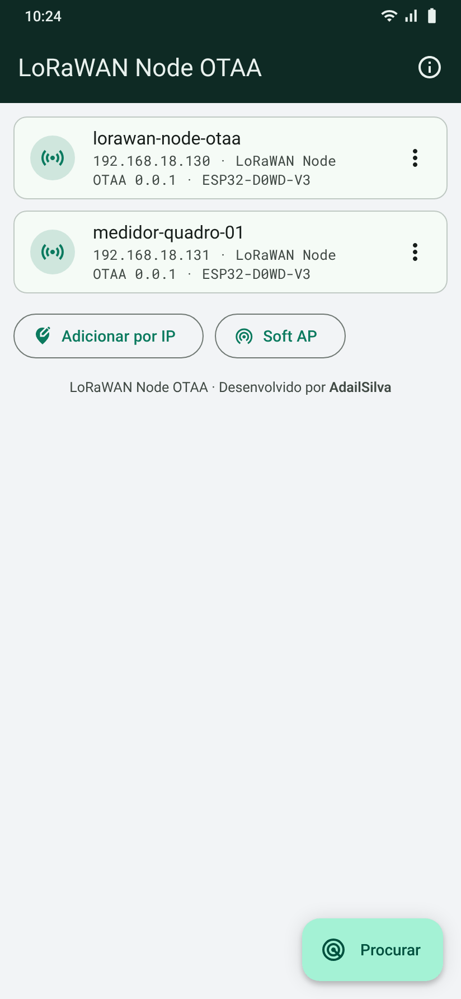
  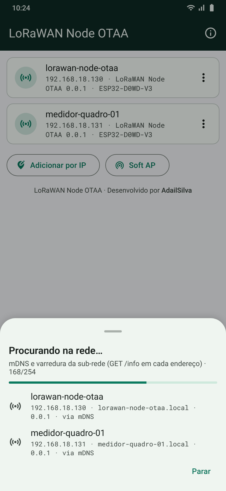
  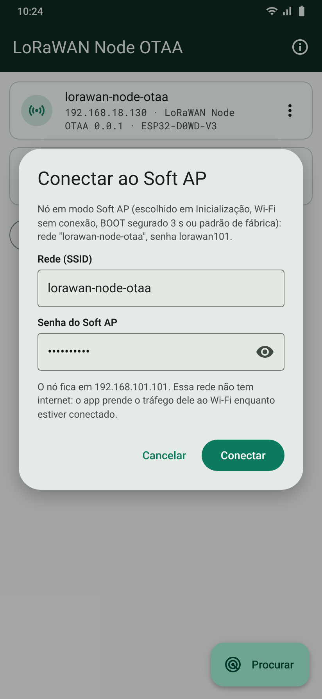
</p>

- A tela inicial mostra os nós salvos, com **IP · firmware · chip**. Toque em um para entrar. O menu **⋮** tem **Renomear**, **Esquecer senha** e **Remover da lista**.
- **Procurar** acha os nós pelo **mDNS** (`<nome>.local`, TXT `type=node`, `mode=otaa`) e pela varredura da sub-rede (`GET /info`). Só aparecem nós OTAA.
- **Adicionar por IP** aceita IP ou `nome.local` (o IP aparece no monitor serial). Se o endereço for de outro tipo de equipamento, o app avisa e pergunta antes de adicionar.
- **Soft AP:** o app conecta na rede **`lorawan-node-otaa`** (senha **`lorawan101`**) e fala com **`192.168.101.101`**, prendendo o tráfego ao Wi-Fi mesmo sem internet. Com o Wi-Fi do nó desligado, segure o botão BOOT por 3 s para abrir o Soft AP.

### 2. Login e Status

<p align="center">
  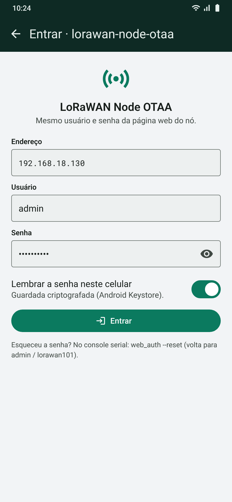
  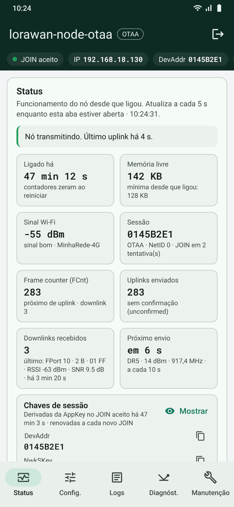
  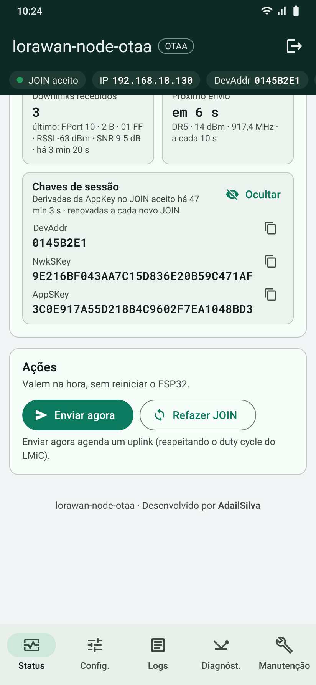
</p>

- **Login:** mesmo usuário e senha da página web. **Lembrar a senha** guarda a senha criptografada no Android Keystore. Esqueceu? No monitor serial, `web_auth --reset`.
- A barra do topo mostra o modo **OTAA**, o estado da sessão (**JOIN aceito** / **Aguardando JOIN**), o **IP**, o **DevAddr** e o **plano** (ex.: AU915 SB1).
- **Status** atualiza a cada 5 s: tempo ligado, memória, Wi-Fi, sessão, **frame counter**, uplinks, último downlink (FPort, bytes, RSSI e SNR) e o próximo envio.
- **Chaves de sessão:** DevAddr, NwkSKey e AppSKey em uso, nesta ordem (o DevAddr vem no JoinAccept; as chaves são derivadas da AppKey a cada JOIN aceito). As chaves ficam ocultas (o DevAddr sempre visível); **Mostrar** revela e o ícone de cópia copia mesmo ocultas.
- **Ações** (valem na hora): **Enviar agora** agenda um uplink; **Refazer JOIN** descarta a sessão e faz um JOIN novo.

### 3. Configuração

<p align="center">
  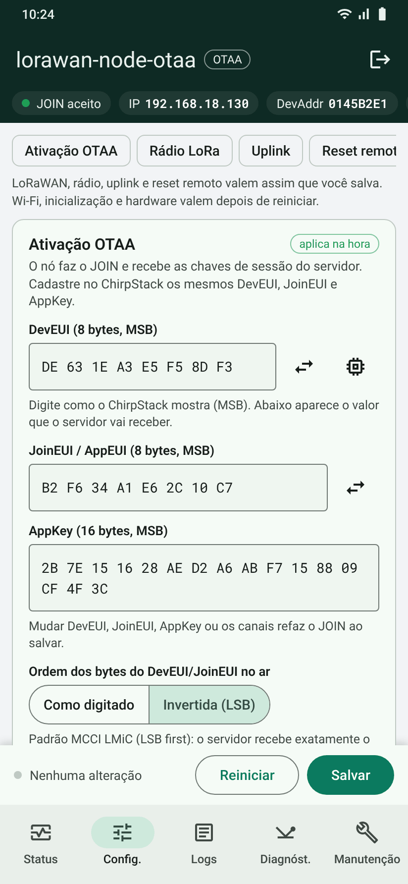
  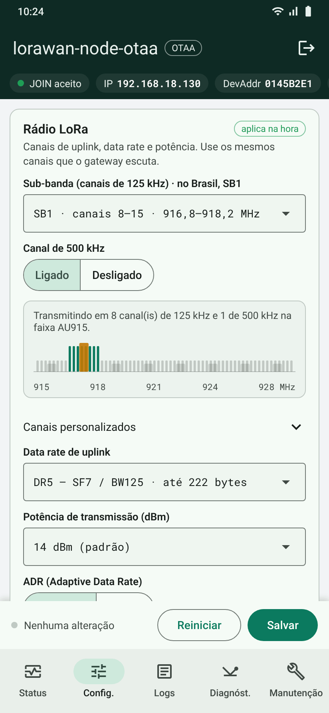
  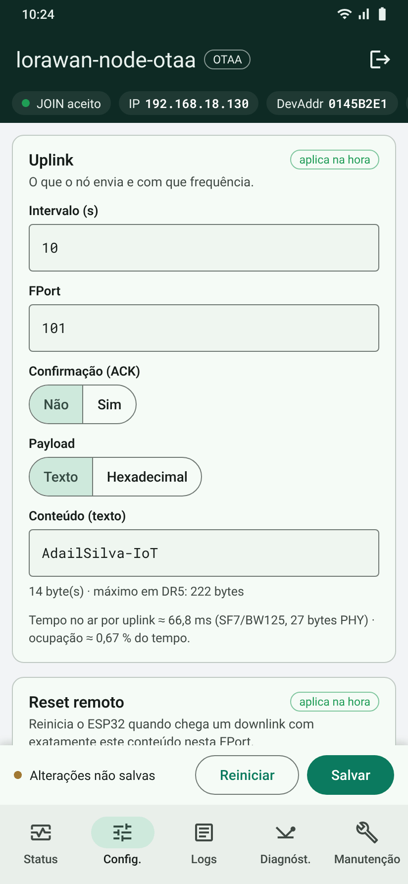
</p>

- Os botões do topo levam direto às seções: **Ativação OTAA**, **Rádio LoRa**, **Uplink**, **Reset remoto**, **Rede Wi-Fi**, **Inicialização**, **Hardware** e **Acesso**. A etiqueta de cada seção diz se ela **aplica na hora** ou **vale após reiniciar**.
- **Ativação OTAA:** DevEUI, JoinEUI e AppKey em MSB, como o ChirpStack mostra. Ao lado do DevEUI, ⇄ inverte a ordem dos bytes e o ícone de chip gera um DevEUI a partir do MAC do ESP32. **Ordem dos bytes no ar** escolhe entre *Como digitado* e *Invertida (LSB)*; a linha de baixo mostra o DevEUI e o JoinEUI que o ChirpStack vai receber. Mudar chaves ou canais refaz o JOIN ao salvar.
- **Rádio LoRa:** sub-banda (no Brasil, **SB1**), canal de 500 kHz, lista de canais personalizada, data rate, potência, ADR, link check e janela RX2. O desenho mostra os canais em uso; use os mesmos que o gateway escuta.
- **Uplink:** intervalo, FPort, confirmação e payload em texto ou hexadecimal. O app conta os bytes, avisa se passou do máximo do data rate e calcula o **tempo no ar** e a ocupação do canal.
- **Reset remoto:** FPort, comando (1 a 16 bytes) e espera. A dica já traz o **hex** e o **base64** para enfileirar no ChirpStack.
- **Rede Wi-Fi**, **Inicialização** (Station, Soft AP ou Wi-Fi desligado), **Hardware** (pinos do RFM95W, clock SPI, serial, diagnóstico de sessão) e **Acesso** valem depois de reiniciar, exceto o login.
- A barra de baixo avisa **Alterações não salvas**. **Salvar** grava no nó; **Reiniciar** aplica Wi-Fi, inicialização e hardware.

### 4. Logs, Diagnósticos e Manutenção

<p align="center">
  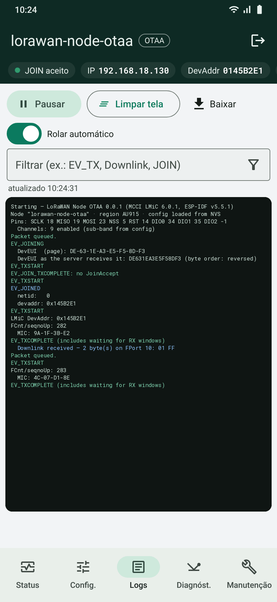
  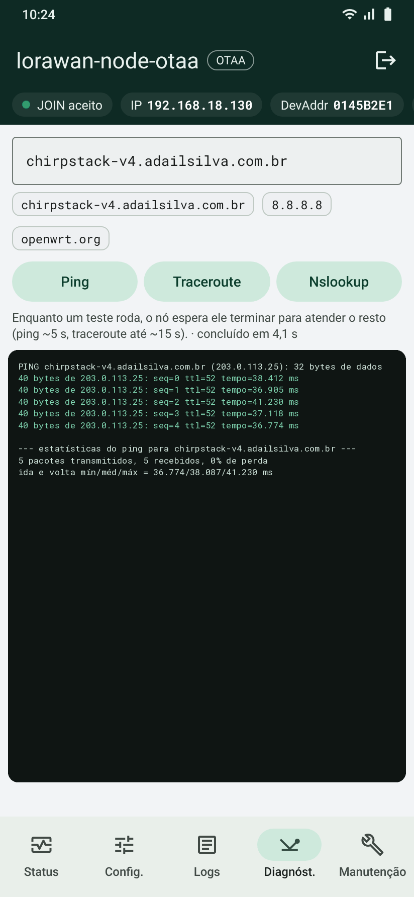
  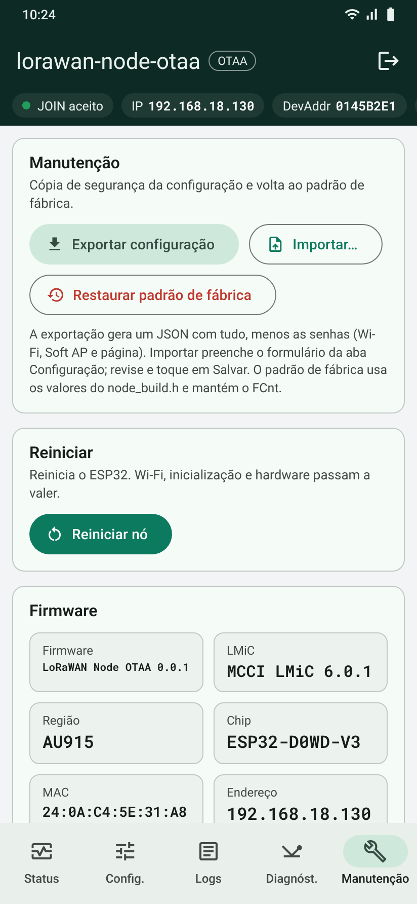
</p>

- **Logs:** tudo o que o nó imprime no monitor serial, ao vivo, com **Pausar**, **Limpar tela**, **Rolar automático**, **filtro** (ex.: `EV_TX`, `Downlink`, `JOIN`) e **Baixar** (do nó, os últimos 16 KB em RAM, ou a sessão do app). Eventos do LMiC em verde, downlinks em azul, avisos em amarelo e erros em vermelho. Cada linha aparece inteira numa linha só, sem quebra: a fonte diminui (até 8) para caber e, se ainda for longa demais (ex.: `JSON up`), é só arrastar o texto para o lado. A saída do Diagnóstico funciona igual.
- **Diagnósticos:** **Ping**, **Traceroute** e **Nslookup** feitos **pelo próprio nó** (os mesmos da página `/diag`), para testar a rede dele até o ChirpStack ou a internet. O campo já vem com **`chirpstack-v4.adailsilva.com.br`** e os atalhos abaixo dele trazem esse domínio, `8.8.8.8` e `openwrt.org`. O resultado chega linha a linha; **Parar** interrompe.
- **Manutenção:** **Exportar configuração** (JSON sem senhas), **Importar…** (preenche a aba Configuração; revise e salve. Um arquivo do gateway é recusado; um de nó ABP pede confirmação), **Restaurar padrão de fábrica** (volta aos valores do `node_build.h`), **Reiniciar nó** e o cartão **Firmware** (versão, LMiC, região, chip, MAC e endereço).

### 5. Classes LoRaWAN

- O ícone **🎓 Classes LoRaWAN** fica na barra superior da lista de nós e da tela do nó (ao lado de **Sair**).
- A tela explica o que é uma classe, as **Classes A, B e C** (quando o nó escuta, atraso do downlink, consumo, exigências e exemplos), um comparativo, **qual usar** e os campos do perfil de dispositivo no **ChirpStack v4**.
- O último cartão mostra **o que este nó suporta hoje**, com os mesmos textos da página `/classes` e de [`doc/CLASSES_LORAWAN.md`](../doc/CLASSES_LORAWAN.md).
- Não acessa a rede: funciona mesmo sem estar logado.

## 🔌 Como o app conversa com o nó

- **HTTP na rede local**, com o mesmo **HTTP Basic** da página (padrão de fábrica `admin` / `lorawan101`). O login é testado com `GET /config.json`: `401` = senha errada.
- **Sair** apenas apaga o login da memória do app. O truque `/logout` → `/saiu` existe só por causa do navegador.
- A senha pode ser lembrada no celular, guardada **criptografada** (Android Keystore, via `flutter_secure_storage`).
- O status é atualizado a cada **5 s**, só com a aba aberta e o app em primeiro plano. Cada pedido espera a resposta do anterior, como na página. Uma conexão keep-alive: **nenhum custo extra de RAM no ESP32**.

### Como o nó é encontrado

| Situação | Como o app acha |
|---|---|
| Nó na rede Wi-Fi (Station) | **mDNS** `_http._tcp` (`http://<nome>.local/`, TXT `type=node`, `mode=otaa`) |
| mDNS bloqueado no roteador | **Varredura da sub-rede**: `GET /info` em cada IP |
| Nó em **Soft AP** (ou Soft AP de emergência) | Botão **Soft AP**: rede com o nome do nó (padrão `lorawan-node-otaa`), senha `lorawan101`, nó em `192.168.101.101` |
| Wi-Fi do nó **desligado** | Segure o botão do Soft AP por 3 s e use **Soft AP** |
| Qualquer caso | **Adicionar por IP** (ou `nome.local`) |

> A busca chama `GET /info` (**sem login**: só tipo, firmware e nome, nada secreto). Firmwares antigos, sem `/info`, não aparecem na busca, mas funcionam pelo **Adicionar por IP**.

### Soft AP (rede sem internet)

A rede do Soft AP não tem internet. Nessa situação o Android manda o tráfego do app pelos **dados móveis**, e o `192.168.101.101` não responde. O `MainActivity.kt` deste app resolve isso pelo canal `lorawan/wifi`, sem plugin de terceiros:

- **Conectar ao Soft AP:** usa `WifiNetworkSpecifier` (Android 10+). O Android mostra um aviso pedindo para confirmar a rede.
- **Ao entrar:** prende o tráfego do app no Wi-Fi com `bindProcessToNetwork`. Também funciona se você conectou no Soft AP pelas configurações do Android.

## 🛠️ Compilar

Requisitos: **Flutter stable atual** (recomendado) e Android SDK (Android Studio). O mínimo é o Flutter 3.24 (Dart 3.5), mas aí é preciso um ajuste depois do `./setup.sh`: em `android/app/build.gradle`, use `compileSdk = 35`, porque `file_picker` e `nsd` exigem esse valor e o template do 3.24 gera 34. Nas versões novas do Flutter não é preciso mexer em nada.

A pasta tem só o código do app (`lib/`) e os arquivos Android que mudam (`AndroidManifest.xml`, `MainActivity.kt` e `network_security_config.xml`). O resto da estrutura Android/iOS é gerado pelo `flutter create`, **que não sobrescreve arquivos que já existem**:

```bash
cd app_flutter
./setup.sh            # = flutter create --org br.com.adailsilva --project-name lorawan_node_otaa_app --platforms android,ios .
                      #   + flutter pub get
flutter run           # celular conectado por USB (depuração USB ligada)
flutter build apk --release
# APK em build/app/outputs/flutter-apk/app-release.apk
```

> O pacote Android é `br.com.adailsilva.lorawan_node_otaa_app`. O `MainActivity.kt` já está em `android/app/src/main/kotlin/br/com/adailsilva/lorawan_node_otaa_app/`. Se você mudar `--org` ou `--project-name`, mova o arquivo e ajuste a linha `package`.

**Dependências:** `flutter_secure_storage` (login guardado), `nsd` (mDNS / `_http._tcp`), `file_picker` (exportar/importar configuração e logs) e `url_launcher` (links).

## 🍏 iOS (próxima etapa)

O código Dart é o mesmo. Depois do `./setup.sh`, acrescente em `ios/Runner/Info.plist`:

```xml
<key>NSLocalNetworkUsageDescription</key>
<string>Encontrar e configurar o nó na rede Wi-Fi local.</string>
<key>NSBonjourServices</key>
<array><string>_http._tcp</string></array>
<key>NSAppTransportSecurity</key>
<dict><key>NSAllowsLocalNetworking</key><true/><key>NSAllowsArbitraryLoads</key><true/></dict>
```

No iOS, a conexão automática ao Soft AP e o `bindProcessToNetwork` ainda não estão implementados (o canal não existe e o app segue sem eles). Conecte no Soft AP pelos Ajustes. O iOS já usa o Wi-Fi para endereços locais.

## 📁 Estrutura

```
app_flutter/
├── lib/
│   ├── main.dart                 # tipo do app (flavor) e tema
│   ├── core/                     # HTTP + Basic, sessão (status a cada 5 s), descoberta,
│   │                             # Wi-Fi/Soft AP, arquivos, formatação e validação
│   ├── ui/                       # lista de dispositivos, login, logs, componentes comuns,
│   │                             # lorawan_classes_screen.dart (tela Classes LoRaWAN)
│   └── node/                     # status e ações, configuração, manutenção, regras da página
├── android/app/src/main/         # AndroidManifest, MainActivity.kt (canal lorawan/wifi),
│                                 # res/xml/network_security_config.xml (HTTP na rede local)
├── test/format_test.dart
├── setup.sh
└── pubspec.yaml
```

---

<p align="center">LoRaWAN Node OTAA · Desenvolvido por <a href="https://k8s.adailsilva.com.br/"><b>AdailSilva</b></a></p>
