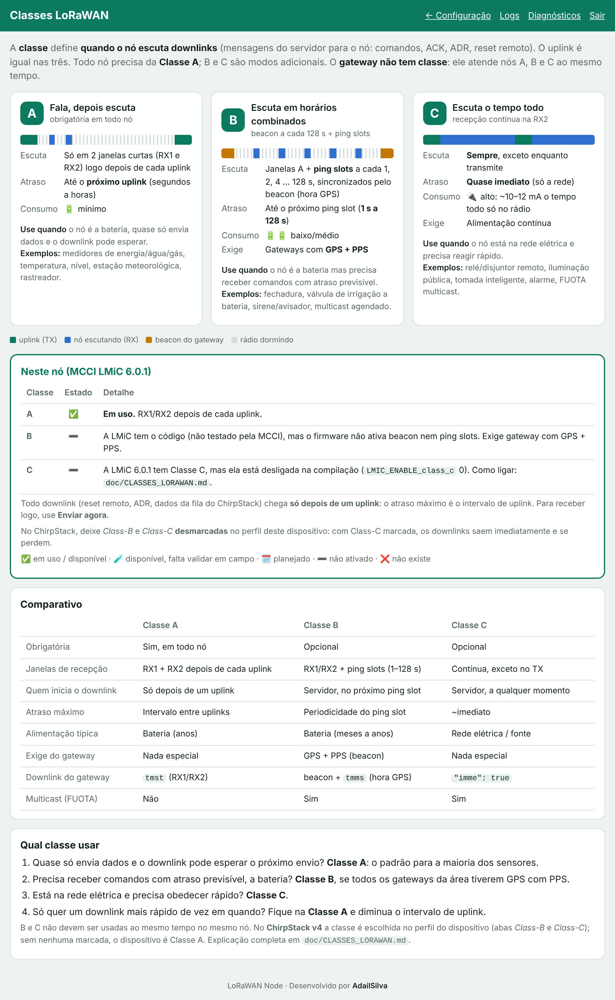

# 📶 Classes LoRaWAN: A, B e C

> Este documento explica o que são as classes de dispositivo do LoRaWAN, para que serve cada uma e **o que o nó **LoRaWAN Node Base OTAA** suporta hoje**. O mesmo conteúdo, resumido, está na página WEB (`/classes`) e no app Android (botão **Classes LoRaWAN** na barra superior).

## Sumário

- [O que é uma "classe"](#o-que-é-uma-classe)
- [Resumo rápido](#resumo-rápido)
- [Classe A: o nó fala, depois escuta](#classe-a-o-nó-fala-depois-escuta)
- [Classe B: escuta em horários combinados](#classe-b-escuta-em-horários-combinados)
- [Classe C: escuta o tempo todo](#classe-c-escuta-o-tempo-todo)
- [Comparativo](#comparativo)
- [Qual classe usar](#qual-classe-usar)
- [Classes no ChirpStack v4](#classes-no-chirpstack-v4)
- [Suporte nas pilhas LoRaWAN](#suporte-nas-pilhas-lorawan)
- [Neste nó](#neste-nó)
- [Referências](#referências)

---

## O que é uma "classe"

A classe define **quando o dispositivo final (nó) está escutando downlinks**, isto é, mensagens que vêm do servidor para o nó: comandos, confirmações (ACK), ajustes de ADR, reset remoto etc.

- O **uplink** (nó → servidor) é igual nas três classes: o nó transmite quando quer.
- O que muda é o **downlink** (servidor → nó): quanto tempo ele espera para chegar e quanta energia o nó gasta mantendo o rádio ligado.
- **Todo** dispositivo LoRaWAN precisa suportar a **Classe A**. As classes B e C são modos *adicionais*, ligados por cima da A.
- A classe é uma característica do **nó** e do **perfil de dispositivo no servidor**. O **gateway não tem classe**: ele só repassa os pacotes e transmite os downlinks no horário que o servidor pede.

## Resumo rápido

| Classe | Quando o nó escuta | Atraso do downlink | Consumo | Uso típico |
|:---:|---|---|---|---|
| **A** | Só em 2 janelas curtas (RX1 e RX2) logo depois de cada uplink | Até o **próximo uplink** (segundos a horas) | 🔋 **Mínimo** | Sensores a bateria: medidores, temperatura, nível, rastreadores |
| **B** | Janelas A + **ping slots** em horários sincronizados por *beacon* | Até o próximo ping slot (**1 s a 128 s**, configurável) | 🔋🔋 Baixo/médio | Atuadores a bateria que precisam receber comando com atraso previsível |
| **C** | **O tempo todo**, exceto enquanto transmite | **Quase imediato** (< 1 s + rede) | 🔌 **Alto**: rádio sempre ligado | Equipamentos ligados à rede elétrica: relés, iluminação pública, válvulas, alarmes |

---

## Classe A: o nó fala, depois escuta

É o modo básico e obrigatório. Depois de **cada uplink**, o nó abre duas janelas de recepção curtas e depois dorme:

```
        uplink              RX1                 RX2
Nó:   [■■■■■■■■]·· 1 s ··[▒▒]······ 1 s ······[▒▒]········· dormindo ·········[■■■■■■■■]··
                           ↑ mesma faixa do       ↑ frequência e DR fixos
                             uplink (DR ajustado)   (AU915: 923,3 MHz, DR8)
```

- **RX1** abre `RECEIVE_DELAY1` (1 s no AU915) depois do fim do uplink; **RX2** abre 1 s depois da RX1. No JOIN OTAA os atrasos são de 5 s e 6 s.
- Se o servidor tiver algo para o nó, ele manda em RX1 ou RX2. Se não houver nada, o nó volta a dormir.
- **Consequência:** o servidor **não consegue falar com o nó quando quer**. Um comando fica na fila do ChirpStack até o nó mandar o próximo uplink. Com uplink a cada 15 min, o comando pode levar até 15 min para chegar.

**Use quando:** o dispositivo funciona a bateria e quase só envia dados; downlink é raro e pode esperar (configuração, ADR, ACK, ajuste de intervalo).

**Exemplos:** medidor de energia/água/gás, sensor de temperatura e umidade, nível de reservatório, estação meteorológica, rastreador de ativos, contador de pulsos.

---

## Classe B: escuta em horários combinados

A Classe B acrescenta **janelas de recepção agendadas** (*ping slots*) para que o servidor alcance o nó com um atraso **conhecido**, sem obrigar o rádio a ficar ligado o tempo todo.

```
beacon                                                                        beacon
 [B]──ps──────ps──────ps──────ps──────ps──────ps──────ps── … ──ps──────ps──────[B]
  │   ↑ ping slots: janelas curtas (~30 ms) em horários combinados                │
  │←──────────────────────────────── 128 s ────────────────────────────────────→│
```

- Os **gateways** transmitem um **beacon** a cada **128 s**, sincronizado pela **hora do GPS**. No AU915 o beacon vai em 923,3 MHz + n × 600 kHz (8 canais), DR8 (SF12 / BW500).
- O nó se sincroniza com o beacon e, a partir dele, calcula os **ping slots**. A periodicidade é `2^k` segundos, com `k` de 0 a 7: **um ping slot a cada 1 s, 2 s, 4 s … até 128 s**.
- Para entrar em Classe B o nó: (1) procura e trava no beacon (pode levar mais de 128 s), (2) informa a periodicidade ao servidor (`PingSlotInfoReq`) e (3) passa a enviar os uplinks com o bit **Class B** ligado. Se perder beacons por cerca de 2 h, volta para a Classe A.
- As janelas RX1/RX2 da Classe A continuam valendo.

**Exige:** gateways com **GPS e PPS** (pulso por segundo) ligados ao concentrador, para que o beacon e os ping slots saiam na hora certa; servidor com Classe B habilitada no perfil do dispositivo.

**Use quando:** o dispositivo é a bateria, mas precisa **receber comandos** com atraso previsível (segundos ou poucos minutos).

**Exemplos:** fechadura inteligente, válvula de irrigação ou de corte de água a bateria, atuador de estacionamento, sirene/avisador remoto, dispositivo que recebe *multicast* agendado.

---

## Classe C: escuta o tempo todo

Na Classe C o rádio fica **em recepção contínua** com os parâmetros da RX2, e só para enquanto o nó transmite:

```
        uplink         RX1
Nó:   [■■■■■■■■][▒▒ RXC ▒▒][▒▒][▒▒▒▒▒▒▒▒▒▒▒▒ RX2 contínua (RXC) ▒▒▒▒▒▒▒▒▒▒▒▒▒▒▒▒][■■■■■■■■][▒▒ …
```

- O servidor pode mandar downlink **a qualquer momento** (o ChirpStack envia em modo *imediato*), e o atraso fica limitado à rede (internet, servidor, gateway).
- O custo é energia: o rádio em recepção gasta da ordem de **10–12 mA** o tempo todo (SX1276/RFM95W), contra cerca de **0,2 µA** dormindo. Duas pilhas AA (~2 500 mAh) durariam cerca de **10 dias** só com o rádio em recepção.
- No LoRaWAN 1.0.x não há aviso no protocolo: o servidor trata o nó como Classe C porque o **perfil do dispositivo** diz isso. Se o perfil disser C e o nó estiver em A, os downlinks se perdem.

**Exige:** alimentação contínua (rede elétrica, fonte, painel solar bem dimensionado); servidor com Classe C habilitada no perfil.

**Use quando:** o dispositivo já é ligado à rede elétrica e precisa reagir rápido a comandos.

**Exemplos:** relé/disjuntor remoto, controlador de iluminação pública, tomada inteligente, painel/display, alarme e sirene, válvula motorizada com fonte, atualização de firmware por rádio (**FUOTA** multicast costuma usar Classe C temporária).

---

## Comparativo

| | **Classe A** | **Classe B** | **Classe C** |
|---|---|---|---|
| Obrigatória | ✅ Sim, em todo nó | ➖ Opcional | ➖ Opcional |
| Janelas de recepção | RX1 + RX2 depois de cada uplink | RX1/RX2 + ping slots a cada 1–128 s | Contínua (RX2), exceto durante o TX |
| Quem inicia o downlink | Só depois de um uplink do nó | O servidor, no próximo ping slot | O servidor, a qualquer momento |
| Atraso máximo do downlink | Intervalo entre uplinks | Periodicidade do ping slot (1–128 s) | ~imediato |
| Consumo do rádio | Mínimo (dorme quase sempre) | Baixo/médio (acorda nos beacons e ping slots) | Alto (escuta sempre) |
| Alimentação típica | Bateria (anos) | Bateria (meses a anos) | Rede elétrica / fonte |
| Exige do gateway | Nada especial | **GPS + PPS** (beacon e hora precisa) | Nada especial (TX "imediato") |
| Exige do servidor | — | Classe B no perfil + periodicidade | Classe C no perfil |
| Multicast (ex.: FUOTA) | ❌ | ✅ | ✅ |

---

## Qual classe usar

1. **O dispositivo quase só envia dados e o downlink pode esperar até o próximo envio?** → **Classe A**. É o padrão e a escolha certa para a maioria dos sensores.
2. **Precisa receber comandos com atraso previsível, mas funciona a bateria?** → **Classe B**, desde que todos os gateways da área tenham **GPS com PPS**.
3. **Está ligado na rede elétrica e precisa obedecer comandos rapidamente?** → **Classe C**.
4. **Só precisa de um downlink mais rápido de vez em quando?** Antes de mudar de classe, considere continuar em **Classe A** e reduzir o intervalo de uplink, ou mandar um uplink extra quando o nó espera resposta.

> 💡 Classe B e Classe C **não devem ser usadas ao mesmo tempo** no mesmo nó. Escolha uma delas como modo adicional à Classe A.

---

## Classes no ChirpStack v4

A classe é definida no **perfil do dispositivo** (*Device profiles* → perfil → abas):

| Aba | Campo | Para que serve |
|---|---|---|
| **Class-B** | *Device supports Class-B* | Liga o envio de downlinks em ping slots |
| | *Ping-slot periodicity* | Precisa ser a mesma configurada no nó (1 s a 128 s) |
| | *Class-B confirmed downlink timeout* | Quanto esperar o ACK de um downlink confirmado |
| **Class-C** | *Device supports Class-C* | Liga o envio imediato de downlinks |
| | *Class-C confirmed downlink timeout* | Quanto esperar o ACK de um downlink confirmado |

Sem nenhuma das duas marcadas, o dispositivo é tratado como **Classe A**: os downlinks da fila saem só nas janelas RX1/RX2 depois de cada uplink.

O ChirpStack passa ao gateway como e quando transmitir cada downlink, e o packet forwarder traduz assim (UDP Semtech e MQTT):

| Classe | No ChirpStack (MQTT, `timing`) | No packet forwarder (UDP, `txpk`) |
|---|---|---|
| A | `delay` (1 s ou 2 s depois do uplink) | `"tmst"`: contador do concentrador no fim do uplink + atraso |
| B | `gpsEpoch` (hora GPS do ping slot) | `"tmms"`: milissegundos desde 06/01/1980 (GPS) |
| C | `immediately` | `"imme": true` |

### Perfis de exemplo por classe

A coluna **Class-B / Class-C** dos 32 perfis de exemplo segue as quatro combinações de classe: **A** (nenhuma marcada), **A+B**, **A+B+C** e **A+C**. Este nó (OTAA, Classe A) usa **#29** `Device Profile - AU915_1 - 1.0.3 - B - OTAA - Class A`; com a Classe C ligada no firmware, **#32** `Device Profile - AU915_1 - 1.0.3 - B - OTAA - Class A+C`. Com Class-B marcada, o ChirpStack recalcula a classe a cada uplink pelo bit *Class B* do FCtrl; por isso, para Classe C, use **A+C**. Cadastro completo: [`CHIRPSTACK_DEVICE_PROFILES.md`](CHIRPSTACK_DEVICE_PROFILES.md).

| # | Nome do perfil (*Name*) | Region configuration | Revisão | Supports OTAA | Class-B | Class-C |
|---:|---|:---:|:---:|:---:|:---:|:---:|
| 1 | `Device Profile - AU915_0 - 1.0.3 - A - ABP - Class A` | `au915_0` | A | — | — | — |
| 2 | `Device Profile - AU915_0 - 1.0.3 - A - ABP - Class A+B` | `au915_0` | A | — | ✅ | — |
| 3 | `Device Profile - AU915_0 - 1.0.3 - A - ABP - Class A+B+C` | `au915_0` | A | — | ✅ | ✅ |
| 4 | `Device Profile - AU915_0 - 1.0.3 - A - ABP - Class A+C` | `au915_0` | A | — | — | ✅ |
| 5 | `Device Profile - AU915_0 - 1.0.3 - A - OTAA - Class A` | `au915_0` | A | ✅ | — | — |
| 6 | `Device Profile - AU915_0 - 1.0.3 - A - OTAA - Class A+B` | `au915_0` | A | ✅ | ✅ | — |
| 7 | `Device Profile - AU915_0 - 1.0.3 - A - OTAA - Class A+B+C` | `au915_0` | A | ✅ | ✅ | ✅ |
| 8 | `Device Profile - AU915_0 - 1.0.3 - A - OTAA - Class A+C` | `au915_0` | A | ✅ | — | ✅ |
| 9 | `Device Profile - AU915_0 - 1.0.3 - B - ABP - Class A` | `au915_0` | B | — | — | — |
| 10 | `Device Profile - AU915_0 - 1.0.3 - B - ABP - Class A+B` | `au915_0` | B | — | ✅ | — |
| 11 | `Device Profile - AU915_0 - 1.0.3 - B - ABP - Class A+B+C` | `au915_0` | B | — | ✅ | ✅ |
| 12 | `Device Profile - AU915_0 - 1.0.3 - B - ABP - Class A+C` | `au915_0` | B | — | — | ✅ |
| 13 | `Device Profile - AU915_0 - 1.0.3 - B - OTAA - Class A` | `au915_0` | B | ✅ | — | — |
| 14 | `Device Profile - AU915_0 - 1.0.3 - B - OTAA - Class A+B` | `au915_0` | B | ✅ | ✅ | — |
| 15 | `Device Profile - AU915_0 - 1.0.3 - B - OTAA - Class A+B+C` | `au915_0` | B | ✅ | ✅ | ✅ |
| 16 | `Device Profile - AU915_0 - 1.0.3 - B - OTAA - Class A+C` | `au915_0` | B | ✅ | — | ✅ |
| 17 | `Device Profile - AU915_1 - 1.0.3 - A - ABP - Class A` | `au915_1` | A | — | — | — |
| 18 | `Device Profile - AU915_1 - 1.0.3 - A - ABP - Class A+B` | `au915_1` | A | — | ✅ | — |
| 19 | `Device Profile - AU915_1 - 1.0.3 - A - ABP - Class A+B+C` | `au915_1` | A | — | ✅ | ✅ |
| 20 | `Device Profile - AU915_1 - 1.0.3 - A - ABP - Class A+C` | `au915_1` | A | — | — | ✅ |
| 21 | `Device Profile - AU915_1 - 1.0.3 - A - OTAA - Class A` | `au915_1` | A | ✅ | — | — |
| 22 | `Device Profile - AU915_1 - 1.0.3 - A - OTAA - Class A+B` | `au915_1` | A | ✅ | ✅ | — |
| 23 | `Device Profile - AU915_1 - 1.0.3 - A - OTAA - Class A+B+C` | `au915_1` | A | ✅ | ✅ | ✅ |
| 24 | `Device Profile - AU915_1 - 1.0.3 - A - OTAA - Class A+C` | `au915_1` | A | ✅ | — | ✅ |
| 25 | `Device Profile - AU915_1 - 1.0.3 - B - ABP - Class A` | `au915_1` | B | — | — | — |
| 26 | `Device Profile - AU915_1 - 1.0.3 - B - ABP - Class A+B` | `au915_1` | B | — | ✅ | — |
| 27 | `Device Profile - AU915_1 - 1.0.3 - B - ABP - Class A+B+C` | `au915_1` | B | — | ✅ | ✅ |
| 28 | `Device Profile - AU915_1 - 1.0.3 - B - ABP - Class A+C` | `au915_1` | B | — | — | ✅ |
| 29 | `Device Profile - AU915_1 - 1.0.3 - B - OTAA - Class A` | `au915_1` | B | ✅ | — | — |
| 30 | `Device Profile - AU915_1 - 1.0.3 - B - OTAA - Class A+B` | `au915_1` | B | ✅ | ✅ | — |
| 31 | `Device Profile - AU915_1 - 1.0.3 - B - OTAA - Class A+B+C` | `au915_1` | B | ✅ | ✅ | ✅ |
| 32 | `Device Profile - AU915_1 - 1.0.3 - B - OTAA - Class A+C` | `au915_1` | B | ✅ | — | ✅ |

Legenda: ✅ marcado · — desmarcado. Todos os 32 usam **Region** `AU915` e **MAC version** `LoRaWAN 1.0.3`.

---

## Suporte nas pilhas LoRaWAN

| Pilha | Classe A | Classe B | Classe C | Observação |
|---|:---:|:---:|:---:|---|
| LMiC original (IBM) | ✅ | ✅ | ❌ | Base das versões da MCCI |
| **MCCI LMiC 3.x** (ex.: 3.3.0) | ✅ | 🧪 | ❌ | Classe B no código (beacon e ping slots), mas a MCCI a lista como **não testada** |
| **MCCI LMiC ≥ 5.0.0** (ex.: 6.0.1) | ✅ | 🧪 | ✅ | Classe C a partir da 5.0.0; precisa ser ligada na compilação (`LMIC_ENABLE_class_c`) **e** em tempo de execução (`LMIC_enableClassC(1)`) |
| Semtech LoRaMac-node | ✅ | ✅ | ✅ | Em modo de manutenção; a Semtech recomenda o LoRa Basics Modem para projetos novos |
| Semtech LoRa Basics Modem | ✅ | ✅ | ✅ | Pilha atual da Semtech |
| Zephyr RTOS (subsistema LoRaWAN) | ✅ | ➖ | ✅ | Baseado na LoRaMac-node |

Legenda: ✅ suportada · 🧪 presente, mas sem validação · ❌ não existe · ➖ não exposta pela API

---

## Neste nó

O firmware **LoRaWAN Node Base OTAA** funciona em **Classe A**. A pilha é a **MCCI LMiC 6.0.1**, que tem:

| Classe | Na MCCI LMiC 6.0.1 | No firmware deste nó |
|:---:|:---:|---|
| **A** | ✅ | ✅ **Em uso.** RX1/RX2 depois de cada uplink, com o fim do TX marcado por interrupção (DIO0/DIO1) |
| **B** | 🧪 presente, não testada pela MCCI | ➖ **Não ativada.** O código de beacon e ping slot está compilado (`DISABLE_PING` e `DISABLE_BEACONS` não estão definidos), mas o firmware não chama `LMIC_enableTracking()` nem `LMIC_setPingable()`. Os eventos `EV_BEACON_*` só aparecem no log |
| **C** | ✅ (desligada na compilação) | ➖ **Não ativada.** `LMIC_ENABLE_class_c` fica em 0 (padrão), então o código da Classe C nem é compilado. Veja abaixo como ligar |

### O que isso significa no uso

- **Todo downlink chega só depois de um uplink.** O comando de **reset remoto**, os ajustes de **ADR**, o `LinkCheckAns` e qualquer dado da fila do ChirpStack esperam o próximo envio do nó.
- O **atraso máximo** de um downlink é o **intervalo de uplink** configurado na página (seção *Uplink*). Para um comando chegar logo, use **Enviar agora** na página ou no app, ou diminua o intervalo.
- No ChirpStack, deixe **Class-B** e **Class-C desmarcadas** no perfil deste dispositivo. Com Classe C marcada, o servidor manda os downlinks "imediatamente" e eles **se perdem**, porque o nó só escuta nas janelas RX1/RX2.
- Em consumo, o rádio quase não pesa neste nó: o **ESP32 com Wi-Fi e servidor WEB** ligado gasta bem mais do que o RFM95W em recepção. A economia da Classe A só faz diferença real num nó a bateria com o Wi-Fi desligado e o ESP32 em *deep sleep*.

### Como seria a Classe C neste nó (não implementado)

A LMiC 6.0.1 já traz a Classe C. Se um dia este nó precisar dela (por exemplo, um relé ligado na rede elétrica), o caminho é:

1. Em `components/lmic/project_config/lmic_project_config.h`, acrescentar `#define LMIC_ENABLE_class_c 1`, e também `#define DISABLE_PING` e `#define DISABLE_BEACONS` (Classe B e C não devem conviver).
2. Em `main/node_main.cpp`, chamar `LMIC_enableClassC(1)` no evento `EV_JOINED` (e `LMIC_enableClassC(0)` para voltar à Classe A).
3. No `EV_TXCOMPLETE`/`EV_RXCOMPLETE`, usar `LMIC_txrxFlags_isClassC(LMIC.txrxFlags)` para saber se o downlink chegou fora das janelas RX1/RX2.
4. No ChirpStack, marcar **Class-C** no perfil do dispositivo.
5. Os parâmetros da recepção contínua são os da **RX2** (data rate e frequência na seção *Rádio LoRa* da página).

### Na página WEB e no app

- Página **Classes** (`http://<ip-do-nó>/classes`, link **Classes** no topo da página do nó, de Logs e de Diagnósticos): resumo das três classes, quando usar cada uma e o que este nó suporta.
- App Android: ícone **Classes LoRaWAN** (🎓) na barra superior da lista de nós e da tela do nó.

<p align="center">
  
</p>

---

## Referências

- LoRa Alliance: *LoRaWAN® L2 1.0.4 Specification* e *RP002-1.0.3 LoRaWAN® Regional Parameters* (AU915: RX2, beacon e ping slots).
- MCCI: [arduino-lmic (README)](https://github.com/mcci-catena/arduino-lmic), [Class C](https://mcci-catena.github.io/arduino-lmic/md_doc_2_c_l_a_s_s-_c.html) e [CHANGELOG](https://mcci-catena.github.io/arduino-lmic/md__c_h_a_n_g_e_l_o_g.html).
- Semtech: [LoRaMac-node](https://github.com/Lora-net/LoRaMac-node) e o protocolo do packet forwarder ([`PROTOCOL.md`](https://github.com/Lora-net/packet_forwarder/blob/master/PROTOCOL.TXT)).
- ChirpStack v4: perfis de dispositivo (*Device profiles*, abas Class-B e Class-C).
