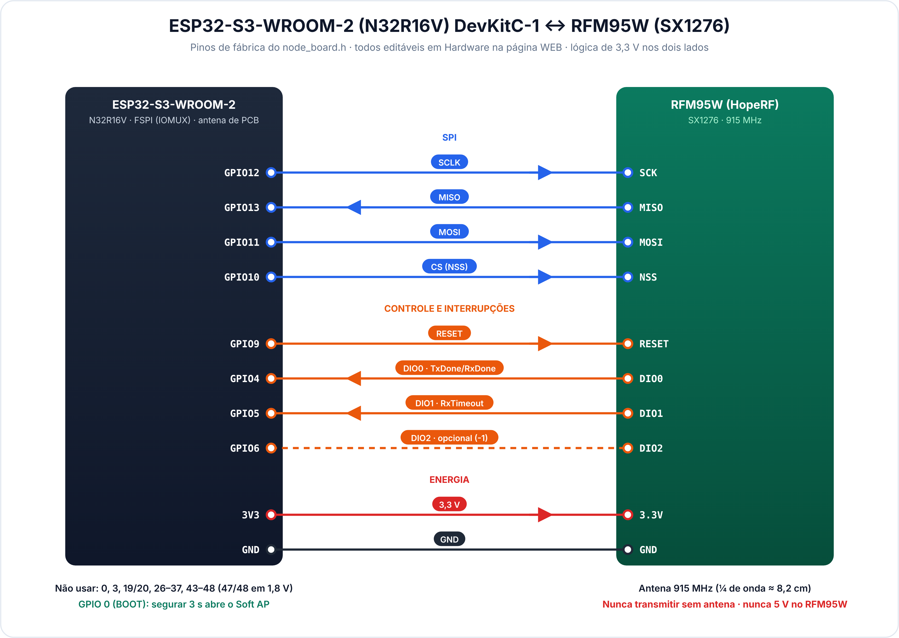

# OTAA: ESP32-S3-WROOM-2-N32R16V DevKit ↔ RFM95W

Placa **`BOARD=esp32s3_n32r16v`** (alvo `esp32s3`). Módulo com a marcação **MCN32R16V** na blindagem. A ligação é **a mesma** do [ESP32-S3-WROOM-1U-N16R8](ESP32-S3-WROOM-1U_N16R8_DevKit.md): os fios não mudam, só o firmware. Comparação das três placas: [README desta pasta](README.md).

| Item | Valor |
|---|---|
| Módulo | ESP32-S3-WROOM-2-N32R16V (ESP32-S3-DevKitC-1, 2 × 22 pinos) |
| Chip | ESP32-S3R16V, Xtensa LX7 dual-core 240 MHz, 512 KB SRAM |
| Flash | **32 MB octal (OPI, 80 MHz), 1,8 V** |
| PSRAM | **16 MB octal, 1,8 V** (GPIO33–37) |
| Antena Wi-Fi | de PCB (não tem u.FL): deixe a ponta do módulo fora da caixa e longe de metal |
| Console | UART0 (GPIO43/44) pelo conector **"UART"/"COM"** da DevKitC-1 → `/dev/ttyUSB0` (CP2102) ou `/dev/ttyACM0` (CH343), 115200 bps |
| SPI do rádio | `SPI2_HOST` (FSPI) nos pinos nativos IOMUX 10–13 |
| Arquivos do build | [`sdkconfig.defaults`](../../sdkconfig.defaults) + [`boards/esp32s3_n32r16v.defaults`](../../boards/esp32s3_n32r16v.defaults) + [`partitions.csv`](../../partitions.csv) |
| Pinos de fábrica | bloco `ESP32-S3` de [`main/node_board.h`](../../main/node_board.h) |

**Rádio:** RFM95W (HopeRF), SX1276, 915 MHz, **3,3 V** de alimentação e de lógica. Nunca ligue o RFM95W em 5 V e nunca transmita sem antena (¼ de onda ≈ 8,2 cm ou antena SMA/u.FL).

> **Por que o console fica na UART e não no USB nativo:** a velocidade da serial é configurável na página (*Hardware → Velocidade da serial*), e isso só existe na UART. Use o conector marcado **UART**. O conector **USB** (nativo, GPIO19/20) serve para gravar também, mas o log não aparece nele.

<p align="center">
  <a href="../images/wiring_esp32s3_wroom2_n32r16v_rfm95w.png"></a>
</p>
<p align="center"><sub>🔍 Alta resolução (PNG, 3720 px de largura): clique na imagem para ampliar · versão vetorial: <a href="../images/wiring_esp32s3_wroom2_n32r16v_rfm95w.svg"><code>wiring_esp32s3_wroom2_n32r16v_rfm95w.svg</code></a></sub></p>

## Ligação (valores de fábrica)

| ESP32-S3 | RFM95W | Sinal | Campo na página (Hardware) |
|---|---|---|---|
| GPIO 12 | SCK | SPI clock (FSPICLK) | SCLK |
| GPIO 13 | MISO | SPI (FSPIQ) | MISO |
| GPIO 11 | MOSI | SPI (FSPID) | MOSI |
| GPIO 10 | NSS | chip select (FSPICS0) | NSS / CS |
| GPIO 9 | RESET | reset do rádio | RESET (`-1` = não ligado) |
| GPIO 4 | DIO0 | TxDone / RxDone | DIO0 |
| GPIO 5 | DIO1 | RxTimeout | DIO1 |
| — (GPIO 6 sugerido) | DIO2 | não usado em LoRa | DIO2 (`-1`) |
| 3V3 | 3.3V | alimentação | — |
| GND | GND | terra | — |
| GPIO 0 | — | botão BOOT: segurar 3 s abre o Soft AP | Botão do Soft AP |

No S3 **todo GPIO é entrada e saída**: não existe a restrição "só entrada" do GPIO34–39 do ESP32 clássico. Todos os pinos podem ser trocados na página (**Hardware**) ou no app, sem recompilar.

```
                        ┌─────────────────────────┐
                        │  WROOM-2-N32R16V        │
                        └────┬───────────────┬────┘
            3V3 ───► RFM95W 3.3V      GND ───► RFM95W GND
   (1) 3V3                                     GND
   (2) 3V3                                     GPIO43 (TX0 console) ✗
   (3) RST                                     GPIO44 (RX0 console) ✗
   (4) GPIO4  ◄── DIO0                         GPIO1
   (5) GPIO5  ◄── DIO1                         GPIO2
   (6) GPIO6      (DIO2, opcional)             GPIO42
   (7) GPIO7                                   GPIO41
   (8) GPIO15                                  GPIO40
   (9) GPIO16                                  GPIO39
  (10) GPIO17                                  GPIO38
  (11) GPIO18                                  GPIO37 (PSRAM) ✗
  (12) GPIO8                                   GPIO36 (PSRAM) ✗
  (13) GPIO3  (strapping) ✗                    GPIO35 (PSRAM) ✗
  (14) GPIO46 (strapping) ✗                    GPIO0  (BOOT → Soft AP)
  (15) GPIO9  ──► RESET                        GPIO45 (strapping) ✗
  (16) GPIO10 ──► NSS                          GPIO48 (1,8 V) ✗
  (17) GPIO11 ──► MOSI                         GPIO47 (1,8 V) ✗
  (18) GPIO12 ──► SCK                          GPIO21
  (19) GPIO13 ◄── MISO                         GPIO20 (USB D+) ✗
  (20) GPIO14                                  GPIO19 (USB D−) ✗
  (21) 5V                                      GND
  (22) GND                                     GND
                    [ UART ]  [ USB ]   ← console no conector UART
```

## Pinos que a página e o app recusam neste módulo

| GPIO | Motivo |
|---|---|
| 0, 3, 45, 46 | strapping (0 = botão BOOT; 45 = tensão da flash) |
| 19, 20 | USB nativo (D−/D+) |
| 22–25 | não existem no ESP32-S3 |
| 26–32 | memória flash |
| 33–37 | flash/PSRAM octal |
| 43, 44 | TX0/RX0 do console |
| 47, 48 | **domínio de 1,8 V** (VDD_SPI do N32R16V): nunca ligue o RFM95W de 3,3 V nesses pinos |
| > 48 | não existem |

Livres para sensores e expansão (com a pinagem de fábrica): 1, 2, 6, 7, 8, 14–18, 21, 38–42. O LED RGB (WS2812) da DevKitC-1 fica no GPIO48 (v1.0) ou GPIO38 (v1.1).

- **GPIO47/48** ficam no domínio de **1,8 V** (VDD_SPI). A página e o app recusam os dois.

## Opções de build deste módulo

[`boards/esp32s3_n32r16v.defaults`](../../boards/esp32s3_n32r16v.defaults):

```
CONFIG_NODE_BOARD_ESP32S3_WROOM_2_N32R16V=y
CONFIG_ESPTOOLPY_OCT_FLASH=y            # flash octal (OPI)
CONFIG_ESPTOOLPY_FLASHFREQ_80M=y
CONFIG_ESPTOOLPY_FLASHSIZE_32MB=y
CONFIG_SPIRAM=y
CONFIG_SPIRAM_MODE_OCT=y                # PSRAM octal
CONFIG_SPIRAM_SPEED_80M=y
CONFIG_SPIRAM_USE_MALLOC=y
```

Sem `CONFIG_ESPTOOLPY_OCT_FLASH=y` o módulo não inicia: a flash dele é octal.

A tabela de partições é a mesma do ESP32 ([`partitions.csv`](../../partitions.csv), 4 MB: `nvs` 0x9000, `app0`/`app1` de 1,25 MB, `spiffs`, `coredump`). O espaço da flash depois dos 4 MB fica livre.

## Compilar e gravar

Com o ESP-IDF já ativado (`. ~/Apps/esp-idf/export.sh`; instalação em [Preparar o ambiente ESP-IDF](../../README.md#-preparar-o-ambiente-esp-idf)):

```bash
sh scripts/build.sh esp32s3_n32r16v                          # só compila
sh scripts/build.sh esp32s3_n32r16v flash   /dev/ttyUSB0    # compila, grava e abre o monitor
sh scripts/build.sh esp32s3_n32r16v monitor /dev/ttyUSB0    # só o monitor
sh scripts/build.sh esp32s3_n32r16v erase   /dev/ttyUSB0    # apaga a flash inteira (fábrica, FCnt 0)
```

> A DevKitC-1 com o conversor **CH343** aparece como `/dev/ttyACM0`: passe a porta (`... flash /dev/ttyACM0`). Confira com `ls /dev/ttyUSB* /dev/ttyACM*`.

**Com log em `logs/`** (Linux/WSL2; os mesmos comandos de [Gravar e acompanhar o log](../../README.md#gravar-e-acompanhar-o-log) do README). Porta desta placa: `/dev/ttyUSB0`, conector "UART". **Do zero** apaga a configuração; **Atualizar** mantém a configuração e o FCnt.

**Do zero:** apaga a flash, compila do zero, grava e abre o monitor

```bash
sudo fuser -k /dev/ttyUSB0 2>/dev/null ; \
cd ~/Apps/esp-idf/ && \
. ./export.sh && \
cd ~/Apps/lorawan_workspace/Node_ESP32_SX1276_RFM95W_HOPERF_OTAA && \
mkdir -p logs && \
LOG=logs/esp32s3_n32r16v_$(date +%Y%m%d_%H%M%S).log && \
script -f -q -c "rm -rf build build-esp32s3_n32r16v sdkconfig.esp32s3_n32r16v managed_components dependencies.lock && sh scripts/build.sh esp32s3_n32r16v erase /dev/ttyUSB0 && sh scripts/build.sh esp32s3_n32r16v flash /dev/ttyUSB0" "$LOG" ; \
sed -r 's/\x1B\[[0-9;]*[mK]//g; s/\r//g' "$LOG" > "${LOG%.log}_limpo.log" && \
echo "Logs salvos em: $LOG e ${LOG%.log}_limpo.log"
```

**Atualizar:** compila do zero, grava e abre o monitor (mantém a configuração e o FCnt)

```bash
sudo fuser -k /dev/ttyUSB0 2>/dev/null ; \
cd ~/Apps/esp-idf/ && \
. ./export.sh && \
cd ~/Apps/lorawan_workspace/Node_ESP32_SX1276_RFM95W_HOPERF_OTAA && \
mkdir -p logs && \
LOG=logs/esp32s3_n32r16v_update_$(date +%Y%m%d_%H%M%S).log && \
script -f -q -c "rm -rf build build-esp32s3_n32r16v sdkconfig.esp32s3_n32r16v managed_components dependencies.lock && sh scripts/build.sh esp32s3_n32r16v flash /dev/ttyUSB0" "$LOG" ; \
sed -r 's/\x1B\[[0-9;]*[mK]//g; s/\r//g' "$LOG" > "${LOG%.log}_limpo.log" && \
echo "Logs salvos em: $LOG e ${LOG%.log}_limpo.log"
```

**Só monitorar:** sem compilar nem gravar

```bash
sudo fuser -k /dev/ttyUSB0 2>/dev/null ; \
cd ~/Apps/esp-idf/ && \
. ./export.sh && \
cd ~/Apps/lorawan_workspace/Node_ESP32_SX1276_RFM95W_HOPERF_OTAA && \
mkdir -p logs && \
LOG=logs/esp32s3_n32r16v_monitor_$(date +%Y%m%d_%H%M%S).log && \
script -f -q -c "sh scripts/build.sh esp32s3_n32r16v monitor /dev/ttyUSB0" "$LOG" ; \
sed -r 's/\x1B\[[0-9;]*[mK]//g; s/\r//g' "$LOG" > "${LOG%.log}_limpo.log" && \
echo "Logs salvos em: $LOG e ${LOG%.log}_limpo.log"
```

Pasta de build e sdkconfig desta placa: `build-esp32s3_n32r16v/` + `sdkconfig.esp32s3_n32r16v`.

Sem o script (Windows nativo, PowerShell):

```powershell
idf.py -B build-esp32s3_n32r16v -D SDKCONFIG=sdkconfig.esp32s3_n32r16v -D IDF_TARGET=esp32s3 -D BOARD=esp32s3_n32r16v build
idf.py -B build-esp32s3_n32r16v -D SDKCONFIG=sdkconfig.esp32s3_n32r16v -D IDF_TARGET=esp32s3 -D BOARD=esp32s3_n32r16v -p COM5 flash monitor
```

Binários prontos da Release (GitHub Actions):

| Arquivo | Uso |
|---|---|
| `Node_ESP32_SX1276_RFM95W_HOPERF_OTAA-<versão>-esp32s3_n32r16v-full.bin` | imagem única, gravar em `0x0` (volta ao padrão de fábrica, FCnt 0) |
| `Node_ESP32_SX1276_RFM95W_HOPERF_OTAA-<versão>-esp32s3_n32r16v-app.bin` | só a aplicação, gravar em `0x10000` (mantém configuração e FCnt) |
| `Node_ESP32_SX1276_RFM95W_HOPERF_OTAA-<versão>-esp32s3_n32r16v-parts.zip` | bootloader, partições, otadata e app, com o `flash_args` |

```bash
esptool.py --chip esp32s3 -p /dev/ttyUSB0 write_flash 0x0 Node_ESP32_SX1276_RFM95W_HOPERF_OTAA-<versão>-esp32s3_n32r16v-full.bin
```

> **Não grave o firmware do ESP32-S3-WROOM-1U-N16R8 neste módulo.** A flash é diferente (quad 3,3 V × octal 1,8 V) e a placa não inicia.

## Conferência no boot

```
Starting — LoRaWAN Node OTAA <versão> (MCCI LMiC 6.0.1, ESP-IDF v5.5.1)
Board: ESP32-S3-WROOM-2-N32R16V (esp32s3_n32r16v, esp32s3)
Pins: SCLK 12 MISO 13 MOSI 11 NSS 10 RST 9 DIO0 4 DIO1 5 DIO2 -1
```

Se aparecer outro `Board:`, o firmware gravado é de outra placa.

> **Configuração vinda de um ESP32 clássico:** se você importar (Manutenção → Importar) um JSON exportado de um nó ESP32, ele traz os pinos 18/19/23/5/14/34/35. GPIO34/35 são da PSRAM no S3 e a página recusa: troque os pinos em **Hardware** para os desta tabela antes de salvar.
