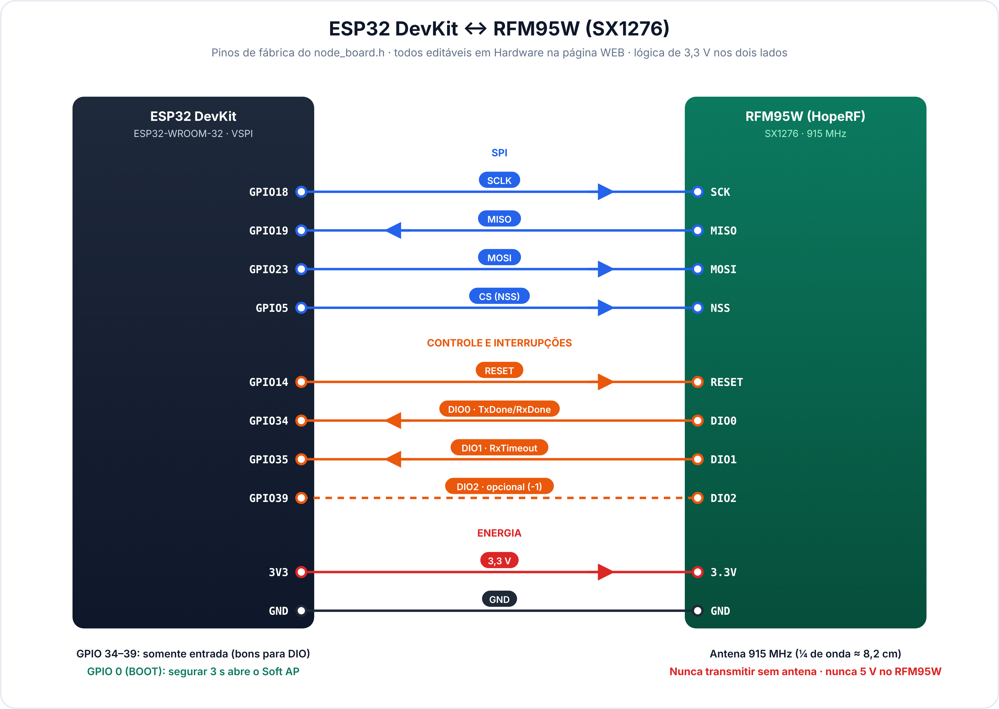

# OTAA: ESP32-WROOM-32U DevKit ↔ RFM95W

Placa **`BOARD=esp32`** (alvo `esp32`). Comparação das três placas: [README desta pasta](README.md).

| Item | Valor |
|---|---|
| Módulo | ESP32-WROOM-32U (DevKitC de 38 pinos; DevKits de 30 pinos também servem, o que vale é o número do GPIO) |
| Chip | ESP32-D0WD-V3, Xtensa LX6 dual-core 240 MHz, 520 KB SRAM |
| Flash | 4 MB quad (DIO, 40 MHz), 3,3 V |
| PSRAM | não tem |
| Antena Wi-Fi | externa, conector u.FL (o "U" do nome) |
| Console | UART0 (GPIO1/3) pelo chip USB-serial da DevKit → `/dev/ttyUSB0`, 115200 bps |
| SPI do rádio | `SPI2_HOST`, pinos 18/19/23/5 pela matriz de GPIO |
| Arquivos do build | [`sdkconfig.defaults`](../../sdkconfig.defaults) + [`boards/esp32.defaults`](../../boards/esp32.defaults) + [`partitions.csv`](../../partitions.csv) |
| Pinos de fábrica | bloco `CONFIG_NODE_BOARD_ESP32_WROOM_32U` de [`main/node_board.h`](../../main/node_board.h) |

**Rádio:** RFM95W (HopeRF), SX1276, 915 MHz, **3,3 V** de alimentação e de lógica. Nunca ligue o RFM95W em 5 V e nunca transmita sem antena (¼ de onda ≈ 8,2 cm ou antena SMA/u.FL).

<p align="center">
  <a href="../images/wiring_esp32_rfm95w.png"></a>
</p>
<p align="center"><sub>🔍 Alta resolução (PNG, 3720 px de largura): clique na imagem para ampliar · versão vetorial: <a href="../images/wiring_esp32_rfm95w.svg"><code>wiring_esp32_rfm95w.svg</code></a></sub></p>

## Ligação (valores de fábrica)

| ESP32 | RFM95W | Sinal | Campo na página (Hardware) |
|---|---|---|---|
| GPIO 18 | SCK | SPI clock | SCLK |
| GPIO 19 | MISO | SPI | MISO |
| GPIO 23 | MOSI | SPI | MOSI |
| GPIO 5 | NSS | chip select | NSS / CS |
| GPIO 14 | RESET | reset do rádio | RESET (`-1` = não ligado) |
| GPIO 34 | DIO0 | TxDone / RxDone | DIO0 |
| GPIO 35 | DIO1 | RxTimeout | DIO1 |
| — | DIO2 | não usado em LoRa | DIO2 (`-1`) |
| 3V3 | 3.3V | alimentação | — |
| GND | GND | terra | — |
| GPIO 0 | — | botão BOOT: segurar 3 s abre o Soft AP | Botão do Soft AP |

Todos os pinos podem ser trocados na página (**Hardware**) ou no app, sem recompilar; valem depois de reiniciar.

## Pinos que a página e o app recusam neste módulo

| GPIO | Motivo |
|---|---|
| 0 | strapping (botão BOOT) |
| 1, 3 | TX0/RX0 do console |
| 6–11 | memória flash |
| 12 | strapping (MTDI): em nível alto no boot, a flash passa a 1,8 V e o ESP32 não inicia |
| 20, 24, 28–31 | não existem no ESP32 |
| 34–39 | **só entrada** (sem pull-up): servem para MISO e DIO, nunca para SCLK, MOSI, NSS ou RESET |
| > 39 | não existem |

Livres para sensores e expansão (com a pinagem de fábrica): 2 (LED azul da DevKit), 4, 13, 15, 16, 17, 21, 22, 25, 26, 27, 32, 33, 36, 39 (36/39 só entrada).

## Opções de build deste módulo

[`boards/esp32.defaults`](../../boards/esp32.defaults):

```
CONFIG_NODE_BOARD_ESP32_WROOM_32U=y
CONFIG_ESPTOOLPY_FLASHMODE_DIO=y
CONFIG_ESPTOOLPY_FLASHFREQ_40M=y
CONFIG_ESPTOOLPY_FLASHSIZE_4MB=y
```

## Compilar e gravar

Com o ESP-IDF já ativado (`. ~/Apps/esp-idf/export.sh`; instalação em [Preparar o ambiente ESP-IDF](../../README.md#-preparar-o-ambiente-esp-idf)):

```bash
sh scripts/build.sh esp32                          # só compila
sh scripts/build.sh esp32 flash   /dev/ttyUSB0    # compila, grava e abre o monitor
sh scripts/build.sh esp32 monitor /dev/ttyUSB0    # só o monitor
sh scripts/build.sh esp32 erase   /dev/ttyUSB0    # apaga a flash inteira (fábrica, FCnt 0)
```

**Com log em `logs/`** (Linux/WSL2; os mesmos comandos de [Gravar e acompanhar o log](../../README.md#gravar-e-acompanhar-o-log) do README). Porta desta placa: `/dev/ttyUSB0`. **Do zero** apaga a configuração; **Atualizar** mantém a configuração e o FCnt.

**Do zero:** apaga a flash, compila do zero, grava e abre o monitor

```bash
sudo fuser -k /dev/ttyUSB0 2>/dev/null ; \
cd ~/Apps/esp-idf/ && \
. ./export.sh && \
cd ~/Apps/lorawan_workspace/Node_ESP32_SX1276_RFM95W_HOPERF_OTAA && \
mkdir -p logs && \
LOG=logs/esp32_$(date +%Y%m%d_%H%M%S).log && \
script -f -q -c "rm -rf build build-esp32 sdkconfig.esp32 managed_components dependencies.lock && sh scripts/build.sh esp32 erase /dev/ttyUSB0 && sh scripts/build.sh esp32 flash /dev/ttyUSB0" "$LOG" ; \
sed -r 's/\x1B\[[0-9;]*[mK]//g; s/\r//g' "$LOG" > "${LOG%.log}_limpo.log" && \
echo "Logs salvos em: $LOG e ${LOG%.log}_limpo.log"
```

**Atualizar:** compila do zero, grava e abre o monitor (mantém a configuração e o FCnt)

```bash
sudo fuser -k /dev/ttyUSB0 2>/dev/null ; \
cd ~/Apps/esp-idf/ && \
. ./export.sh && \
cd ~/Apps/lorawan_workspace/Node_ESP32_SX1276_RFM95W_HOPERF_OTAA && \
mkdir -p logs && \
LOG=logs/esp32_update_$(date +%Y%m%d_%H%M%S).log && \
script -f -q -c "rm -rf build build-esp32 sdkconfig.esp32 managed_components dependencies.lock && sh scripts/build.sh esp32 flash /dev/ttyUSB0" "$LOG" ; \
sed -r 's/\x1B\[[0-9;]*[mK]//g; s/\r//g' "$LOG" > "${LOG%.log}_limpo.log" && \
echo "Logs salvos em: $LOG e ${LOG%.log}_limpo.log"
```

**Só monitorar:** sem compilar nem gravar

```bash
sudo fuser -k /dev/ttyUSB0 2>/dev/null ; \
cd ~/Apps/esp-idf/ && \
. ./export.sh && \
cd ~/Apps/lorawan_workspace/Node_ESP32_SX1276_RFM95W_HOPERF_OTAA && \
mkdir -p logs && \
LOG=logs/esp32_monitor_$(date +%Y%m%d_%H%M%S).log && \
script -f -q -c "sh scripts/build.sh esp32 monitor /dev/ttyUSB0" "$LOG" ; \
sed -r 's/\x1B\[[0-9;]*[mK]//g; s/\r//g' "$LOG" > "${LOG%.log}_limpo.log" && \
echo "Logs salvos em: $LOG e ${LOG%.log}_limpo.log"
```

Pasta de build e sdkconfig desta placa: `build-esp32/` + `sdkconfig.esp32`.

Sem o script (Windows nativo, PowerShell):

```powershell
idf.py -B build-esp32 -D SDKCONFIG=sdkconfig.esp32 -D IDF_TARGET=esp32 -D BOARD=esp32 build
idf.py -B build-esp32 -D SDKCONFIG=sdkconfig.esp32 -D IDF_TARGET=esp32 -D BOARD=esp32 -p COM5 flash monitor
```

Binários prontos da Release (GitHub Actions):

| Arquivo | Uso |
|---|---|
| `Node_ESP32_SX1276_RFM95W_HOPERF_OTAA-<versão>-esp32-full.bin` | imagem única, gravar em `0x0` (volta ao padrão de fábrica, FCnt 0) |
| `Node_ESP32_SX1276_RFM95W_HOPERF_OTAA-<versão>-esp32-app.bin` | só a aplicação, gravar em `0x10000` (mantém configuração e FCnt) |
| `Node_ESP32_SX1276_RFM95W_HOPERF_OTAA-<versão>-esp32-parts.zip` | bootloader, partições, otadata e app, com o `flash_args` |

```bash
esptool.py --chip esp32 -p /dev/ttyUSB0 write_flash 0x0 Node_ESP32_SX1276_RFM95W_HOPERF_OTAA-<versão>-esp32-full.bin
```

## Conferência no boot

```
Starting — LoRaWAN Node OTAA <versão> (MCCI LMiC 6.0.1, ESP-IDF v5.5.1)
Board: ESP32-WROOM-32U (esp32, esp32)
Pins: SCLK 18 MISO 19 MOSI 23 NSS 5 RST 14 DIO0 34 DIO1 35 DIO2 -1
```
