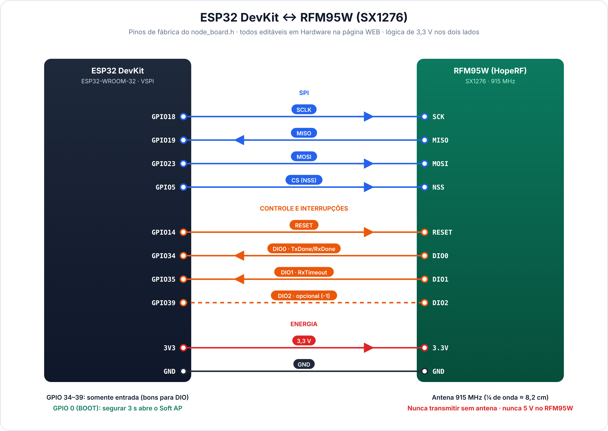
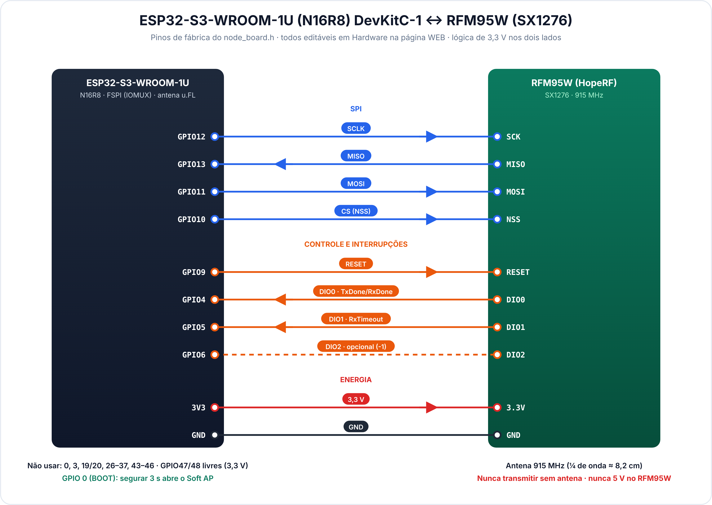
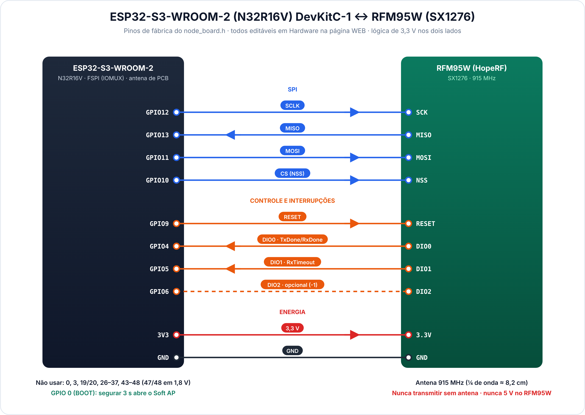

# Placas suportadas pelo nó OTAA

O mesmo código-fonte gera **um firmware para cada módulo ESP32**. A placa é escolhida no build pelo nome `BOARD`:

| `BOARD` | Módulo (DevKit) | `IDF_TARGET` | Flash | PSRAM | Antena Wi-Fi | Console (UART0) | Guia |
|---|---|---|---|---|---|---|---|
| `esp32` | **ESP32-WROOM-32U** (DevKitC 38 pinos) | `esp32` | 4 MB quad, 3,3 V | — | externa (u.FL) | GPIO1/3 → `/dev/ttyUSB0` | [ESP32-WROOM-32U_DevKit.md](ESP32-WROOM-32U_DevKit.md) |
| `esp32s3_n16r8` | **ESP32-S3-WROOM-1U-N16R8** (DevKitC-1) | `esp32s3` | 16 MB **quad**, 3,3 V | 8 MB **octal** | externa (u.FL) | GPIO43/44, conector "UART" | [ESP32-S3-WROOM-1U_N16R8_DevKit.md](ESP32-S3-WROOM-1U_N16R8_DevKit.md) |
| `esp32s3_n32r16v` | **ESP32-S3-WROOM-2-N32R16V** (DevKitC-1) | `esp32s3` | 32 MB **octal**, **1,8 V** | 16 MB **octal** | de PCB | GPIO43/44, conector "UART" | [ESP32-S3-WROOM-2_N32R16V_DevKit.md](ESP32-S3-WROOM-2_N32R16V_DevKit.md) |

> **Os dois S3 não são intercambiáveis.** O N16R8 tem flash **quad** de 3,3 V e o N32R16V flash **octal** de 1,8 V: o firmware de um não inicia no outro. Confira a marcação na blindagem do módulo (`N16R8`, `MCN32R16V`) ou rode `esptool.py --chip esp32s3 -p <porta> flash_id` (`Detected flash size: 16MB` ou `32MB`).

---

## 1. Pinos de fábrica do RFM95W

Os pinos ficam na NVS e são trocados na página (**Hardware**) ou no app, sem recompilar. Os valores abaixo valem no primeiro boot e depois de *Restaurar padrão de fábrica*. Eles estão em [`main/node_board.h`](../../main/node_board.h), um bloco por placa.

| RFM95W | `esp32` | `esp32s3_n16r8` | `esp32s3_n32r16v` |
|---|:---:|:---:|:---:|
| SCK | GPIO18 | GPIO12 | GPIO12 |
| MISO | GPIO19 | GPIO13 | GPIO13 |
| MOSI | GPIO23 | GPIO11 | GPIO11 |
| NSS | GPIO5 | GPIO10 | GPIO10 |
| RESET | GPIO14 | GPIO9 | GPIO9 |
| DIO0 | GPIO34 | GPIO4 | GPIO4 |
| DIO1 | GPIO35 | GPIO5 | GPIO5 |
| DIO2 | `-1` | `-1` | `-1` |
| Botão do Soft AP | GPIO0 | GPIO0 | GPIO0 |
| Controlador SPI | `SPI2_HOST` (matriz de GPIO) | `SPI2_HOST` (IOMUX) | `SPI2_HOST` (IOMUX) |

### GPIOs que a página e o app recusam

A regra vem do firmware (`/config.json` → `_pins_rsv`, `_pins_in`, `_pin_max`), então a página e o app sempre validam conforme a placa gravada:

| | `esp32` | `esp32s3_n16r8` | `esp32s3_n32r16v` |
|---|---|---|---|
| Flash | 6–11 | 26–32 | 26–32 |
| PSRAM | — | 33–37 | 33–37 (flash/PSRAM octal) |
| Domínio de 1,8 V | — | — | 47, 48 |
| Console | 1, 3 | 43, 44 | 43, 44 |
| USB nativo | — | 19, 20 | 19, 20 |
| Strapping | 0, 12 | 0, 3, 45, 46 | 0, 3, 45, 46 |
| Não existem | 20, 24, 28–31, > 39 | 22–25, > 48 | 22–25, > 48 |
| Só entrada (recusados em SCK, MOSI, NSS, RESET) | 34–39 | — | — |

---

## 2. Arquivos de configuração por placa

O [`CMakeLists.txt`](../../CMakeLists.txt) da raiz traduz `BOARD` em `IDF_TARGET` e carrega, nesta ordem (o último vence):

| Ordem | Arquivo | `esp32` | `esp32s3_n16r8` | `esp32s3_n32r16v` | Conteúdo |
|:---:|---|:---:|:---:|:---:|---|
| 1 | [`sdkconfig.defaults`](../../sdkconfig.defaults) | ✅ | ✅ | ✅ | Partições (`partitions.csv`), tick de 1 ms, HTTP, console UART0 115200 |
| 2 | [`boards/esp32.defaults`](../../boards/esp32.defaults) | ✅ | — | — | Flash 4 MB DIO 40 MHz, `CONFIG_NODE_BOARD_ESP32_WROOM_32U` |
| 2 | [`boards/esp32s3_n16r8.defaults`](../../boards/esp32s3_n16r8.defaults) | — | ✅ | — | Flash 16 MB **QIO** 80 MHz, PSRAM **octal** 8 MB, `CONFIG_NODE_BOARD_ESP32S3_WROOM_1U_N16R8` |
| 2 | [`boards/esp32s3_n32r16v.defaults`](../../boards/esp32s3_n32r16v.defaults) | — | — | ✅ | Flash 32 MB **octal (OPI)** 80 MHz, PSRAM **octal** 16 MB, `CONFIG_NODE_BOARD_ESP32S3_WROOM_2_N32R16V` |
| — | [`partitions.csv`](../../partitions.csv) | ✅ | ✅ | ✅ | Layout de 4 MB (`nvs` 0x9000, OTA `app0`/`app1` de 1,25 MB) |
| — | [`main/Kconfig.projbuild`](../../main/Kconfig.projbuild) | ✅ | ✅ | ✅ | Escolha `NODE_BOARD`, `NODE_BOARD_ID`, `NODE_BOARD_NAME` |
| — | [`main/node_board.h`](../../main/node_board.h) | ✅ | ✅ | ✅ | Pinos de fábrica e GPIOs recusados, por placa |
| — | [`main/CMakeLists.txt`](../../main/CMakeLists.txt) | ✅ | ✅ | ✅ | Conferência `BOARD` × sdkconfig |

### Opções que mudam entre as placas (resultado no `sdkconfig.<board>`)

| Opção | `esp32` | `esp32s3_n16r8` | `esp32s3_n32r16v` |
|---|---|---|---|
| `CONFIG_IDF_TARGET` | `esp32` | `esp32s3` | `esp32s3` |
| `CONFIG_NODE_BOARD_*` | `ESP32_WROOM_32U` | `ESP32S3_WROOM_1U_N16R8` | `ESP32S3_WROOM_2_N32R16V` |
| `CONFIG_ESPTOOLPY_FLASHMODE_*` | `DIO` | `QIO` | — (`OCT_FLASH=y` → OPI) |
| `CONFIG_ESPTOOLPY_OCT_FLASH` | — | — | `y` |
| `CONFIG_ESPTOOLPY_FLASHFREQ_*` | `40M` | `80M` | `80M` |
| `CONFIG_ESPTOOLPY_FLASHSIZE_*` | `4MB` | `16MB` | `32MB` |
| `CONFIG_SPIRAM` / `SPIRAM_MODE_OCT` | — | `y` / `y` | `y` / `y` |
| `CONFIG_SPIRAM_SPEED_80M` / `USE_MALLOC` | — | `y` / `y` | `y` / `y` |
| `CONFIG_ESP_CONSOLE_UART_DEFAULT` | `y` (GPIO1/3) | `y` (GPIO43/44) | `y` (GPIO43/44) |

---

## 3. Compilar, gravar e monitorar

```bash
sh scripts/build.sh esp32                                  # ESP32-WROOM-32U
sh scripts/build.sh esp32s3_n16r8                          # ESP32-S3-WROOM-1U-N16R8
sh scripts/build.sh esp32s3_n32r16v                        # ESP32-S3-WROOM-2-N32R16V
sh scripts/build.sh all                                    # as três, em sequência

sh scripts/build.sh esp32s3_n16r8 flash   /dev/ttyUSB0     # grava e abre o monitor
sh scripts/build.sh esp32s3_n16r8 monitor /dev/ttyUSB0     # só o monitor
sh scripts/build.sh esp32s3_n16r8 erase   /dev/ttyUSB0     # apaga a flash (fábrica, FCnt 0)
```

Os comandos completos de cada placa (liberar a porta com `fuser`, ativar o ESP-IDF e salvar a saída em `logs/`), nas variantes **Do zero** (apaga a flash), **Atualizar** (mantém a configuração) e **Só monitorar**, estão em [Gravar e acompanhar o log](../../README.md#gravar-e-acompanhar-o-log) do README e no documento de cada placa: [ESP32-WROOM-32U](ESP32-WROOM-32U_DevKit.md), [ESP32-S3-WROOM-1U-N16R8](ESP32-S3-WROOM-1U_N16R8_DevKit.md), [ESP32-S3-WROOM-2-N32R16V](ESP32-S3-WROOM-2_N32R16V_DevKit.md).

| `BOARD` | Pasta de build | sdkconfig gerado |
|---|---|---|
| `esp32` | `build-esp32/` | `sdkconfig.esp32` |
| `esp32s3_n16r8` | `build-esp32s3_n16r8/` | `sdkconfig.esp32s3_n16r8` |
| `esp32s3_n32r16v` | `build-esp32s3_n32r16v/` | `sdkconfig.esp32s3_n32r16v` |

No Windows nativo (PowerShell), o `build.sh` não roda; use a linha que ele mostra:

```powershell
idf.py -B build-esp32s3_n16r8 -D SDKCONFIG=sdkconfig.esp32s3_n16r8 -D IDF_TARGET=esp32s3 -D BOARD=esp32s3_n16r8 build
```

> **Se aparecer** `BOARD=... but sdkconfig has board ...`, o `sdkconfig.<board>` é de outra placa. Apague esse arquivo e a pasta `build-<board>/` e compile de novo.

---

## 4. Binários prontos (GitHub Actions / Releases)

| Arquivo | Uso |
|---|---|
| `Node_ESP32_SX1276_RFM95W_HOPERF_OTAA-<versão>-<BOARD>-full.bin` | imagem única, gravar em `0x0` (volta ao padrão de fábrica, FCnt 0) |
| `Node_ESP32_SX1276_RFM95W_HOPERF_OTAA-<versão>-<BOARD>-app.bin` | só a aplicação, gravar em `0x10000` (mantém configuração e FCnt) |
| `Node_ESP32_SX1276_RFM95W_HOPERF_OTAA-<versão>-<BOARD>-parts.zip` | bootloader, partições, otadata e app, com `flash_args` |

---

## 5. Como o firmware informa a placa

| Onde | Exemplo |
|---|---|
| Boot (monitor serial) | `Board: ESP32-S3-WROOM-1U-N16R8 (esp32s3_n16r8, esp32s3)` |
| `GET /info` (sem login) | `"chip":"ESP32-S3","board":"esp32s3_n16r8","board_name":"ESP32-S3-WROOM-1U-N16R8"` |
| `GET /config.json` | `"_board"`, `"_board_name"`, `"_pins_rsv"`, `"_pins_in"`, `"_pin_max"`, `"_pins_hint"` |
| Página WEB | rodapé da Manutenção (firmware · LMiC · região · **placa**) e a dica da seção **Hardware** |
| App Android | Manutenção → **Placa**; a validação dos pinos usa as regras da placa |

Mudar de placa (por exemplo, trocar o ESP32 por um S3) não leva a configuração junto, porque ela fica na NVS do chip. Exporte o JSON no nó antigo, importe no novo e **corrija os pinos** em Hardware.

## Diagramas de ligação em alta resolução

Clique na imagem para abrir o PNG de 3720 px. Cada um tem a versão vetorial (SVG) ao lado.

| ESP32-WROOM-32U (`esp32`) | ESP32-S3-WROOM-1U-N16R8 (`esp32s3_n16r8`) | ESP32-S3-WROOM-2-N32R16V (`esp32s3_n32r16v`) |
|:---:|:---:|:---:|
| [](../images/wiring_esp32_rfm95w.png) | [](../images/wiring_esp32s3_wroom1u_n16r8_rfm95w.png) | [](../images/wiring_esp32s3_wroom2_n32r16v_rfm95w.png) |
| [SVG](../images/wiring_esp32_rfm95w.svg) | [SVG](../images/wiring_esp32s3_wroom1u_n16r8_rfm95w.svg) | [SVG](../images/wiring_esp32s3_wroom2_n32r16v_rfm95w.svg) |
